# Architecture : Contrôle BL & factures

Ce document montre l'architecture du projet « Contrôle BL & factures »
(Habitat & Rénovation), surtout par des schémas. Chaque schéma est suivi de
quelques lignes d'explication et de ses sources (`fichier:ligne`). Il ne
remplace ni le cahier des charges (`docs/cahier-des-charges.md`, qui fait
foi) ni la documentation technique détaillée (`infra/README.md`).

- **État décrit** : branche `refonte-front` au commit `be77aa0`, constats
  sur le VPS du 24/09/2026.
- **Principe directeur** : l'IA (OCR Mistral) extrait et normalise, elle ne
  décide jamais. Les anomalies (« problèmes » à l'écran) viennent de règles
  déterministes R01 à R17, et chacune porte une justification chiffrée.

## Sommaire

1. [Contexte](#1-contexte)
2. [Conteneurs et déploiement](#2-conteneurs-et-déploiement)
3. [Modules applicatifs et frontières](#3-modules-applicatifs-et-frontières)
4. [Modèle de données](#4-modèle-de-données)
5. [Flux](#5-flux)
6. [Cycles de vie](#6-cycles-de-vie)
7. [Front](#7-front)
8. [Règles de contrôle](#8-règles-de-contrôle)
9. [Renvois](#9-renvois)

---

## 1. Contexte

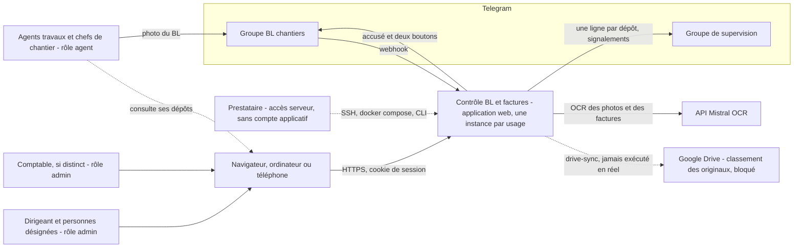

Deux rôles applicatifs seulement, `admin` et `agent`. Les agents déposent les
photos de BL dans un groupe Telegram et confirment les quantités avec les
boutons du bot. L'admin dépose les factures PDF, traite les problèmes et
valide les référentiels ; le comptable a le même rôle. Mistral OCR est le
seul service qui lit les documents. Google Drive est prévu pour y ranger les
originaux, mais reste bloqué : un compte de service ne peut pas écrire dans
un Drive personnel, et le choix de la solution revient à Ilane.

Sources : `docs/cahier-des-charges.md:50-61`,
`app/modules/ingest/router.py:150-215`, `app/modules/ingest/mistral.py:1-22`,
`app/modules/jobs/drive.py:1-31`, `infra/README.md:972-985`.

---

## 2. Conteneurs et déploiement

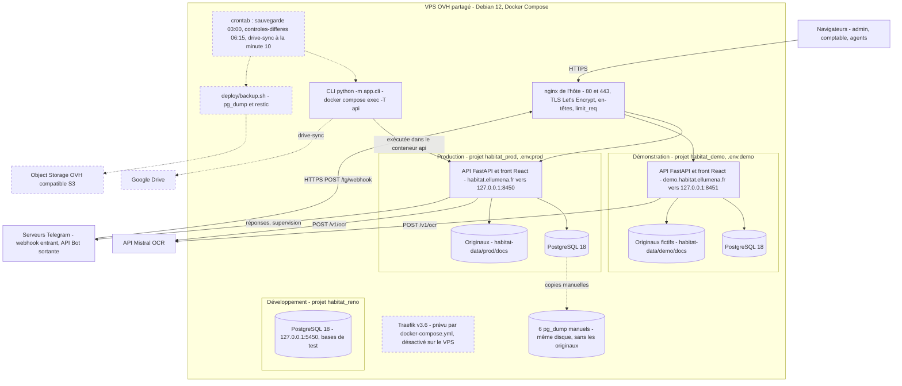

Le trait plein montre ce qui tourne, le pointillé ce qui est prévu mais pas
posé.

- **Une instance** = un nom de projet Compose et un fichier d'environnement,
  avec sa base, son volume et son dossier de documents. Commande type :
  `docker compose -p habitat_prod --env-file .env.prod -f deploy/docker-compose.yml -f deploy/docker-compose.vps.yml up -d`.
- **nginx** (`deploy/nginx/habitat.conf`, identique à la copie installée)
  aiguille selon le nom d'hôte, termine le TLS avec un seul certificat pour
  les deux noms et pose les en-têtes nosniff, DENY, `same-origin`, HSTS et
  une CSP stricte. Il limite les requêtes à 10 par seconde (zone `general`
  de l'hôte, rafale de 40) et les corps à 25 Mo. Traefik, prévu par la pile
  de base, reste dans un profil jamais activé sur ce VPS.
- **Image** : un étage `node:24-alpine` construit le front, puis
  `python:3.11-slim` avec uv. uvicorn sert l'API et `web/dist` sur le port
  8000, avec l'uid 10001 et `--proxy-headers`. Le port n'est publié que sur
  la boucle locale.
- **Pas de worker ni de file d'attente** : les tâches périodiques sont des
  commandes CLI. Aucune ligne cron n'est posée ; sur l'hôte, ni `crontab`
  ni `restic` ne sont installés. Aucun dépôt restic n'est initialisé. Les
  seules copies sont six `pg_dump` manuels sur le même disque.
- **Variables** : sont obligatoires `database_url`, `docs_dir`, les quatre
  variables Telegram, `mistral_api_key` et `cookie_secure`. Sont optionnelles
  les deux variables Drive et trois drapeaux à `false` par défaut :
  `CONTROLE_PRIX_ACTIF`, `CONTROLE_LIVRE_NON_FACTURE_ACTIF` et
  `API_DOCS_ACTIVES`. Il manque une variable obligatoire ? L'API refuse de
  démarrer.
- **Vigilance** : la surcouche de développement publie l'API sur
  127.0.0.1:8450, et le proxy Vite de `npm run dev` vise ce port. Or c'est
  aujourd'hui celui de la production. `deploy/test-restauration.sh` utilise
  8451, celui de la démonstration.

Sources : `deploy/docker-compose.yml:1-115`,
`deploy/docker-compose.vps.yml:1-24`, `deploy/docker-compose.dev.yml:1-14`,
`deploy/nginx/habitat.conf:1-55`, `Dockerfile:1-40`,
`app/core/config.py:69-83`, `deploy/backup.sh:1-118`,
`infra/README.md:822-882`, `web/vite.config.mts:4-38`,
`deploy/test-restauration.sh:2-18`. Constats `docker ps`,
`docker volume ls`, `crontab -l` et `systemctl list-timers` du 24/09/2026.

---

## 3. Modules applicatifs et frontières

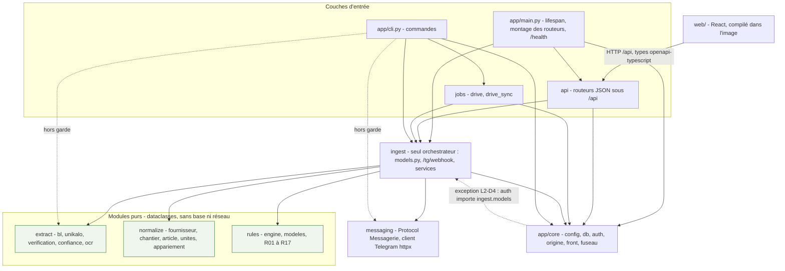

C'est un monolithe modulaire, et `ingest` est le seul module métier qui en
importe d'autres. Il possède le schéma (`models.py`) et le webhook
Telegram : le routeur vit dans `ingest` parce que `messaging` ne peut pas
importer `ingest`. Il enchaîne extraction, normalisation, rapprochement et
règles. `api` et `jobs` sont des couches d'entrée : elles n'importent que
`ingest` et `app.core`. Un routeur valide, appelle un service et sérialise,
sans aucune règle métier.

Interdits, vérifiés par `tests/test_frontieres.py` (analyse `ast` de
`app/modules`, imports placés dans les fonctions compris) :

- `extract`, `normalize` et `rules` n'importent ni `fastapi`, ni `starlette`,
  ni `sqlalchemy`, ni `httpx`, ni `asyncpg`.
- Hors `ingest`, aucun module de `app.modules` n'en importe un autre ;
  `api` et `jobs` peuvent importer `ingest`, et rien d'autre.
- `rules` ne réutilise pas les dataclasses d'`extract` ni de `normalize`
  (L4-D1). Une règle n'importe que `rules.modeles`, plus une règle sœur pour
  un helper partagé (R01 importe R02, R04 importe R03, R08 importe R07).

Hors garde : `app/core`, `app/main.py` et `app/cli.py` ne sont pas scannés.
C'est ce qui permet à `core/auth.py` d'importer `ingest.models` (exception
assumée) et à `cli.py` d'importer `extract` et `messaging` (en pointillé).

Écarts avec l'arborescence de `CLAUDE.md` : `jobs` ne contient que `drive.py`
et `drive_sync.py`, sans bilan ni rappels ; le bilan est dans
`ingest/bilan.py`. `extract/facture.py` ne définit que des dataclasses : la
facture est lue par `extract/unikalo.py` et le BL par `extract/bl.py`. Les
docstrings de `messaging/base.py` et de `Document.photo_compressee` citent
encore `ingest/service.py`, découpé à la fin du lot 2.

Sources : `app/main.py:26-89`, `app/modules/api/__init__.py:3-37`,
`app/modules/ingest/router.py:1-22`, `app/core/auth.py:16-40`,
`app/cli.py:62-129`, `tests/test_frontieres.py:34-183`,
`app/modules/rules/__init__.py:1-13`, `app/modules/jobs/drive_sync.py:1-40`.

---

## 4. Modèle de données

`app/modules/ingest/models.py` est la source de vérité unique du schéma. Il
déclare 15 tables : les 14 du CDC plus `jeton_session`. Le schéma est
découpé ici en deux vues.

### 4.1 Cœur métier

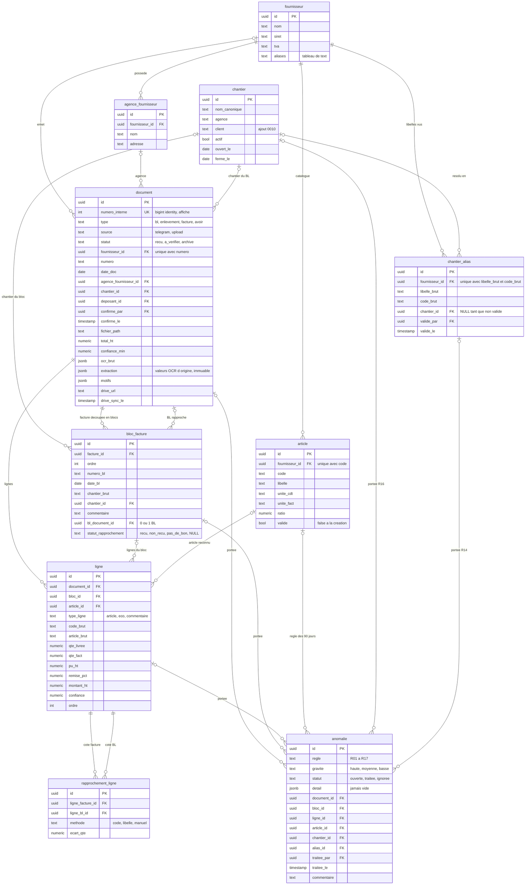

Une facture (`document` de type `facture`) se découpe en blocs
« Concerne le B.L. n°… ». Chaque bloc pointe vers 0 ou 1 BL déposé
(`bl_document_id`), et le rapprochement apparie ses lignes à celles du BL
(`rapprochement_ligne`). Une anomalie est identifiée de façon unique par
(`regle`, `document_id`, `bloc_id`, `ligne_id`, `chantier_id`, `alias_id`)
en `NULLS NOT DISTINCT` ; c'est la clé de l'upsert décrit au §5.3. Un alias
de chantier est créé sans `chantier_id` et attend la validation d'un admin.
Un article est créé non validé à la première ligne qui porte un code.

### 4.2 Comptes et traçabilité

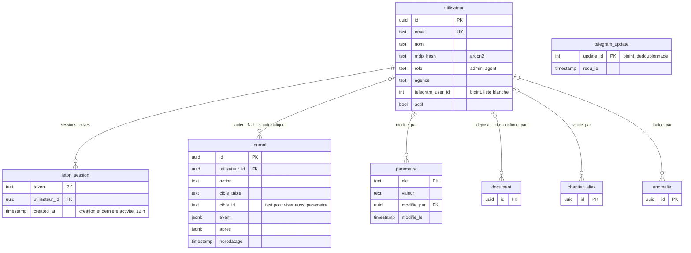

Conventions : identifiant UUID généré par la base, sauf `parametre` (`cle`)
et `telegram_update` (`update_id`). `created_at` est présent partout. Les
tables modifiables ont en plus `updated_at` et `updated_by` (vers
`utilisateur`, non dessiné). Les listes fermées sont en `text` avec un
`CHECK` nommé, sans ENUM, et les montants en `numeric` (lus en `Decimal`).
Aucune relation ORM, aucune suppression en cascade, aucune suppression
physique de document. `journal` et `telegram_update` ne reçoivent que des
ajouts. Le fuseau d'affichage est Europe/Paris, et tout est stocké en UTC.

### 4.3 Migrations

| Migration | Apport |
| --- | --- |
| 0001 `schema_initial` | Les 14 tables du CDC et leurs contraintes |
| 0002 `jeton_session` | Sessions de la `DatabaseStrategy` fastapi-users |
| 0003 `document_supervision` | `numero_interne`, `photo_compressee`, `total_ht` |
| 0004 `bloc_facture_ordre` | `bloc_facture.ordre` (position dans la facture) |
| 0005 `extraction` | Colonnes d'extraction du document, `ligne.confiance` |
| 0006 `anomalies` | `anomalie.article_id`, première clé d'unicité |
| 0007 `anomalie_chantier` | `chantier_id` et `alias_id`, clé d'unicité à six colonnes |
| 0008 `anomalie_bloc_origine` | Données seules : `bloc_id` complété pour R07, R08, R09, R13, R17 |
| 0009 `drive_sync` | Suivi de la synchronisation Drive sur `document` |
| 0010 `chantier_client` | `chantier.client` (tête actuelle) |

`tests/test_migrations.py` vérifie que `upgrade head` crée les 15 tables et
que `alembic check` ne voit aucune dérive. `app/core/db.py` impose pour cela
une convention de nommage des contraintes.

Sources : `app/modules/ingest/models.py:1-622`, `app/core/db.py:1-49`,
`app/core/fuseau.py:1-9`, `migrations/versions/0001_schema_initial.py` à
`0010_chantier_client.py`, `tests/test_migrations.py:48-66`.

---

## 5. Flux

### 5.1 Dépôt d'un BL par Telegram

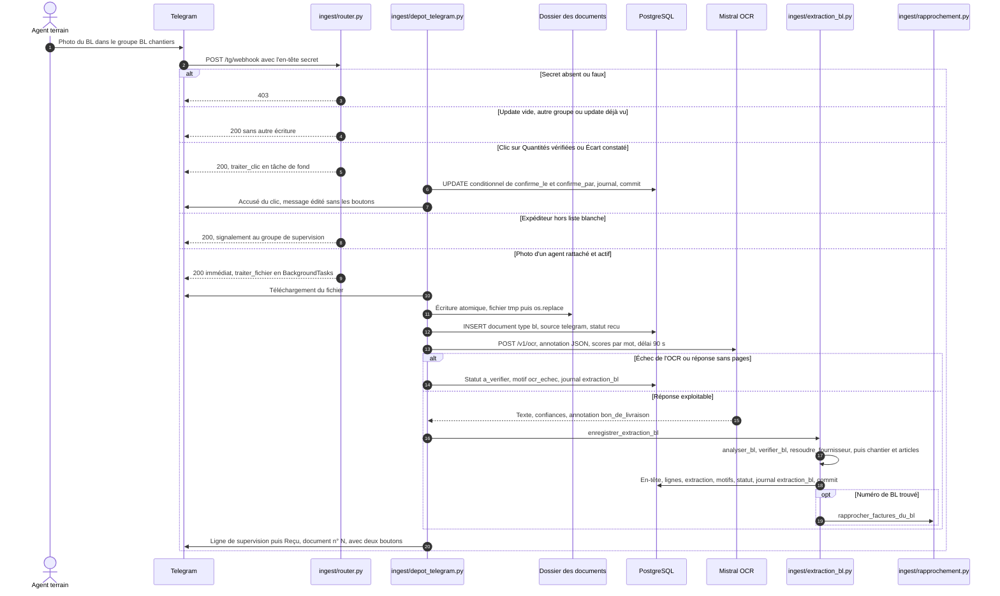

Le webhook répond toujours vite : le téléchargement, l'OCR et l'extraction
tournent en tâche de fond, dans leur propre session. Le document est
enregistré au statut `recu` avant l'OCR, donc un échec OCR ne perd jamais
le dépôt. `extract` et `normalize` travaillent sans base ni réseau. Un
fournisseur n'est jamais créé à partir de l'OCR. Un libellé de chantier
inconnu crée un alias en attente, et un code article inconnu un article non
validé. « Écart constaté » passe en plus le document en `a_verifier`. Si
le téléchargement, l'écriture ou l'insertion échoue, le fichier est nettoyé,
la supervision est prévenue et l'agent reçoit « Échec de l'enregistrement,
renvoyez la photo. ».

Sources : `app/modules/ingest/router.py:150-215`,
`app/modules/ingest/depot_telegram.py:133-706`,
`app/modules/ingest/extraction_bl.py:164-576`,
`app/modules/extract/bl.py:185-597`,
`app/modules/extract/verification.py:38-326`,
`app/modules/normalize/fournisseur.py:81-129`,
`app/modules/ingest/referentiels.py:130-267`,
`app/modules/messaging/telegram.py:101-107`.

### 5.2 Dépôt d'une facture PDF

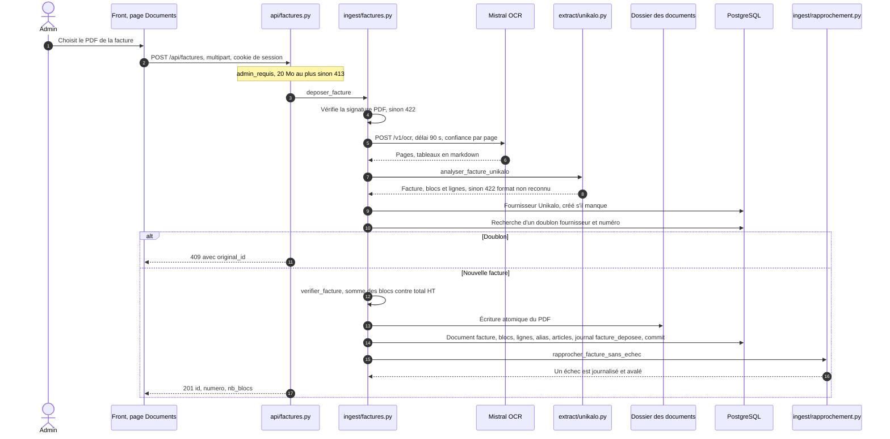

La facture est toujours lue par l'OCR Mistral, puis par le parseur
Unikalo, jamais par pdfplumber : le document disponible est un scan. Il n'y
a pas encore de parseur Point.P, faute de document. Son statut vaut
`a_verifier` si `verifier_facture` trouve un motif, `recu` sinon. Une erreur
OCR donne 502 et une erreur disque un 500 neutre. Le rapprochement suit
immédiatement le commit, et son échec n'annule jamais le dépôt.

Sources : `app/modules/api/factures.py:89-171`,
`app/modules/ingest/factures.py:59-514`,
`app/modules/extract/unikalo.py:552-597`,
`app/modules/extract/verification.py:328-352`,
`web/src/api/factures.ts:52-56`.

### 5.3 Rapprochement, règles et problèmes

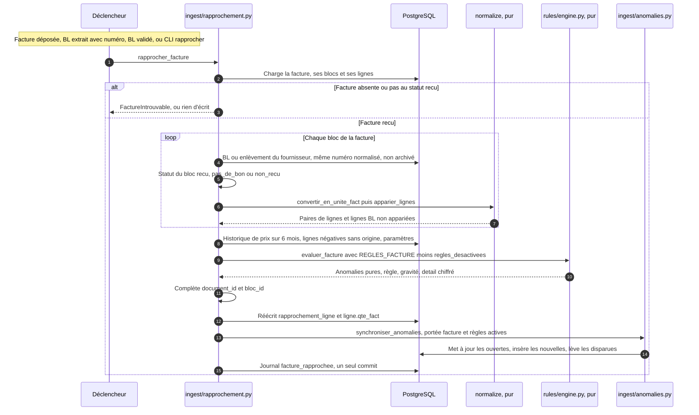

Le rapprochement est idempotent : on peut le rejouer à chaque nouvel
événement. `synchroniser_anomalies` fait un upsert sur la clé d'identité.
Une anomalie `ouverte` est mise à jour ; une `traitee` ou `ignoree` n'est
jamais touchée. Une nouvelle est insérée, sauf si une anomalie de même
règle, même article et même fournisseur a été ignorée depuis moins de
`duree_ignorance_j` jours (90 par défaut). Une ouverte qui n'est plus
produite est supprimée avec un journal `anomalie_levee`. La portée des
règles est obligatoire : une règle qui n'a pas été recalculée n'est jamais
balayée. Les règles de suivi (R06, R14, R15, R16) passent par le même
mécanisme via la CLI `controles-differes`, sans portée de document.

Sources : `app/modules/ingest/rapprochement.py:1-16`,
`app/modules/ingest/rapprochement.py:376-405`,
`app/modules/ingest/rapprochement.py:569-1113`,
`app/modules/ingest/anomalies.py:17-59`,
`app/modules/ingest/anomalies.py:267-472`,
`app/modules/ingest/suivi.py:366-400`, `app/cli.py:446-532`.

### 5.4 Traitement d'un problème par l'admin

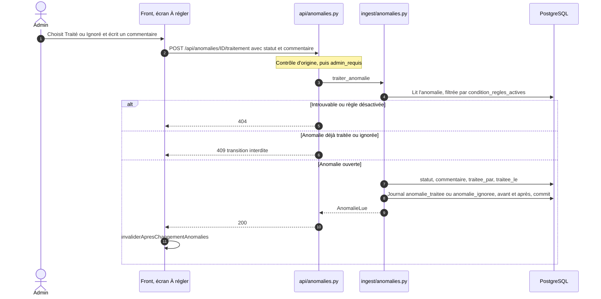

Le commentaire est obligatoire, de 1 à 500 caractères. Le traitement est
définitif : aucune transition ne part de `traitee` ni de `ignoree`. Après
l'écriture, le front invalide les caches TanStack Query des anomalies, de
« À régler » et de son compteur, du tableau de bord, du bilan, des factures
et des documents. Aucun chiffre n'est recalculé côté navigateur.

Sources : `app/modules/api/anomalies.py:152-175`,
`app/modules/ingest/anomalies.py:752-822`,
`app/core/origine.py:1-33`, `web/src/pages/ProblemeDetail.tsx:219-225`,
`web/src/api/invalidations.ts:9-38`.

---

## 6. Cycles de vie

### 6.1 Document

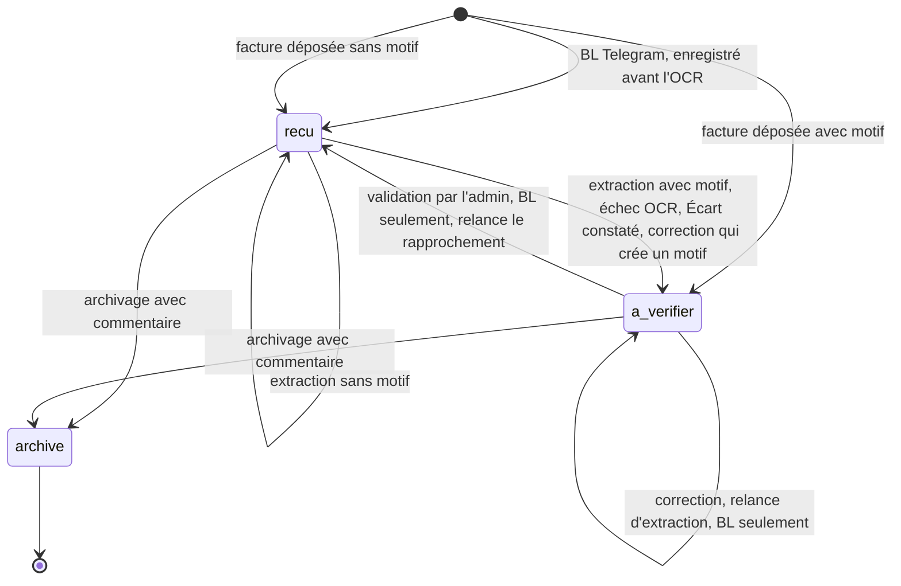

`document.statut` ne prend que trois valeurs : `recu`, `a_verifier` et
`archive`. Correction, validation et relance d'extraction ne concernent que
les BL et enlèvements. Seul un document `a_verifier` peut être validé ou
relancé. Une facture `a_verifier` n'est jamais rapprochée et n'en sort que
par l'archivage : aucun chemin du code ne la repasse en `recu`. Un document
archivé ne peut plus être modifié ni confirmé depuis Telegram. Il n'est
plus candidat au rapprochement. Archiver une facture lève toutes ses
anomalies ouvertes (balayage à vide). Le bouton « Quantités vérifiées » pose
`confirme_le` sans changer le statut.

Sources : `app/modules/ingest/depot_telegram.py:419-426`,
`app/modules/ingest/depot_telegram.py:591-613`,
`app/modules/ingest/extraction_bl.py:445-466`,
`app/modules/ingest/factures.py:368`,
`app/modules/ingest/corrections.py:560-655`,
`app/modules/ingest/corrections.py:977-1117`.

### 6.2 Problème (anomalie)

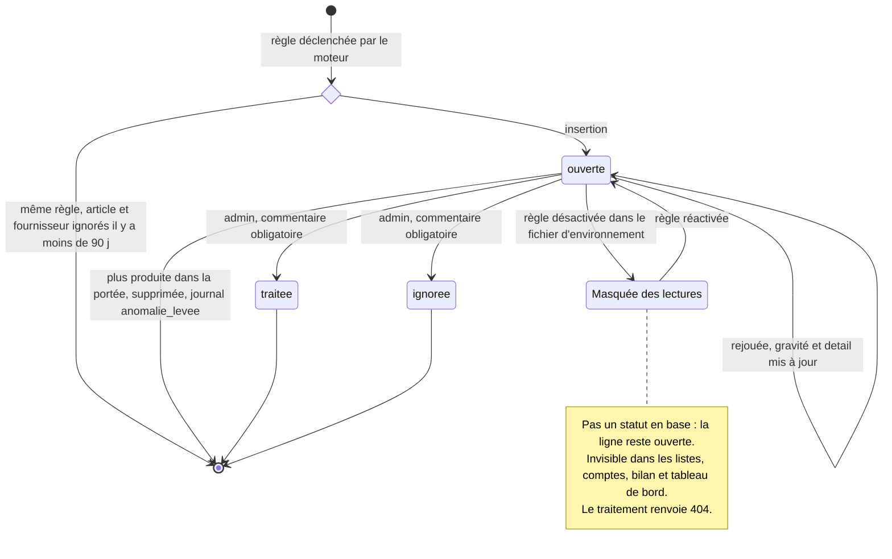

`anomalie.statut` vaut `ouverte`, `traitee` ou `ignoree` (contrainte
`CHECK`). Le masquage n'est pas un statut : `condition_regles_actives`
exclut des lectures toute règle désactivée par `CONTROLE_PRIX_ACTIF`
(R07, R08, R09) ou `CONTROLE_LIVRE_NON_FACTURE_ACTIF` (R06). Cela vaut aussi
pour les anomalies traitées ou ignorées de ces règles. Une règle désactivée
n'est ni évaluée ni balayée ; ses anomalies restent donc en base, telles
quelles, jusqu'à sa réactivation (modifier `.env` puis recréer le conteneur
API). Le journal, lui, ne filtre pas.

Sources : `app/modules/ingest/models.py:450-541`,
`app/modules/ingest/anomalies.py:17-132`,
`app/modules/ingest/anomalies.py:184-190`,
`app/modules/ingest/anomalies.py:516-526`,
`app/modules/ingest/commun.py:60-109`, `app/core/config.py:37-56`.

---

## 7. Front

### 7.1 Navigation, routes et gardes

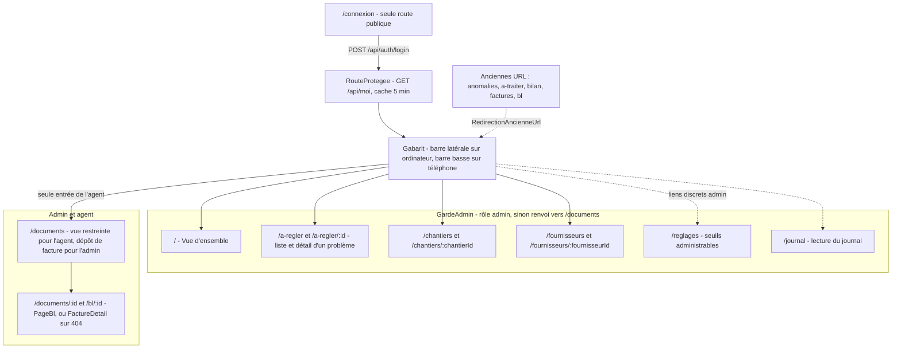

L'admin a cinq entrées : Vue d'ensemble, À régler (avec la pastille du
nombre de problèmes), Chantiers, Fournisseurs et Documents. Réglages et
Journal sont des liens discrets. L'agent ne voit que Documents. Les gardes
ne décident que de la navigation : le rôle vient de `GET /api/moi`, et c'est
l'API qui contrôle les droits (`admin_requis`). Sur un grand écran,
`/a-regler/:id` affiche le détail dans un panneau à droite ; en dessous,
en page pleine. Toute URL inconnue renvoie vers `/`.

Sources : `web/src/App.tsx:21-219`, `web/src/routes/GardeAdmin.tsx:7-32`,
`web/src/routes/RouteProtegee.tsx:6-35`,
`web/src/routes/RedirectionAncienneUrl.tsx:4-22`,
`web/src/components/Gabarit.tsx:60-427`, `web/src/pages/PageBl.tsx:431-521`.

### 7.2 Flux de données

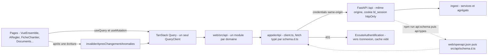

Le front ne contient aucune règle métier : les montants, états de chantier
et catégories arrivent calculés par l'API. Il est servi par la même origine
que l'API : pas de CORS, pas de JWT, rien dans localStorage. Les types TS
sont générés depuis le schéma OpenAPI par openapi-typescript, et les deux
fichiers générés sont versionnés. En production, `core/front.py` sert
`/assets` et renvoie `index.html` pour toute route GET du front, avec
`Cache-Control: no-cache`.
Les préfixes réservés (`/api`, `/tg`, `/health`...) restent en 404 JSON.
Pile : React 18, react-router 7, TanStack Query 5, Vite, TypeScript strict,
Tailwind (charte « Registre » dans `theme.extend`) et polices
auto-hébergées, compatibles avec la CSP.

Sources : `web/src/main.tsx:1-52`, `web/src/api/client.ts:1-132`,
`web/src/components/EcouteAuthentification.tsx:7-32`,
`web/src/api/invalidations.ts:9-38`, `web/package.json:9-32`,
`app/core/front.py:1-87`, `app/core/auth.py:95-100`,
`web/tailwind.config.cjs:1-39`.

---

## 8. Règles de contrôle

### 8.1 Ordre d'évaluation d'une facture

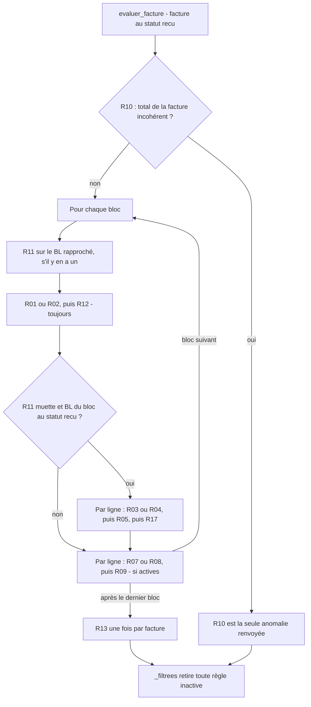

Chaque règle est une fonction pure, dans son propre fichier
(`rules/rules/Rxx.py`). Elle reçoit des dataclasses et renvoie
`Anomalie | None`, avec un `detail` chiffré jamais vide. `rules` ne lit
jamais la configuration : `ingest.commun.regles_desactivees()` décide
seule, et le moteur reçoit l'ensemble des règles actives. Exclusivités :
R01 ou R02, R03 ou R04, et R07 jusqu'au seuil fort inclus, R08 au-delà.

### 8.2 Catalogue

| Règle | Intitulé | Famille à l'écran | Gravité | État au 24/09/2026 |
| --- | --- | --- | --- | --- |
| R01 | BL facturé non reçu | bl | haute | active, à chaque rapprochement |
| R02 | BL facturé « pas de bon » | bl | haute | active |
| R03 | Quantité facturée > quantité BL | quantites | haute | active |
| R04 | Quantité facturée < quantité BL | quantites | moyenne | active |
| R05 | Ligne facturée absente du BL | quantites | haute | active |
| R06 | Ligne BL non facturée après 45 j | quantites | basse | désactivée par `CONTROLE_LIVRE_NON_FACTURE_ACTIF`, et dépend de `controles-differes`, non planifiée |
| R07 | Prix hors historique, écart de plus de 5 % et jusqu'à 15 % | prix | moyenne | désactivée par `CONTROLE_PRIX_ACTIF` |
| R08 | Prix hors historique fort, plus de 15 % | prix | haute | désactivée par `CONTROLE_PRIX_ACTIF` |
| R09 | Remise absente | prix | moyenne | désactivée par `CONTROLE_PRIX_ACTIF` |
| R10 | Incohérence arithmétique de la facture | autre | haute | active |
| R11 | Incohérence arithmétique du BL | autre | moyenne | active |
| R12 | Doublon de facturation | autre | haute | active |
| R13 | Avoir sans origine | autre | moyenne | active |
| R14 | Chantier non résolu après 48 h | rattacher | moyenne | dépend de `controles-differes`, non planifiée |
| R15 | BL sans confirmation après 24 h | autre | basse | dépend de `controles-differes`, non planifiée |
| R16 | Chantier silencieux depuis 7 j | autre | basse | dépend de `controles-differes`, non planifiée |
| R17 | Conditionnement inhabituel | autre | moyenne | active |

Deux points d'entrée : `REGLES_FACTURE` (`evaluer_facture`, lancé à chaque
rapprochement) et `REGLES_SUIVI` (`evaluer_suivi` : R06, R14, R15, R16,
lancé seulement par `python -m app.cli controles-differes`, qu'aucun cron
n'appelle aujourd'hui). La famille vient de `CATEGORIES_REGLE`, seule table
règle vers catégorie. Elle fonde l'état d'un chantier au tableau de bord et
le montant « en écart » du bilan. Les seuils sont les 9 réglages de
`ingest/parametres.py` ; ceux d'une règle désactivée sont masqués. Les
délais de suivi sont comparés en « strictement supérieur ».

Sources : `app/modules/rules/engine.py:1-38`,
`app/modules/rules/engine.py:139-370`, `app/modules/rules/modeles.py:24-237`,
`app/modules/rules/rules/R01.py` à `R17.py` (docstrings),
`app/modules/ingest/anomalies.py:134-181`,
`app/modules/ingest/commun.py:19-109`,
`app/modules/ingest/parametres.py:58-171`.

---

## 9. Renvois

- `infra/README.md` : documentation technique d'ensemble (projet, CDC
  résumé, architecture, infrastructure, services externes, sécurité,
  exploitation). Deux passages sont périmés : l'avertissement sur la
  divergence entre `refonte-front` et `main` (les deux pointent sur
  `be77aa0`) et la liste des dumps manuels (il y en a six, pas deux).
- `docs/cahier-des-charges.md` : ce qui fait foi.
- `docs/passation-lot-5.md`, puis les passations précédentes : état,
  décisions, questions ouvertes.
- `docs/lot-1-recette.md` à `docs/lot-5-recette.md` et
  `docs/refonte-front-recette.md` : recettes.
- `docs/dette.md` (dette assumée, désactivations R06 à R09) et
  `docs/evolutions-proposees.md`.
- `docs/deploiement-et-tests.md`, `docs/exploitation-lot-4.md` et
  `docs/exploitation-lot-5.md` : instances, commandes, crontab prévue.
- `docs/protocole-mesure-ocr.md` : mesure OCR à la réception des photos.
- `deploy/` : `docker-compose.yml` et ses surcouches `vps` et `dev`,
  `nginx/habitat.conf`, `backup.sh`, `restore.sh`, `test-restauration.sh`
  et `RESTAURATION.md`.
- `tests/test_frontieres.py` : la garde des frontières du §3.
