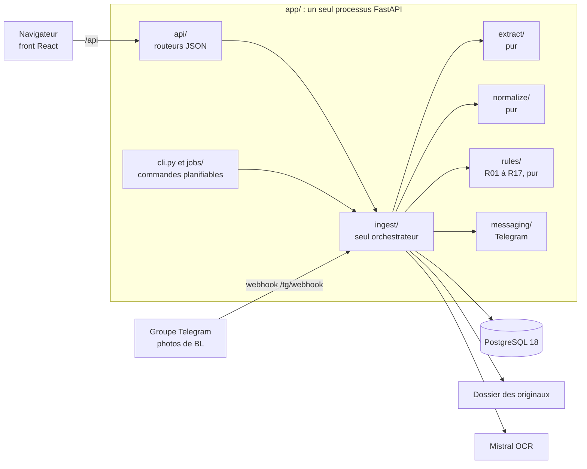

# Contrôle BL & factures — Habitat & Rénovation

Application de contrôle des factures fournisseurs réalisée pour
Habitat & Rénovation :

- les agents photographient leurs bons de livraison (BL) dans un groupe
  Telegram ; l'administrateur dépose les factures fournisseurs (PDF) ;
- les documents sont lus par OCR (Mistral) et normalisés (fournisseurs,
  chantiers, articles, unités), puis chaque BL facturé est rapproché du BL
  reçu, par son numéro, puis ligne à ligne ;
- des règles déterministes nommées (R01 à R17) signalent ce qu'il faut
  contester ou vérifier, avec une justification chiffrée et le document
  source : **l'IA extrait et normalise, elle ne décide jamais** ;
- une application web (ordinateur et téléphone) présente la vue du mois, ce
  qui reste « À régler », les chantiers, les fournisseurs, les documents, le
  journal et des exports CSV.

Le cahier des charges ([`docs/cahier-des-charges.md`](docs/cahier-des-charges.md))
fait foi. La documentation technique d'ensemble (demande du client,
architecture, infrastructure, sécurité, exploitation, limites) est
[`infra/README.md`](infra/README.md) : ce fichier-ci en est un résumé.

Schémas de l'architecture : [`ARCHITECTURE.md`](ARCHITECTURE.md).

## Stack

| Domaine | Choix |
| --- | --- |
| API | Python 3.11, uv, FastAPI, Uvicorn, pydantic-settings |
| Données | PostgreSQL 18, SQLAlchemy 2 async + asyncpg, Alembic (migrations `0001` à `0010`) |
| Authentification | fastapi-users : cookie `httpOnly`, sessions en base, argon2id ; slowapi sur la connexion |
| Lecture des documents | API Mistral OCR, puis un parseur par fournisseur (`extract/unikalo.py`) |
| Messagerie | Telegram Bot API en webhook, via httpx, sans framework de bot |
| Front | React 18, TypeScript, Vite, React Router 7, TanStack Query 5, Tailwind 3 ; types générés par openapi-typescript |
| Exploitation | Docker Compose, image multi-étage non root ; nginx + certbot sur le VPS actuel (Traefik dans le compose de base) ; `pg_dump` + restic |
| Qualité | ruff, mypy strict, pytest, pre-commit |

Le front compilé est servi par l'API, sur la même origine : ni CORS, ni JWT,
ni jeton dans le navigateur. `pdfplumber`, prévu par le cahier des charges,
n'est pas utilisé : la seule facture fournie est un scan (`infra/README.md`
§2.9).

## Architecture

Monolithe modulaire : un dépôt, un conteneur applicatif, une base.



- `extract`, `normalize` et `rules` sont **purs** : ni FastAPI, ni
  SQLAlchemy, ni httpx, des dataclasses en entrée et en sortie, des tests
  sans base ni réseau. Chaque règle `Rxx` est une fonction pure, avec au
  moins un test positif et un test négatif.
- `ingest` est le seul orchestrateur ; `api` et `jobs` n'importent que
  `ingest` et `app.core` ; aucune règle métier dans les routeurs ni dans le
  front. `tests/test_frontieres.py` vérifie ces imports (analyse `ast`).
- `app/core` lit la configuration au démarrage : une variable obligatoire
  absente empêche l'API de démarrer.
- Pas de worker ni de file d'attente : les tâches différées sont des
  commandes `python -m app.cli …` prévues pour un cron ou un timer de l'hôte.

Modules, modèle de données, moteur de règles et routes : `infra/README.md`
§3 et §4.

## Démarrage local

Prérequis : Docker et Docker Compose, Python 3.11,
[uv](https://docs.astral.sh/uv/), Node.js 24 (celui de l'image) et npm.

```bash
git clone https://github.com/Asuura666/habitat-renovation.git
cd habitat-renovation
uv sync                      # dépendances Python, dev comprises
npm --prefix web ci          # dépendances du front
cp .env.example .env && chmod 600 .env
```

Toutes les variables de `.env.example` sont commentées. En local, ajuster :
`POSTGRES_PASSWORD`, à reporter dans `DATABASE_URL` (base `bl`) et
`TEST_DATABASE_URL` (base `bl_test`), toutes deux sur `127.0.0.1:5450` ;
`DOCS_DIR=var/docs` (dossier ignoré par git, créé au premier dépôt) ;
`COOKIE_SECURE=false` (HTTP). Des valeurs factices suffisent pour Telegram et
Mistral, mais lire une facture ou une photo exige une vraie clé Mistral
(appel facturé). `CONTROLE_PRIX_ACTIF`, `CONTROLE_LIVRE_NON_FACTURE_ACTIF` et
`API_DOCS_ACTIVES` sont optionnelles, à `false` par défaut.

Base de développement (publiée sur `127.0.0.1:5450` seulement) et migrations :

```bash
docker compose --env-file .env -f deploy/docker-compose.yml \
  -f deploy/docker-compose.dev.yml up -d postgres
uv run alembic upgrade head
```

API, puis front en mode développement dans un second terminal :

```bash
uv run uvicorn app.main:app --host 127.0.0.1 --port 8450 --reload --reload-dir app
npm --prefix web run dev     # Vite relaie /api vers 127.0.0.1:8450
```

Variante proche de la production : `npm --prefix web run build` **avant** de
démarrer l'API, qui sert alors le front sur `http://127.0.0.1:8450`.

> Sur le VPS partagé du projet, l'API de développement ne peut pas écouter
> sur 8450 (port déjà pris par la production) : utiliser un autre port et
> adapter temporairement `CIBLE_API_DEV` dans `web/vite.config.mts`, sans
> committer ce changement ; sinon `npm run dev` tel quel interrogerait l'API
> de production (`infra/README.md` §4.7). Sur un poste neuf, les commandes
> ci-dessus fonctionnent telles quelles.

Premier administrateur (les comptes ne se créent qu'en ligne de commande ; mot
de passe demandé deux fois, sans écho, 12 caractères au moins) :

```bash
uv run python -m app.cli utilisateur-creer \
  --email admin@example.invalid --nom "Administrateur" \
  --role admin --agence "Agence de test"
```

Autres commandes : `uv run python -m app.cli --help` et `infra/README.md`
§4.8. Après un changement du schéma de l'API, régénérer puis committer
`web/openapi.json` et `web/src/api/schema.d.ts` :
`npm --prefix web run api:schema && npm --prefix web run api:types`.

## Tests et qualité

```bash
uv run pytest                   # suite complète (≈ 7 min), PostgreSQL de dev requis
uv run pytest -k <expression>   # tests ciblés
uv run ruff check
uv run ruff format --check
uv run mypy                     # strict, sur app/ et tests/
npm --prefix web run typecheck
npm --prefix web run build
```

- 1 684 tests au 24/09/2026, dont 742 marqués `db`. Pytest crée au besoin la
  base de `TEST_DATABASE_URL` et une base suffixée `_migrations`, et vide la
  base après chaque test. Sans PostgreSQL, les tests **échouent**, ils ne sont
  jamais ignorés. Un seul pytest à la fois par base de test.
- Les tests qui lisent des documents réels du client sont ignorés sur un
  clone neuf. Le front n'a pas de tests unitaires : des tests de contrat
  pytest (`tests/test_web_*.py`) lisent ses sources.
- Les hooks pre-commit (ruff, formatage, mypy, **suite pytest complète**,
  refus des fixtures et de `.env`, typecheck et build si `web/` change)
  tiennent lieu d'intégration continue :

```bash
uv run pre-commit install          # une fois, depuis le clone principal
uv run pre-commit run --all-files
```

**Ne jamais lancer `pre-commit install` depuis un arbre de travail git
secondaire (worktree)** : les hooks sont partagés entre tous les arbres.
Méthode : une tâche = un commit, message en français préfixé du module
(`extract: …`, `ingest/api: …`), tests avant ou avec le code.

## Déploiement

Depuis le 23/09/2026, deux instances tournent sur un VPS OVH partagé,
derrière nginx et certbot : la **production** (données réelles) et la
**démonstration** (données fictives). Chacune est un projet Compose
(`habitat_prod`, `habitat_demo`) avec son fichier d'environnement non
versionné (`.env.prod`, `.env.demo`), la surcouche
`deploy/docker-compose.vps.yml` (Traefik désactivé, API sur `127.0.0.1`
seulement) et le virtual host `deploy/nginx/habitat.conf`. En plus des
variables de `.env.example`, chaque fichier d'instance doit définir
`API_HOST_PORT` (8450 pour la production, 8451 pour la démonstration),
exigée par la surcouche VPS. Les migrations ne sont jamais lancées au
démarrage : on les applique à la main, API arrêtée, après une sauvegarde.

```bash
P="-p habitat_prod --env-file .env.prod -f deploy/docker-compose.yml -f deploy/docker-compose.vps.yml"
docker compose $P build api
docker compose $P stop api
docker compose $P run --rm -T api alembic upgrade head
docker compose $P up -d --wait api
```

Procédures complètes : [`docs/deploiement-et-tests.md`](docs/deploiement-et-tests.md)
(§1.1 instances, §10 mise à jour) et [`infra/README.md`](infra/README.md) §5
et §9. Les commandes des §4 et §6 à §12 de `docs/deploiement-et-tests.md`
visent `-p habitat_reno --env-file .env -f deploy/docker-compose.yml` (VPS
dédié, avec Traefik : la cible du cahier des charges) : sur le VPS partagé,
les remplacer par les options de l'instance (§1.1 du guide). Consigner à
chaque déploiement le SHA déployé et la révision Alembic.

## État du projet (24/09/2026)

| Étape | Commit de jalon | État |
| --- | --- | --- |
| Lot 1 : Socle | `9254ffe` | Fait côté code ; sauvegarde et restauration prouvées en local seulement, sans restic réel ni supervision |
| Lot 2 : Collecte | `59a2880` | Fait, fusionné dans `main` avec le lot 1 le 17/09/2026 |
| Lot 3 : Extraction | `4fe41e9` | Fait, sauf le parseur de facture Point.P et la mesure OCR sur 30 photos |
| Lot 4 : Rapprochement | `c9f51a5` | Fait (règles R01 à R17), fusionné le 18/09/2026 |
| Lot 5 : Restitution | `a92d558` | Fait (bilan, CSV, référentiels, journal, réglages ; Drive codé mais bloqué en réel), fusionné le 20/09/2026 |
| Refonte du front | `a085948` | Cinq écrans pour un dirigeant non technique, fusionnée et déployée le 23/09/2026 |
| Lot 6 : Livraison | — | Non commencé |

**Désactivé par défaut côté serveur depuis le 24/09/2026** : R07, R08 et R09
(prix : un seul mois de factures ne fonde aucun « prix habituel », variable
`CONTROLE_PRIX_ACTIF`) ; R06, « Livré mais pas facturé » (aucun cas
constaté, `CONTROLE_LIVRE_NON_FACTURE_ACTIF`) ; `/docs`, `/redoc` et
`/openapi.json`, qui n'exigent aucune authentification (`API_DOCS_ACTIVES`).
Aucun interrupteur à l'écran : pour réactiver, passer la variable à `true`
dans le fichier d'environnement de l'instance puis **recréer** le conteneur
API (`up -d api` ; un `restart` ne relit pas les variables), voir
[`docs/evolutions-proposees.md`](docs/evolutions-proposees.md) §b et §c.

**Limites connues** (liste complète : `infra/README.md` §10.1) : seules les
factures Unikalo sont lues ; 4 photos de BL réelles sur les 30 exigées ;
synchronisation Google Drive bloquée (il faut un Drive partagé ou OAuth) ;
R18 (semi-remorque) non construite ; aucune validation par un utilisateur
réel ; ni restic, ni tâches planifiées, ni supervision externe sur les
instances en service.

**Prochaines étapes** (`infra/README.md` §10.2) : configurer restic et tester
une restauration ; planifier `controles-differes` et une sonde externe sur
`GET /health` ; trancher le mode Drive ; revoir avec le client le classement d'août, les
montants du bilan et les écrans de la refonte. Décidé pour après la
démonstration du 26/09/2026 : gestion des fournisseurs à l'écran,
identification d'une facture par SIRET ou TVA, factures d'autres
fournisseurs (`docs/evolutions-proposees.md` §f à §h). Le **lot 6**
(Livraison) couvre la recette sur deux mois réels, les
corrections, la documentation d'exploitation et les guides, une formation de
deux heures et la remise du dépôt taggé par jalon.

## Données et secrets

- **Aucun document réel dans git.** Les factures et photos de BL du client
  restent dans `tests/fixtures/`, ignoré (seul son `README.md` est suivi) ;
  le hook `interdit-fixtures` refuse tout ajout forcé. Leur contenu (noms,
  numéros, montants) n'apparaît ni dans le code, ni dans un commit, ni dans
  un journal : les tests commités utilisent des données inventées.
- **Aucun secret dans git.** `.env` et tout `.env.*` sont ignorés, sauf
  `.env.example`, sans valeur réelle. Le hook `interdit-env` ne bloque que
  les fichiers nommés exactement `.env` : ne jamais faire `git add -f` sur un
  fichier d'environnement. L'image Docker ne copie que des chemins
  explicites, jamais de `.env`.
- Jeton du bot, secret du webhook, clé Mistral et compte de service Drive
  sont typés `SecretStr` (absents des journaux et des erreurs) ;
  `DATABASE_URL` reste une chaîne simple (dette, `infra/README.md` §5.6).
  `var/`, `.superpowers/` et `.claude/` sont ignorés.

## Documentation

| Où | Contenu |
| --- | --- |
| [`infra/README.md`](infra/README.md) | Documentation technique d'ensemble : demande du client, architecture, infrastructure et ses choix, sécurité, exploitation, limites |
| [`ARCHITECTURE.md`](ARCHITECTURE.md) | Schémas de l'architecture : conteneurs, modules et frontières, modèle de données, flux, cycles de vie, front, règles de contrôle |
| [`docs/cahier-des-charges.md`](docs/cahier-des-charges.md) | Cahier des charges, **fait foi** |
| [`docs/deploiement-et-tests.md`](docs/deploiement-et-tests.md) | Guide opérationnel : tests, déploiement, mise à jour, tâches planifiées, retour arrière |
| `docs/plan-lot-1.md` à `docs/plan-lot-5.md` | Plans de lot : décisions numérotées, questions, tâches |
| `docs/lot-1-recette.md` à `docs/lot-5-recette.md`, [`docs/refonte-front-recette.md`](docs/refonte-front-recette.md) | Recettes : ce qui a été livré et vérifié |
| `docs/passation-lots-1-2.md`, `docs/passation-lot-3.md` à `docs/passation-lot-5.md` | Passations : état, décisions, questions ouvertes |
| [`docs/dette.md`](docs/dette.md) | Dette technique et simplifications assumées |
| [`docs/evolutions-proposees.md`](docs/evolutions-proposees.md) | Évolutions hors cahier des charges, réactivation des contrôles désactivés |
| `docs/exploitation-lot-4.md`, `docs/exploitation-lot-5.md` | Contrôles différés et rejeu du rapprochement ; synchronisation Drive |
| [`docs/protocole-mesure-ocr.md`](docs/protocole-mesure-ocr.md) | Mesure du taux d'erreur OCR sur des photos réelles |
| `docs/superpowers/` | Conception et plan de la refonte du front |
| `deploy/docker-compose.yml`, `docker-compose.vps.yml`, `docker-compose.dev.yml` | Stack de base, surcouche du VPS partagé, surcouche de développement |
| `deploy/nginx/habitat.conf` | Virtual host nginx des deux instances |
| `deploy/backup.sh`, `restore.sh`, `test-restauration.sh`, [`RESTAURATION.md`](deploy/RESTAURATION.md) | Sauvegarde, restauration, test isolé, procédure complète |
| [`CLAUDE.md`](CLAUDE.md) | Consignes de travail : stack imposée, règles de frontière, méthode |
