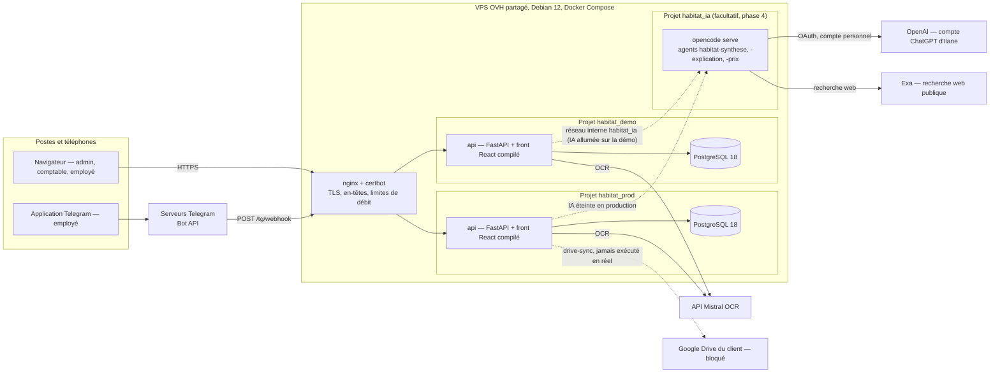
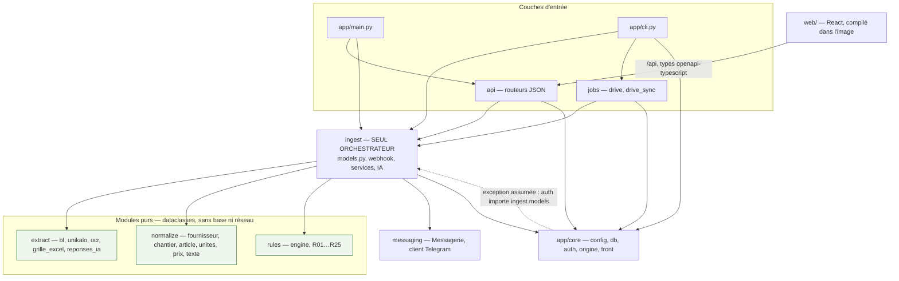

# Contrôle BL & factures — Habitat & Rénovation

Application qui collecte les bons de livraison (photos envoyées par Telegram)
et les factures fournisseurs (PDF) d'une entreprise de rénovation, les lit par
reconnaissance de texte (OCR), les rapproche automatiquement et signale les
écarts par des règles de calcul nommées et chiffrées. L'IA lit, résume,
explique ou cherche une information à titre indicatif : **elle ne décide
jamais**. Les règles décident ; l'humain tranche. Un seul client, deux
instances (production et démonstration) sur un serveur provisoire, un dépôt
Git privé.

*Document rédigé le 29/09/2026 à partir de la branche `dev`, puis mis à jour
le 30/09/2026 après la mise en production du jour (`main`, étiquette
`mise-en-prod-2026-09-30`), à partir du récapitulatif de travail, de la
roadmap d'octobre, des recettes, des passations, des décisions d'Ilane et de
l'audit du 29/09/2026. Chaque fait renvoie à son document ou à son fichier
source. Quand une information n'a pas pu être établie avec certitude, ce
document le dit au lieu de l'inventer. Ce qui est prévu, en cours ou décidé
mais non déployé est écrit comme tel.*

**Sommaire**

1. [Résumé](#1-résumé)
2. [Le besoin](#2-le-besoin)
3. [Périmètre livré](#3-périmètre-livré)
4. [Parcours utilisateur de bout en bout](#4-parcours-utilisateur-de-bout-en-bout)
5. [Catalogue des règles](#5-catalogue-des-règles)
6. [Architecture](#6-architecture)
7. [Stack imposée et interdits](#7-stack-imposée-et-interdits)
8. [Arborescence du dépôt](#8-arborescence-du-dépôt)
9. [Modèle de données](#9-modèle-de-données)
10. [API](#10-api)
11. [Front](#11-front)
12. [IA (phase 4)](#12-ia-phase-4)
13. [Configuration](#13-configuration)
14. [Démarrer en local](#14-démarrer-en-local)
15. [Tests et qualité](#15-tests-et-qualité)
16. [Commandes CLI](#16-commandes-cli)
17. [Déploiement](#17-déploiement)
18. [Exploitation](#18-exploitation)
19. [Sécurité et RGPD](#19-sécurité-et-rgpd)
20. [Audit du 29/09/2026](#20-audit-du-29092026)
21. [Organisation du travail](#21-organisation-du-travail)
22. [Historique et état du projet](#22-historique-et-état-du-projet)
23. [Limites connues et ce qui attend le client](#23-limites-connues-et-ce-qui-attend-le-client)
24. [Index de la documentation](#24-index-de-la-documentation)
25. [Glossaire](#25-glossaire)

---

## 1. Résumé

**Pour qui.** Habitat & Rénovation, quatre agences (Toulouse, Montauban,
Albi, Carcassonne) : des dizaines de bons de livraison (BL) et de bons
d'enlèvement arrivent chaque mois, puis des factures fournisseurs mensuelles
qui les regroupent. Avant l'application, personne ne comparait
systématiquement ce qui avait été reçu sur chantier avec ce qui était
facturé.

**Ce que ça fait.**

- Les employés photographient leurs bons dans un groupe Telegram (en tapant le
  nom du chantier en légende de la photo) ; l'administrateur dépose les
  factures PDF dans l'application.
- L'OCR Mistral lit les documents ; le code normalise (fournisseur, chantier,
  article, unités) puis rapproche chaque bloc de facture du bon de même
  numéro, puis ligne à ligne.
- Des règles nommées (R01 à R25) signalent ce qu'il faut contester ou
  vérifier, avec une justification chiffrée et le document source.
- Une application web, utilisable sur ordinateur et sur téléphone, présente
  la vue du mois, ce qui reste « À régler », les chantiers, les
  fournisseurs, les documents, les prix à vérifier, les comptes, le journal
  et des exports CSV.
- Les employés ou l'administrateur peuvent laisser un commentaire sur chaque
  ligne d'un bon. Une IA d'appoint sait en faire une synthèse hebdomadaire,
  expliquer une alerte de prix et chercher un prix public sur internet
  (jusqu'à cinq sources), toujours à titre indicatif.

**Ce que ça ne fait pas.** Aucune IA ne décide : toute anomalie vient d'une
fonction Python pure, testée, dont le nom et le détail chiffré sont affichés.
L'IA ne crée, ne ferme ni ne modifie jamais une anomalie, un prix de grille
ou un document. L'application ne remplace pas la comptabilité : elle ne
paie rien, ne corrige aucune facture chez le fournisseur et n'est pas
reliée à un logiciel comptable.

**Comment c'est fait.** Un monolithe modulaire (FastAPI + React, une seule
base PostgreSQL), des frontières de code vérifiées automatiquement, une suite
de 2 799 tests (au 30/09/2026) qui doit rester verte avant chaque
commit.

**Où ça en est au 30/09/2026.**

- Les lots 1 à 5 du cahier des charges (Socle, Collecte, Extraction,
  Rapprochement, Restitution), la refonte du front (23/09) et les
  optimisations de sécurité (25/09) sont livrés.
- Les demandes exprimées par le client lors de la démonstration du samedi
  26/09, consignées dans la roadmap du 27/09 (phases 1 à 4), sont **codées
  et déployées en production depuis le 28/09/2026** (étiquette
  `mise-en-prod-octobre-2026`), sauf le contrôle des prix à la facture, non
  commencé. L'IA est **éteinte en production**, allumée sur la démo, et
  **gelée** par Ilane le 29/09 (plus d'évolution sans son accord).
- **Mise en production du 30/09/2026** (PR #17, `dev` vers `main`, étiquette
  `mise-en-prod-2026-09-30`) : démo mise à jour à 07 h 29 UTC, production à
  07 h 31 UTC. Elle apporte tout ce qui n'était que dans `dev` : le
  Laboratoire IA, les correctifs de l'IA, la touche Entrée pour enregistrer un
  commentaire, la lecture des prix écrits avec le symbole euro collé aux
  chiffres, le prix internet identifié par marque, nom et format, les prix
  internet à plusieurs sources (migration 0015, appliquée en production), la
  mise à jour des dépendances, la documentation et les corrections de l'audit.
  Les décisions d'Ilane du 29/09 (« Conforme » strict, R10 visible, chantiers
  à numéro jamais rattachés automatiquement) sont **déployées**.
- L'audit complet du 29/09 a relevé **0 problème critique et 13 importants
  confirmés** (section 20). Les 13 sont **corrigés**, relus et fusionnés
  (PR #16), puis déployés le 30/09 ; les constats mineurs restent dans
  `docs/dette.md`. Un essai réel de restauration isolé a réussi le 30/09
  (section 18.1).
- Ce qui n'est pas livré ni validé par le client (section 23) : le lot 6
  (recette sur deux mois, formation, procès-verbal), Google Drive (bloqué),
  le lecteur de factures Point.P, la mesure de l'OCR sur 30 photos, les
  sauvegardes hors du serveur, le serveur dédié au client.

Demandes de la réunion du 26/09 point par point : section 2.4. Historique
complet : section 22.

---

## 2. Le besoin

### 2.1 Le client et le problème

Habitat & Rénovation reçoit, sur ses quatre agences, des bons de livraison
et des bons d'enlèvement de ses fournisseurs (deux fournisseurs pilotes :
Unikalo et Point.P ; le lot Prix ajoute des grilles de prix pour deux
fournisseurs, Cedeo et Point.P), puis des factures mensuelles qui les
regroupent. Une partie des BL facturés porte la mention « retrait, pas de
bon » et n'a parfois jamais été remise au chantier. Personne ne compare
systématiquement ce qui a été reçu avec ce qui est facturé
(`docs/cahier-des-charges.md` §1, repris dans `infra/README.md` §1).

### 2.2 Les utilisateurs

Deux rôles applicatifs seulement (`docs/cahier-des-charges.md` §3) :

| Rôle | Qui | Ce qu'il fait | Ce qu'il voit |
| --- | --- | --- | --- |
| admin | Le dirigeant, les personnes qu'il désigne, le comptable | Dépose les factures, traite les problèmes, valide les référentiels, gère les comptes, règle les seuils | Tout, toutes agences |
| agent | Agents travaux, chefs de chantier (« employé » à l'écran) | Photographient leurs BL dans Telegram, confirment les quantités | Leurs propres dépôts (écran Documents) |
| Prestataire | Ilane | Déploiement, exploitation, support | Accès serveur ; aucun compte applicatif nominatif hors recette |

Au dernier récapitulatif (28/09/2026), le compte de production était le
compte admin ; la création des comptes des employés (avec leur identifiant
Telegram) et le changement du mot de passe admin de production restent à
faire par Ilane (`docs/phase-2-exploitation-recette.md` §2).

### 2.3 Le principe non négociable

> L'IA extrait et normalise, elle ne décide jamais. Chaque anomalie porte le
> nom de sa règle et une justification chiffrée.
> — `CLAUDE.md`, repris et étendu par la phase 4 : « Python décide qu'une
> anomalie existe. L'IA explique, recherche et synthétise. L'humain décide de
> l'action. » (`docs/superpowers/specs/2026-09-27-phase-4-ia-design.md`)

Concrètement : l'OCR Mistral lit un document mais ne choisit rien ; chaque
règle Rxx est une fonction Python pure qui reçoit des dataclasses et rend
`Optional[Anomalie]`, jamais un jugement de l'IA ; l'assistant interne
(OpenCode) peut résumer des commentaires, expliquer un écart déjà calculé ou
chercher un prix public à titre indicatif, jamais créer, fermer ni modifier
une anomalie, un prix de grille ou un document (`docs/phase-4-ia.md` §1).

### 2.4 Les demandes du client du 26/09/2026 et leur état exact

Le samedi 26/09/2026, le client a vu l'application lors d'une démonstration.
Les demandes qu'il y a exprimées ont été rapportées par Ilane le 27/09 et
consignées dans la roadmap du 27/09 (`docs/roadmap-octobre-2026.md` §1, avenant
du cahier des charges §14 et §15). **La roadmap fait foi comme compte rendu
de ces demandes.** Les décisions d'Ilane du même jour y figurent aussi
(§1.2).

**Calendrier demandé.**

- **1er octobre** : mise en production pour suivre les BL du mois et les
  rapprocher des factures, corrections comprises. **Fait en avance** : la
  production a été mise à jour le 28/09/2026 vers 19 h UTC.
- **Courant octobre** : contrôle des prix (grilles, alertes, page de suivi)
  et commentaires. **Code fait les 27 et 28/09 et déployé en production le
  28/09** ; le contrôle des prix est éteint jusqu'au chargement des grilles
  par Ilane (interrupteur général).
- **Plus tard** : l'IA (prix sur internet, synthèse des commentaires). **Code
  fait les 27 et 28/09**, déployé sur la démo, éteint en production ; gelé
  par Ilane le 29/09.

**Légende de l'état.** « Fait » = codé, testé, relu, fusionné dans `dev` et
déployé en production (le 28/09/2026, ou le 30/09/2026 pour ce qui est daté du
29/09) sauf mention contraire. « En attente » = comme écrit.

| # | Demande exprimée le 26/09 | Décision d'Ilane (27/09) | État au 30/09/2026 |
| --- | --- | --- | --- |
| 1a | Fiche fournisseur : filtrer sur un mois | — | **Fait** (27/09, phase 1) |
| 1b | Voir aussi les bons conformes, pas seulement les problèmes, et les ouvrir d'un clic | Montant « Conforme » cliquable vers la liste des livraisons, puis la page du bon | **Fait** (27/09). **« Conforme » strict** (décision d'Ilane du 29/09) : une seule définition calculée par le serveur, **déployée le 30/09** (section 20) |
| 1c | « Confirmé par » (chantiers) affiche un identifiant au lieu du nom | Noms affichés partout ; Journal entièrement en français | **Fait** (27/09) ; le Journal affiche aussi le nom du compte visé (PR #7, 28/09) |
| 1d | Fournisseur : même problème d'identifiant | idem | **Fait** (27/09) |
| 2a | Le nom du chantier, toujours écrit sur le BL, est lu automatiquement et ajouté au tableau de bord | Une seule règle pour les bons et les factures | **Fait** (27/09) |
| 2b | L'employé indique aussi le nom du chantier en envoyant la photo (confirmation) | La légende de la photo Telegram sert de confirmation | **Fait** (27/09) |
| 2c | Ressemblance d'au moins 90 % avec un chantier existant : rattaché ; sinon un chantier est créé et l'utilisateur prévenu sur le site | Seuil réglable dans Réglages ; chantier créé « à compléter » (sans agence ni client) et signalé dans « À régler » ; pas d'import de la liste des chantiers (le client complète) | **Fait** (27/09). **Défaut relevé par l'audit, corrigé et déployé le 30/09** : deux noms ne différant que par un numéro ne sont plus jamais rattachés automatiquement (décision d'Ilane du 29/09), ils sont proposés « à confirmer » |
| 2d | Nom lu et légende désignant deux chantiers différents | Alerte R18, l'humain choisit ; bouton « Fusionner avec… » contre les doublons ; reprise des noms en attente au déploiement | **Fait** (27/09). Reprise faite au déploiement du 28/09 : des chantiers ont été créés « à compléter » ; **à compléter par Ilane et le client** |
| + | Gestion des comptes par un admin « au cas où » (créer, modifier, supprimer, changer le mot de passe) | Ajout d'Ilane | **Fait** (27/09) : créer, modifier, changer le mot de passe, **retirer ou rétablir l'accès** (pas de suppression définitive : rien n'est supprimé physiquement), garde-fous (jamais soi-même, jamais le dernier admin). Comptes des employés **à créer par Ilane** |
| + | Photos rangées sur le serveur | `bl/<année>/<mois>/<jour>_<déposant>_<chantier>_n<numéro>` | **Fait** (27/09) : rangement par lien physique + commande `ranger-photos` (nocturne). Ce rangement n'est pas une sauvegarde |
| 3a | Une grille de prix par fournisseur | Historique complet, jamais écrasé (verrou en base), non affiché mais interrogeable ; grilles réelles fournies par Ilane | **Fait** (27–28/09, migration 0013). Deux grilles réelles reçues et utilisées pour concevoir le modèle d'import ; **import en production à faire par Ilane** |
| 3b | Mise à jour manuelle | Saisie à l'écran | **Fait** (28/09) |
| 3c | Import d'une grille Excel avec un modèle fourni | Aperçu avant confirmation ; modèle téléchargeable | **Fait** (28/09) |
| 3d | Mise à jour automatique après validation manuelle par un représentant | « Valider ce prix » ajoute une ligne à la grille (date d'effet = date du bon) | **Fait** (28/09) |
| 4a | Contrôle des prix à la réception du BL : historique des factures, grille avec sa date, seuil en % réglable | Au bon d'abord, à la facture ensuite ; tout garder (unités seau/kg, prix catalogue, remise, net) ; sept alertes R19 à R25 activables séparément, interrupteur général éteint par défaut | **Fait** (28/09), **éteint en production** jusqu'au chargement des grilles |
| 4b | Produit ni en grille ni en facture : une IA cherche le prix sur internet (indicatif) | Plus tard, avec la synthèse | **Fait** (28/09), amélioré le 29/09 (marque + nom + format, jusqu'à cinq sources en HT). **Allumé sur la démo seulement**, éteint en production ; **IA gelée** par Ilane le 29/09. Les améliorations du 29/09 sont en production depuis le 30/09 (IA éteinte) |
| 4c | La règle de seuil déclenche l'alerte ; l'IA commente l'écart sans décider | Explication automatique de chaque alerte de prix, sans chiffre inventé | **Fait** (28/09), même état que 4b |
| 4d | Contrôle des prix à la facture | Après le contrôle au bon | **Non commencé** (phase 4 hors IA) |
| 5a | Page de suivi des produits en alerte : prix facturé, prix de grille, prix internet | Page « Prix à vérifier » simple : prix du bon, grille (date), dernier prix facturé (date), écart, ressemblance ; l'humain décide (Valider / Contester / Ignorer) | **Fait** (28/09) ; colonne « Internet » visible seulement quand l'IA est allumée |
| 5b | Un prix validé met à jour la grille | idem 3d | **Fait** (28/09) |
| 6a | Commentaire sur chaque ligne de BL | Tout compte connecté ; ni modifiable ni supprimable | **Fait** (27/09) ; Entrée enregistre le commentaire sur ordinateur (29/09, en production le 30/09) |
| 6b | Chaque semaine, une IA lit les commentaires et envoie une synthèse à l'accueil avec les actions à mener, sans rien modifier | Accueil = Vue d'ensemble ; actions à cocher (qui, quand), les non faites restent visibles | **Fait** (28/09), même état que 4b |

**À faire côté client et Ilane pour ces demandes** (`docs/roadmap-octobre-2026.md`
§1.2, §10) : comptes Telegram des employés (à partir du
28/09) ajoutés au groupe par Ilane ; groupe Telegram de test distinct du
groupe de production (le bot de la démo est aujourd'hui invalide, voir
section 23) ; import des grilles réelles puis allumage du contrôle des prix ;
compléter les chantiers créés automatiquement.

### 2.5 Ce que le client a demandé avant, dans le cahier des charges

Le cahier des charges (`docs/cahier-des-charges.md`, daté du 16/09/2026 à
partir d'un compte rendu du 14/09) fait foi avec Ilane. Il prévoit six lots :
Socle, Collecte, Extraction, Rapprochement, Restitution, Livraison. Les cinq
premiers sont construits ; le sixième (recette sur deux mois de documents
réels, formation de 2 heures, procès-verbal de réception) n'est **pas
commencé**. Deux avenants du 27/09/2026 le complètent : §14 (mise en
production du 1er octobre) et §15 (IA, **à confirmer par Ilane**). Le
détail de l'écart entre le cahier des charges et ce qui existe est en
section 23.

---

## 3. Périmètre livré

Cette section dit ce qui existe, par phase et par écran, avec les dates. Elle
sert de base pour vérifier qu'un point est livré ou non. « Production » =
version déployée le 30/09/2026 (`mise-en-prod-2026-09-30`, après la mise en
production du 28/09/2026, `mise-en-prod-octobre-2026`) ; « démo » = instance
de démonstration.

### 3.1 Par phase et par date

| Phase | Dates | Contenu livré | Où c'est déployé |
| --- | --- | --- | --- |
| **Lot 1 — Socle** | 16–17/09 | Dépôt, outillage (uv, ruff, mypy strict, pytest, pre-commit), Docker Compose, PostgreSQL, Alembic, configuration qui refuse de démarrer si une variable manque, `GET /health`, webhook Telegram, lecture des factures Unikalo (blocs « Concerne le B.L. n°… »), détection du numéro de BL sur une photo, commande `bl-non-recus`, scripts de sauvegarde et de restauration | Oui |
| **Lot 2 — Collecte** | 17/09 | Connexion par cookie (sessions en base, argon2, limitation de `/login`), liste blanche des employés, groupe des BL, notifications de supervision, numéro interne et boutons de confirmation, dépôt de facture PDF, API des factures et des documents, contrôle d'origine anti-CSRF, en-têtes de sécurité, premier écran React | Oui |
| **Lot 3 — Extraction** | 17/09 | Normalisation (fournisseur, chantier, unités, article), lecture d'un BL depuis l'annotation Mistral, confiance par valeur, contrôle de cohérence (somme des lignes contre total), écran « À traiter » avec correction et validation, outil de mesure du taux d'erreur OCR | Oui |
| **Lot 4 — Rapprochement** | 17–18/09 | Moteur de règles R01 à R17, rapprochement facture-BL par bloc puis par ligne (conversion d'unités, avoirs), anomalies (génération idempotente, cycle de vie), contrôles différés, rejeu, écran Anomalies | Oui (fusionné le 18/09) |
| **Lot 5 — Restitution** | 18–20/09 | Bilan par chantier et par fournisseur (quatre montants), exports CSV, référentiels, vue des dépôts par employé, journal, réglage des seuils, synchronisation Google Drive **codée** (jamais exécutée en réel) | Oui (fusionné le 20/09) ; Drive bloqué |
| **Déploiement sur le VPS** | 23/09 | Deux instances (production et démonstration) derrière nginx, certificats Let's Encrypt, base et dossier de documents séparés par instance | Oui |
| **Export CSV détaillé** | 23/09 | Une ligne par ligne de facture, sur toute la période (décision d'Ilane du 23/09) | Oui |
| **Refonte du front** | 23/09 | Cinq écrans (Vue d'ensemble, À régler, Chantiers, Fournisseurs, Documents), page BL, Réglages et Journal ; navigation téléphone ; aucun jargon ; quatre ajouts serveur ; client du chantier (migration 0010) | Oui (23/09) |
| **Désactivation de contrôles** | 24/09 | R07, R08, R09 (prix) et R06 (livré mais pas facturé) désactivées côté serveur ; `/docs`, `/redoc`, `/openapi.json` fermés par défaut ; lien direct du Journal vers l'élément concerné | Oui (24/09) |
| **Optimisations rapidité et sécurité** | 25/09 | Documents en 0640/0750, fichiers Telegram vérifiés (signature, taille), en-têtes nginx, limite de débit dédiée à la connexion, conteneurs durcis, cache des fichiers du front, données fraîches 30 s, correction d'un N+1, audit des dépendances dans les hooks | Oui (25/09) |
| **Tuile « Montant des bons reçus »** | nuit du 25 au 26/09 | Sur l'accueil, cette tuile remplace « Écart de quantité » (décision d'Ilane) | Oui |
| **Démonstration au client** | 26/09 | Démonstration ; demandes consignées le 27/09 dans la roadmap (section 2.4) | — |
| **Phase 1 — mise en production du 1er octobre** | 27/09 | Légende Telegram, rattachement automatique des chantiers (90 %), R18, fusion de chantiers, reprise des noms en attente, photos rangées, écran Comptes, Journal en noms, fiche fournisseur par mois, « Conforme » cliquable | Oui (28/09) |
| **Phase 2 — exploitation** | 27/09 | `restore.sh` corrigé et test de restauration rejoué avec succès, sauvegardes restic **locales** nocturnes, tâches planifiées systemd, alerte d'échec Telegram | Oui (timers posés le 27/09, réinstallés le 28/09) ; reste : sauvegardes hors du serveur |
| **Phase 3 — commentaires** | 27/09 | Commentaires sur chaque ligne de bon (migration 0012), non modifiables | Oui (28/09) |
| **Phase 3 — lot Prix** | 27–28/09 | Grilles de prix par fournisseur à historique inaltérable (migration 0013), saisie, import Excel avec modèle, contrôle des prix des bons (R19 à R25), page « Prix à vérifier » avec Valider / Contester / Ignorer, réglages | Oui (28/09), **contrôle éteint** |
| **Phase 4 — IA** | 27–28/09 | OpenCode, synthèse hebdomadaire des commentaires, explication des alertes de prix, prix internet (migration 0014), colonne « Internet » de la page Prix | Oui (28/09) ; **IA éteinte en production**, allumée sur la démo |
| **Journal : noms des comptes** | 28/09 | Le Journal affiche le nom du compte visé ; filtre « Auteur » par nom (PR #7) | Oui (28/09) |
| **Laboratoire IA** | 29/09 | Page d'essai réservée aux admins (`/ia`) pour essayer les trois usages de l'IA et voir exactement ce qui a été envoyé et contrôlé, sans rien enregistrer (PR #9) | Oui (30/09, IA éteinte) ; démo |
| **Correctifs de l'IA** | 29/09 | Modèle `gpt-5.6-sol` ; sortie structurée ; pages lues relevées sur toutes les étapes ; références de synthèse reconnues ; semaine sans commentaire sans appel (PR #10) | Oui (30/09, IA éteinte) ; démo |
| **Entrée = enregistrer** | 29/09 | Sur ordinateur, Entrée enregistre un commentaire (Maj+Entrée = saut de ligne) ; prix écrits avec le symbole euro collé aux chiffres reconnus (PR #11) | Oui (30/09, IA éteinte) ; démo |
| **Prix internet par marque, nom, format** | 29/09 | Le code du fournisseur n'est plus qu'un indice (PR #12) | Oui (30/09, IA éteinte) ; démo |
| **Prix internet à plusieurs sources** | 29/09 | Jusqu'à cinq offres contrôlées une à une, ramenées en HT ; migration 0015 ; page Prix « dès … HT · N sources » (PR #13) | Oui (30/09, IA éteinte) ; démo |
| **Dépendances à jour** | 29/09 | Mise à jour dans les versions existantes, sans faille connue (PR #14) | Oui (30/09) |
| **Audit complet** | 29/09 | 6 angles, vérification contradictoire (section 20) | Oui |
| **Corrections de l'audit** | 29–30/09 | Les 13 constats importants, en cinq groupes : recalculs après correction, codes répétés, « Conforme » strict et R10, chantiers à numéro, sauvegardes et restauration (PR #16) | Oui (30/09) |
| **Mise en production du 30/09** | 30/09 | `dev` vers `main` (PR #17, étiquette `mise-en-prod-2026-09-30`), migration 0015, rapprochement rejoué | Oui (démo 07 h 29 UTC, production 07 h 31 UTC) |

### 3.2 Par écran

Écrans de l'application (`web/src/App.tsx`). « Admin » = compte administrateur.

| Écran | Route | Accès | Ce qu'on y fait | Depuis |
| --- | --- | --- | --- | --- |
| Connexion | `/connexion` | Public | Se connecter (cookie httpOnly, 12 h glissantes) | 17/09 |
| Vue d'ensemble | `/` | Admin | Sélecteur de mois ; chiffres du mois (facturé, conforme, écart, sans bon, montant des bons reçus, problèmes à régler, BL reçus/facturés) ; chantiers triés par montant à vérifier, avec pastille d'état ; problèmes prioritaires ; carte « Commentaires de la semaine » (IA) ; export Excel du détail du mois | 23/09 (refonte) ; carte IA 28/09 |
| À régler | `/a-regler`, `/a-regler/:id` | Admin | Liste unique de ce qui attend une décision (problèmes ouverts, documents à corriger, chantiers à rattacher), filtrable ; détail avec « pourquoi c'est signalé » chiffré, liens vers la facture et le bon ; traiter exige un commentaire (« Contesté auprès du fournisseur » ou « C'est normal, ignorer ») ; choix du chantier sur une alerte R18 ; avis de l'IA sur une alerte de prix | 23/09 ; R18 27/09 ; avis IA 28/09 |
| Chantiers | `/chantiers`, `/chantiers/:id` | Admin | Liste et création ; filtre agence ; fiche (client, agence, livraisons cliquables, quatre chiffres, modification) ; chantiers « à compléter » ; **fusion** de deux chantiers | 23/09 ; à compléter et fusion 27/09 |
| Fournisseurs | `/fournisseurs`, `/fournisseurs/:id` | Admin | Liste ; fiche avec chantiers concernés, **filtre par mois**, problèmes ouverts ; lien vers la grille de prix | 23/09 ; mois 27/09 |
| Grille de prix | `/fournisseurs/:id/prix` | Admin | Prix en vigueur, recherche, ajout ou modification (nouvelle ligne d'historique), retrait, import Excel avec aperçu, modèle à télécharger | 28/09 |
| Livraisons | `/livraisons` | Admin | Bons « Conforme » (et autres états), filtrables par mois, agence, chantier, fournisseur ; clic vers le bon | 27/09 |
| Prix à vérifier | `/prix` | Admin | Une rangée par produit en alerte (prix du bon, grille et sa date, dernier prix facturé et sa date, écart, ressemblance, colonne « Internet » si l'IA est allumée) ; Valider ce prix / Contester (commentaire obligatoire) / Ignorer ; recontrôle des bons | 28/09 ; prix internet à plusieurs sources 29/09 (production le 30/09) |
| Documents | `/documents`, `/documents/:id`, `/bl/:id` | Admin et agent (ses dépôts) | Liste filtrable ; dépôt d'une facture PDF (admin) ; **page BL** : photo, téléchargement nommé, tableau livré/facturé/prix/contrôle par ligne, correction de lecture, validation, archivage, relance de la lecture, **commentaires par ligne** | 23/09 ; commentaires 27/09 |
| Comptes | `/comptes` | Admin | Créer, modifier, changer le mot de passe, retirer ou rétablir l'accès | 27/09 |
| Journal | `/journal` | Admin | Journal des actions, en français, avec lien direct vers l'élément | 24/09 ; noms 27–28/09 |
| Réglages | `/reglages` | Admin | Seuils modifiables ; interrupteurs du contrôle des prix des bons ; lien « Essayer l'IA » | 19/09 ; prix 28/09 |
| Laboratoire IA | `/ia` | Admin | Diagnostic de l'IA (allumée, joignable, agents, recherche web, compte ChatGPT connecté), essais des trois usages, journal des appels | 29/09 (production le 30/09) |

Les anciennes adresses (`/a-traiter`, `/anomalies`, `/bilan…`, `/bl`,
`/factures…`) redirigent vers les nouvelles.

### 3.3 Ce qui n'est pas livré

- **Lot 6 — Livraison** : recette sur deux mois de documents réels,
  formation de 2 heures, procès-verbal de réception, guides utilisateur.
- **Lecteur de factures Point.P** et tout rapprochement avec ce fournisseur
  (aucune facture Point.P disponible).
- **Mesure de l'OCR** sur 30 photos de BL dont 10 dégradées (4 photos
  seulement disponibles).
- **Règle « semi-remorque »** du cahier des charges (aucun déclencheur défini
  par le client).
- **Synchronisation Google Drive** en réel (bloquée : voir section 23).
- **Contrôle des prix à la facture** (non commencé).
- **Écran de correction d'une facture « à vérifier »**, gestion des
  fournisseurs à l'écran, reconnaissance du fournisseur d'une facture par
  SIRET/TVA, import des chantiers depuis Excel : évolutions proposées, non
  construites (`docs/evolutions-proposees.md`).
- **Sauvegardes hors du serveur**, **serveur dédié au client**,
  **supervision externe** (UptimeRobot prévu par le cahier des charges).
- **Export comptable, WhatsApp, double authentification** : hors périmètre du
  cahier des charges.

---

## 4. Parcours utilisateur de bout en bout

**Dépôt d'un BL (Telegram).** Un employé photographie son bon dans le groupe
Telegram des BL ; la légende de la photo, où il tape le nom du chantier, sert
de confirmation (avenant du 27/09/2026). Le bot répond tout de suite, puis en
tâche de fond : téléchargement, vérification de la signature du fichier,
écriture du fichier, enregistrement du document (statut `recu`), OCR Mistral,
extraction et normalisation, rattachement du chantier, rapprochement si un
numéro de BL a été lu, enfin une ligne de supervision et un accusé « Reçu,
document n° N » avec deux boutons (« Quantités vérifiées », « Écart
constaté »). Le bot ignore les messages texte seuls. Détail :
`ARCHITECTURE.md` §5.1.

**Dépôt d'une facture (PDF).** L'admin dépose le PDF sur l'écran Documents
(20 Mo au plus) ; traitement synchrone : vérification de la signature PDF, OCR
Mistral, lecture par le parseur du fournisseur (aujourd'hui seulement
`extract/unikalo.py`), détection de doublon, enregistrement puis
rapprochement. `ARCHITECTURE.md` §5.2.

**Lecture OCR.** Un seul point d'appel (`app/modules/ingest/mistral.py`),
confiance par mot pour un BL, par page pour une facture ; chaque valeur
annotée par le modèle est confrontée au texte OCR brut pour détecter une
valeur inventée ou reformulée (`infra/README.md` §6.1). Un document dont la
somme des lignes ne correspond pas au total passe « à vérifier ».

**Rattachement du chantier** (avenant du 27/09/2026, règle R18). Le nom lu
sur le document et la légende Telegram sont comparés aux chantiers connus
par une fonction de ressemblance (0 à 100,
`normalize/texte.py::ressemblance`) : une ressemblance d'au moins le seuil
réglable (90 % par défaut) rattache le document ; sinon un chantier est créé
automatiquement, marqué « à compléter », et signalé dans « À régler ». Si le
nom lu et la légende désignent deux chantiers différents, une alerte R18
« Chantier à confirmer » est levée et un humain choisit. Un admin peut
fusionner deux chantiers doublons. Exemples inventés : « Villa Test » et
« VILLA TEST (123) » = 100 (rattaché) ; « Les Pins » et « Les Pins 2 » = 88
(nouveau chantier). *Défaut relevé par l'audit (section 20) et corrigé le
30/09 : deux noms ne différant que par un numéro (« Lot 12 », « Lot 13 »)
pouvaient atteindre le seuil ; sur décision d'Ilane, ils ne sont plus jamais
rattachés automatiquement et sont proposés « à confirmer » (R18). Les alias
déjà appris ne sont pas revus : la commande `chantiers-alias-suspects`
(section 16) les liste pour relecture ; elle n'en a signalé aucun, sur la démo
comme en production, le 30/09.*

**Rapprochement BL ↔ facture.** Chaque bloc « Concerne le B.L. n°… » d'une
facture est comparé au BL du même numéro (reçu, non reçu, « pas de bon ») ;
les lignes sont appariées par code puis par désignation, converties en unité
de facturation, puis le moteur de règles évalue les anomalies. Idempotent :
rejouable à chaque nouvel événement. `ARCHITECTURE.md` §5.3.

**Anomalies et « À régler ».** Chaque anomalie porte sa règle, sa gravité et
un détail chiffré. L'écran « À régler » réunit les anomalies ouvertes, les
documents à corriger et les chantiers à rattacher ; traiter une anomalie
exige un commentaire ; une anomalie traitée ou ignorée n'est jamais rouverte.
`ARCHITECTURE.md` §5.4, §6.2.

**Les écrans** (refonte du 23/09/2026) : voir section 3.2 et section 11.

**Commentaires sur les lignes** (phase 3). Sur la page d'un bon, n'importe
quel compte connecté ajoute un commentaire par ligne (1 000 caractères au
plus) ; un commentaire n'est ni modifiable ni supprimable (on en ajoute un
autre pour se corriger). Sur ordinateur, Entrée enregistre (en production depuis le 30/09).

**Contrôle des prix d'un bon** (phase 3, éteint en production). Après la
lecture d'un bon, ou après la correction de ses lignes, chaque ligne est
comparée à la grille du fournisseur (prix en vigueur à la date du bon) et au
dernier prix facturé ; les alertes R19 à R25 sont créées si l'interrupteur
général et l'alerte concernée sont allumés (Réglages). La page « Prix à
vérifier » liste les produits en alerte ; l'humain valide (le prix du bon
entre dans la grille), conteste ou ignore.

**Synthèse IA de la semaine** (phase 4). Une fois l'IA allumée, une tâche
quotidienne regarde si la dernière semaine complète (lundi à dimanche, heure
de Paris) a une synthèse ; sinon elle résume en français les commentaires
de la semaine et propose des actions à cocher, affichées sur la Vue
d'ensemble avec la mention « Rédigé par l'IA — à vérifier ». Une semaine sans
commentaire n'appelle pas l'IA. Détail : section 12.

**Avis de l'IA sur les alertes de prix** (phase 4). Pour chaque alerte de prix
ouverte, une tâche horaire demande à l'IA d'expliquer l'écart déjà calculé
(jamais un nouveau chiffre) et, pour un produit absent de toute référence
interne (ni grille ni facture), cherche un prix public sur internet à
titre indicatif, avec ses sources et sa date. Affiché dans le détail du
problème (« Avis de l'IA — à titre indicatif ») et dans la colonne
« Internet » de la page Prix.

---

## 5. Catalogue des règles

Chaque règle est une fonction pure dans son propre fichier
(`app/modules/rules/rules/Rxx.py`), reçoit des dataclasses et rend
`Anomalie | None` avec un `detail` chiffré jamais vide ; au moins un test
positif et un test négatif par règle (`app/modules/rules/tests/`).

### 5.1 R01 à R18 — règles sur les factures, les suivis et les chantiers

État vérifié dans `app/core/config.py`, `app/modules/ingest/commun.py` et
`app/modules/rules/rules/*.py` ; catalogue de référence :
`ARCHITECTURE.md` §8.2 et `infra/README.md` §2.5.

| Règle | Titre à l'écran | Déclencheur | Gravité | Seuil réglable | État |
| --- | --- | --- | --- | --- | --- |
| R01 | Bon de livraison jamais reçu | BL facturé sans BL déposé de même numéro | Haute | — | Active |
| R02 | Livré sans bon | Bloc facturé « pas de bon » | Haute | — | Active (gardée séparée de R01, décision du 24/09) |
| R03 | Facturé plus que livré | Quantité facturée supérieure à la quantité du BL | Haute | — | Active |
| R04 | Facturé moins que livré | Quantité facturée inférieure à la quantité du BL | Moyenne | — | Active |
| R05 | Facturé mais absent du bon | Ligne facturée sans ligne de BL correspondante | Haute | — | Active |
| R06 | Livré mais pas facturé | Ligne d'un BL déjà rapproché restée non facturée après un délai | Basse | `delai_ligne_bl_non_facturee_j` (45 jours) | Désactivée par défaut (`CONTROLE_LIVRE_NON_FACTURE_ACTIF=false`) ; contrôle différé |
| R07 | Prix un peu plus cher | Écart de prix supérieur à 5 % à la médiane des 6 derniers mois de factures | Moyenne | `seuil_prix_pct` | Désactivée par défaut (`CONTROLE_PRIX_ACTIF=false`) |
| R08 | Prix plus cher que d'habitude | Même écart, supérieur à 15 % | Haute | `seuil_prix_fort_pct` | Désactivée par défaut (idem R07) |
| R09 | Remise habituelle oubliée | Remise historique absente | Moyenne | `occurrences_prix_min` (3) | Désactivée par défaut (idem R07) |
| R10 | Erreur de calcul sur la facture | Somme des blocs différente du total HT | Haute | `tolerance_total_ht` (quelques centimes) | Active. Jusqu'au 29/09 elle était **inatteignable en pratique** (une facture incohérente reste « à vérifier » et n'était jamais rapprochée) ; depuis le 30/09, sur décision d'Ilane, R10 est évaluée seule pour une facture « à vérifier » et apparaît dans « À régler ». Elle tombe au rejeu suivant si la somme redevient cohérente ou si la facture est archivée |
| R11 | Erreur de calcul sur le bon | Somme des lignes différente du total HT du BL | Moyenne | `tolerance_total_ht` | Active |
| R12 | Bon facturé deux fois | Doublon de facturation | Haute | — | Active |
| R13 | Avoir sans achat d'origine | Ligne négative sans ligne positive d'origine | Moyenne | — | Active |
| R14 | Chantier à rattacher | Alias de chantier non résolu après un délai | Moyenne | `delai_alias_non_resolu_h` (48 h) | Contrôle différé |
| R15 | Quantités non confirmées par l'équipe | BL sans confirmation après un délai | Basse | `delai_confirmation_bl_h` (24 h) | Contrôle différé |
| R16 | Chantier sans bon déposé récemment | Aucun BL déposé depuis un délai | Basse | `delai_chantier_silencieux_j` (7 jours) | Contrôle différé |
| R17 | Quantité inhabituelle pour le conditionnement | Conditionnement inhabituel | Moyenne | — | Active |
| R18 | Chantier à confirmer | Nom lu et légende Telegram désignent deux chantiers différents (ou plusieurs candidats à égalité) | Moyenne | `seuil_ressemblance_chantier_pct` (90 %) | Active (point d'entrée `evaluer_chantier`, appelé au rattachement) |

Trois points d'entrée dans le moteur (`app/modules/rules/engine.py`) :
`evaluer_facture` (R01 à R05, R07 à R13, R17, à chaque rapprochement),
`evaluer_suivi` (R06, R14 à R16, via `python -m app.cli controles-differes`)
et `evaluer_chantier` (R18, au rattachement d'un chantier). Une règle
désactivée par une variable d'environnement n'est ni évaluée ni balayée ;
ses anomalies déjà ouvertes restent en base, masquées des écrans, jusqu'à
réactivation (`ingest.commun.regles_desactivees`, seule fonction qui lit ces
drapeaux).

La règle « semi-remorque » du cahier des charges n'a jamais été construite
(aucun déclencheur défini par le client). Son numéro d'origine (R18 dans le
cahier des charges) ne doit pas être confondu avec R18 « Chantier à
confirmer ».

### 5.2 R19 à R25 — contrôle des prix d'un bon (lot Prix, 28/09/2026)

Spécification : `docs/superpowers/specs/2026-09-27-prix-design.md` §5.2. Les
règles sont dans `app/modules/rules/rules/R19.py` à `R25.py`. Elles sont
évaluées après la lecture d'un bon et après la correction de ses lignes
(`ingest/prix_bl.py`).

| Règle | Titre à l'écran | Déclencheur | Gravité | Réglage propre |
| --- | --- | --- | --- | --- |
| R19 | Plus cher que la grille | Prix net du bon supérieur au prix de grille en vigueur, plus le seuil de hausse (0 % par défaut) | Haute | `prix_alerte_plus_cher_grille`, `prix_seuil_hausse_pct` |
| R20 | Plus cher que la dernière fois | Prix net du bon supérieur au dernier prix facturé, plus le seuil de hausse | Haute | `prix_alerte_plus_cher_dernier_prix` |
| R21 | Moins cher que la grille | Prix du bon inférieur au prix de grille, moins le seuil de baisse (5 % par défaut) | Basse | `prix_alerte_moins_cher_grille`, `prix_seuil_baisse_pct` |
| R22 | Produit absent de la grille | Aucun produit de grille retrouvé (ni par référence, ni par nom) ; porte le dernier prix facturé s'il existe | Basse | `prix_alerte_absent_grille` |
| R23 | Reconnu seulement par son nom | Produit retrouvé par ressemblance de désignation, pas par référence | Basse | `prix_alerte_reconnu_par_nom`, `prix_seuil_ressemblance_produit_pct` |
| R24 | Unités différentes | Unité du bon et de la référence non convertibles | Moyenne | `prix_alerte_unites_differentes` |
| R25 | Grille ancienne | Prix de grille plus vieux qu'un seuil (12 mois par défaut) | Basse | `prix_alerte_grille_ancienne`, `prix_age_grille_mois` |

Chaque alerte est activable séparément dans Réglages, derrière un
interrupteur général (`prix_controle_bl_actif`, **éteint par défaut**). Le
prix lu sur un bon est considéré comme net et comparé au prix net de la
grille (prix moins remise), après conversion d'unité quand le ratio de
l'article est connu (sinon : pas de comparaison, R24). Le contrôle porte
d'abord sur les bons (décision d'Ilane) ; le contrôle à la facture n'existe
pas. Ordre conseillé au déploiement : importer les grilles, vérifier la page
« Grille » du fournisseur, puis allumer le contrôle et lancer un recontrôle
des bons existants.

---

## 6. Architecture

### 6.1 Conteneurs et services externes



Une instance = un projet Docker Compose + un fichier d'environnement
(`.env.prod` / `.env.demo`), sa propre base, son propre volume de documents.
Le conteneur OpenCode est unique et sert les deux instances (mémoire du VPS) ;
il n'est joignable que depuis le réseau Docker interne `habitat_ia`, jamais
publié. Sources : `infra/README.md` §2, §5.2 ;
`docs/superpowers/specs/2026-09-27-phase-4-ia-design.md` §2.

### 6.2 Modules applicatifs et frontières



- `extract`, `normalize`, `rules` sont purs : ni FastAPI, ni SQLAlchemy, ni
  httpx, ni asyncpg ; dataclasses en entrée et en sortie ; tests sans base ni
  réseau.
- `ingest` est le seul module métier qui en importe d'autres ; `api` et `jobs`
  (couches d'entrée) n'importent que `ingest` et `app.core` (décision L2-D3).
  Aucune règle métier dans un routeur ni dans le front.
- Vérifié par `tests/test_frontieres.py` : analyse statique des imports via
  `ast` sur tout `app/modules` — trois gardes : (1) les modules purs
  n'importent aucune bibliothèque d'infrastructure ; (2) `extract`,
  `normalize`, `rules`, `messaging` n'importent aucun autre module de
  `app.modules` ; (3) `api` et `jobs` n'importent que `ingest`. `app/core`,
  `app/main.py` et `app/cli.py` échappent à cette garde (exceptions assumées :
  `core/auth.py` importe `ingest.models`, `cli.py` importe `extract` et
  `messaging`). L'audit du 29/09 note que cette garde ne couvre pas toutes les
  règles de `CLAUDE.md` (F-10, mineur).
- Écart de nommage : `CLAUDE.md` décrit une arborescence partiellement
  dépassée ; `ARCHITECTURE.md` §3 et ce document font foi pour la structure
  réelle.

---

## 7. Stack imposée et interdits

D'après `CLAUDE.md` (« ne pas discuter, ne pas remplacer ») et
`docs/cahier-des-charges.md` §7, complétés par le code.

| Domaine | Choix imposé | Raison documentée |
| --- | --- | --- |
| Langage / paquets | Python 3.11, uv | Stack imposée par le client |
| API | FastAPI, Uvicorn, pydantic-settings | — |
| Données | PostgreSQL 18, SQLAlchemy 2 async + asyncpg, Alembic | Un seul ORM autorisé |
| Authentification | fastapi-users, cookie httpOnly, sessions en base, argon2id ; slowapi sur `/login` | Session serveur révocable, aucun jeton dans le navigateur, aucun tiers à déclarer |
| Lecture des documents | API Mistral OCR (`pdfplumber` prévu par le cahier des charges mais non utilisé) | La seule facture fournie est un scan sans couche texte ; Mistral choisi pour la qualité sur les tableaux et parce que le sous-traitant est européen |
| Messagerie | Telegram Bot API en webhook, via httpx, sans framework de bot | Les employés ont déjà Telegram ; interface `Messagerie` gardée en vue d'un passage à WhatsApp (seule abstraction « pour plus tard » autorisée) |
| Front | React 18 + TypeScript + Vite, React Router, TanStack Query, Tailwind ; types générés par openapi-typescript depuis `/openapi.json` | Servi par l'API, même origine : ni CORS ni JWT |
| Infra | Docker + Compose, Traefik (prévu), restic | nginx + certbot en remplacement provisoire de Traefik sur le VPS actuel (section 17) |
| Qualité | ruff, mypy strict, pytest | Tient lieu d'intégration continue (aucune n'est configurée sur GitHub) |
| IA (phase 4, hors stack d'origine) | OpenCode connecté au compte ChatGPT d'Ilane ; recherche web par le service public d'Exa | Décision D2 du 27/09/2026, contre la recommandation d'un accès direct par API ; risques consignés (section 12) |

Interdits explicites (`CLAUDE.md`) : n8n, Redis, Celery/RQ, MinIO/S3, Neo4j,
Keycloak, LangChain, tout ORM autre que SQLAlchemy, tout state manager front
autre que TanStack Query, `localStorage` pour l'authentification. Raison
générale : volume trop faible pour justifier un worker ou une file de
messages (moins de 500 documents par mois) ; les tâches différées sont de
simples commandes CLI lancées par des minuteries systemd.

---

## 8. Arborescence du dépôt

```
app/
  main.py        point d'entrée FastAPI (config lue à l'import : fail-fast), /health
  cli.py         commandes d'exploitation (python -m app.cli …)
  core/          config (pydantic-settings, fail-fast), db, auth, origine (anti-CSRF), front (sert web/dist), fuseau
  modules/
    ingest/      SEUL ORCHESTRATEUR : webhook Telegram, dépôts, extraction, rapprochement, anomalies,
                 bilan, exports, référentiels, journal, commentaires, grilles de prix, contrôle des prix
                 (prix_bl), IA (opencode, ia_synthese, ia_prix, ia_labo), rattachement de chantier,
                 fusion, rangement des photos, modèles SQL (models.py)
    extract/     PUR — lecture OCR, BL (bl.py), factures Unikalo (unikalo.py), confiance, vérification,
                 grilles Excel (grille_excel.py), réponses de l'IA (reponses_ia.py)
    normalize/   PUR — fournisseur, chantier, article, unités, appariement, prix (produit, prix net), texte (ressemblance)
    rules/       PUR — engine.py, modeles.py, rules/R01.py à R25.py
    api/         routeurs JSON consommés par le front (préfixe /api posé une seule fois)
    messaging/   base.py (interface Messagerie), telegram.py — n'importe rien d'autre
    jobs/        drive.py (client Drive), drive_sync.py — couche d'entrée comme api
web/             front React + TypeScript (Vite) — voir section 11
migrations/      Alembic, 0001 à 0015
deploy/          compose (base, vps, dev, ia), nginx, sauvegarde/restauration, tâches planifiées, opencode/
docs/            cahier des charges, roadmap, specs et plans (superpowers/), recettes, dette, guides
infra/           documentation technique d'ensemble (infra/README.md)
tests/           tests transverses (frontières, migrations, CLI, contrats web, installateur de tâches…)
```

Chaque module métier a son propre dossier `tests/` à côté du code ;
`tests/` à la racine couvre ce qui traverse plusieurs modules (frontières,
migrations, CLI, contrats du front, installateur de tâches planifiées, script
de restauration, configuration OpenCode).

---

## 9. Modèle de données

PostgreSQL 18, SQLAlchemy 2 async ; `app/modules/ingest/models.py` est la
source de vérité unique du schéma (`ARCHITECTURE.md` §4).

### 9.1 Cœur métier

| Table | Rôle | Clés notables |
| --- | --- | --- |
| `fournisseur` | Référentiel fournisseur (nom, SIRET, TVA, alias) | — |
| `agence_fournisseur` | Agences d'un fournisseur | FK `fournisseur_id` |
| `chantier` | Chantier (nom canonique, agence, client en texte libre, `a_completer`, `fusionne_dans_id`) | auto-référence `fusionne_dans_id` |
| `chantier_alias` | Libellé fournisseur ↔ chantier, en attente ou validé | unique (`fournisseur_id`, `libelle_brut`, `code_brut`) |
| `article` | Article par fournisseur (unités, ratio, validé) | unique (`fournisseur_id`, `code`) |
| `document` | BL, enlèvement, facture ou avoir (statut, extraction OCR conservée, légende) | unique (`fournisseur_id`, `numero`) |
| `bloc_facture` | Bloc « Concerne le B.L. n°… » d'une facture | FK `facture_id`, `bl_document_id` |
| `ligne` | Ligne d'un document (article, éco-participation, commentaire) | FK `document_id`, `bloc_id`, `article_id` |
| `rapprochement_ligne` | Appariement ligne de facture ↔ ligne de BL | FK vers deux `ligne` |
| `anomalie` | Règle, gravité, statut, détail chiffré | unique (règle, document, bloc, ligne, chantier, alias), `NULLS NOT DISTINCT` |
| `commentaire` | Commentaire sur une ligne de bon (migration 0012, append-only) | FK `document_id` (cascade), `ligne_id` (`SET NULL`) |

### 9.2 Comptes et traçabilité

| Table | Rôle |
| --- | --- |
| `utilisateur` | Comptes (e-mail, rôle admin/agent, agence, identifiant Telegram, mot de passe argon2) |
| `jeton_session` | Sessions serveur (fastapi-users `DatabaseStrategy`) |
| `journal` | Journal d'actions, append-only |
| `parametre` | Seuils modifiables (clé/valeur, journalisé) |
| `telegram_update` | Dédoublonnage des updates Telegram, append-only |

### 9.3 Grilles de prix (lot Prix, migration 0013)

| Table | Rôle |
| --- | --- |
| `grille_import` | Trace de chaque import Excel (nom et empreinte du fichier, date d'effet, nombre de lignes nouvelles, modifiées, inchangées et en erreur, auteur) |
| `grille_prix` | Historique des prix par fournisseur : une ligne par changement (référence, désignation, unité, prix catalogue HT, remise, prix net, marque, famille, date d'effet, source saisie/import/validation, auteur) ; **UPDATE, DELETE et TRUNCATE refusés par des déclencheurs PostgreSQL** ; le prix en vigueur est la dernière ligne par produit |

### 9.4 IA (migrations 0014 et 0015)

| Table | Rôle |
| --- | --- |
| `appel_ia` | Journal technique de chaque appel à l'IA (usage, statut, durée, erreur) — jamais le texte envoyé ni la réponse |
| `synthese_commentaires` | Une synthèse par semaine (`semaine_debut` unique), résumé, statut |
| `synthese_action` | Actions à cocher d'une synthèse, liées à des commentaires et des bons |
| `explication_alerte` | Explication IA d'une alerte de prix, par empreinte du détail (évite de renvoyer un texte périmé) |
| `prix_internet` | Historique des recherches de prix public ; depuis la migration 0015, colonne JSONB `offres` (jusqu'à cinq offres avec prix, HT ou TTC, unité, conditionnement, source) ; les colonnes d'origine portent l'offre la moins chère en HT |

### 9.5 Migrations

| Révision | Objet |
| --- | --- |
| 0001 | Schéma initial (14 tables du cahier des charges) |
| 0002 | `jeton_session` |
| 0003 | Numéro interne, photo compressée, total HT du document |
| 0004 | Ordre des blocs de facture |
| 0005 | Colonnes d'extraction du document, confiance des lignes |
| 0006 | Anomalies : article, première clé d'unicité |
| 0007 | Anomalies : chantier et alias dans l'identité |
| 0008 | Données seules : `bloc_id` complété pour les anciennes anomalies |
| 0009 | Suivi de la synchronisation Drive |
| 0010 | `chantier.client` (ajout hors cahier des charges, 23/09/2026) |
| 0011 | `document.legende`, `chantier.a_completer`, `chantier.fusionne_dans_id` (avenant du 27/09/2026) |
| 0012 | Table `commentaire` (append-only) |
| 0013 | Grilles de prix (`grille_import`, `grille_prix`, historique inaltérable par déclencheur) |
| 0014 | Tables de l'IA : `appel_ia`, `synthese_commentaires`, `synthese_action`, `explication_alerte`, `prix_internet` |
| 0015 | `prix_internet.offres` (jusqu'à cinq offres) et reprise des prix déjà trouvés comme une offre unique |

**En production au 30/09/2026 : jusqu'à la révision 0015.** La 0015 a été
appliquée sur la démo puis en production le 30/09 (sauvegarde d'abord,
coupure d'environ 15 secondes).

Conventions : identifiants UUID générés par la base (sauf `parametre`,
`telegram_update`, `jeton_session`) ; montants en `numeric` lus en `Decimal` ;
listes fermées en `text` avec un `CHECK` nommé, jamais un `ENUM` ; aucune
suppression physique de document (statut `archive`) ni cascade générale — deux
exceptions assumées (`commentaire.document_id` en cascade, `commentaire.ligne_id`
en `SET NULL`) pour ne jamais perdre un commentaire quand une ligne est
recréée à la lecture. Les migrations ne tournent jamais au démarrage du
conteneur : appliquées à la main, API arrêtée.

---

## 10. API

Toutes les routes JSON sont sous `/api` (`app/modules/api/__init__.py`), plus
trois routes hors `/api` : `POST /tg/webhook` (webhook Telegram, secret
vérifié), `GET /health` (`{"statut":"ok","base":"ok"}` ou 503) et
`/docs`, `/redoc`, `/openapi.json`, en 404 par défaut (`API_DOCS_ACTIVES`,
section 13). Sauf indication contraire, une route exige une session
(`admin_requis`, ou accès agent restreint à ses propres dépôts).

### 10.1 Authentification

- `POST /api/auth/login`, `POST /api/auth/logout`, `GET /api/moi`
  (fastapi-users, `app/core/auth.py`).
- Cookie `bl_session`, httpOnly, SameSite=Lax, `Secure` selon `COOKIE_SECURE`,
  session serveur (table `jeton_session`), 12 h d'expiration glissante.
- Mots de passe argon2id, 12 caractères au moins ; hachage factice pour un
  e-mail inconnu (contre l'attaque temporelle).
- slowapi limite `/api/auth/login` à 5 tentatives par minute et par adresse
  IP, en plus de la zone nginx `login`.
- Comptes créés en ligne de commande (`utilisateur-creer`,
  `utilisateur-desactiver`) et, depuis la phase 1, à l'écran
  (`/api/comptes`).
- Contrôle d'origine (anti-CSRF) : toute écriture (POST/PUT/PATCH/DELETE) sous
  `/api` dont l'en-tête `Origin` diffère de l'origine du service, ou dont
  `Sec-Fetch-Site` vaut `cross-site`, est refusée (403) ; `/tg/webhook` n'est
  pas concerné.
- Docs OpenAPI désactivées par défaut (constat de sécurité du 24/09/2026).

### 10.2 Routes par domaine

Liste relue dans les décorateurs `@router.*` de `app/modules/api/*.py`
(29/09/2026). « Admin » = `admin_requis`.

| Domaine | Méthode et chemin | Accès | Rôle |
| --- | --- | --- | --- |
| Documents | `GET /api/documents`, `GET /api/documents/{id}` | admin + agent (ses dépôts) | Liste, détail |
| | `GET /api/documents/{id}/fichier` | admin + agent | Fichier original (`?telechargement=true` : nom explicite) |
| | `GET /api/documents/{id}/comparaison` | admin | Lignes livrées/facturées/prix appariées |
| | `PATCH /api/documents/{id}` | admin | Correction d'en-tête |
| | `PUT /api/documents/{id}/lignes` | admin | Correction des lignes |
| | `PUT /api/documents/{id}/chantier` | admin | Choix manuel du chantier (alerte R18) |
| | `POST /api/documents/{id}/validation` | admin | Valide un document « à vérifier » |
| | `POST /api/documents/{id}/archivage` | admin | Archive |
| | `POST /api/documents/{id}/extraction` | admin | Relance l'extraction |
| Factures | `GET /api/factures`, `GET /api/factures/{id}`, `GET /api/factures/{id}/fichier` | admin | Liste, détail, fichier |
| | `POST /api/factures` | admin | Dépôt d'un PDF (20 Mo au plus) |
| À régler | `GET /api/a-traiter` | admin | Documents à vérifier, alias, articles en attente |
| | `GET /api/a-regler/compte` | admin | Compte unique des problèmes |
| | `GET /api/anomalies` | admin | Liste des anomalies |
| | `POST /api/anomalies/{id}/traitement` | admin | Traiter ou ignorer (commentaire obligatoire) |
| Référentiels | `GET/POST /api/chantiers`, `GET/PUT /api/chantiers/{id}` | admin | Liste, création, fiche, modification |
| | `POST /api/chantiers/{id}/fusionner` | admin | Fusion de deux chantiers |
| | `GET /api/fournisseurs` | admin | Liste |
| | `POST /api/alias-chantier/{id}/validation`, `POST /api/articles/{id}/validation` | admin | Validation d'un alias, d'un article |
| | `GET /api/referentiels/depots-par-agent`, `.../chantiers-silencieux`, `.../agences` | admin | Statistiques et listes |
| Bilan | `GET /api/bilan/agences` | admin | Filtre |
| | `GET /api/bilan/chantiers` (+ `.csv`), `.../{id}/fournisseurs` (+ `.csv`), `.../{id}/fournisseurs/{id}/bl` (+ `.csv`) | admin | Bilan par chantier, détail, exports |
| | `GET /api/bilan/fournisseurs` (+ `.csv`), `.../{id}/chantiers` (+ `.csv`) | admin | Bilan par fournisseur, détail, exports |
| | `GET /api/bilan/livraisons` | admin | Livraisons (bons « Conforme » et autres états) |
| | `GET /api/bilan/detail.csv` | admin | Export détaillé ligne à ligne, toute période |
| Vue d'ensemble | `GET /api/tableau-de-bord` | admin | Chiffres du mois, état par chantier |
| Journal, réglages | `GET /api/journal` | admin | Journal |
| | `GET /api/parametres`, `PUT /api/parametres/{cle}` | admin | Seuils et interrupteurs |
| Comptes | `GET/POST /api/comptes`, `PUT /api/comptes/{id}`, `PUT /api/comptes/{id}/mot-de-passe` | admin | Liste, création, modification, mot de passe |
| | `POST /api/comptes/{id}/retirer-acces`, `.../retablir-acces` | admin | Accès (jamais soi-même, jamais le dernier admin) |
| Commentaires | `GET /api/commentaires/documents/{id}` | tout compte connecté | Commentaires d'un bon (visibilité du bon) |
| | `POST /api/commentaires/lignes/{id}` | tout compte connecté | Ajoute un commentaire (1 à 1 000 caractères) |
| Grilles de prix | `GET /api/grilles/modele`, `GET /api/grilles/fournisseurs/{id}`, `.../produits/{cle}/historique` | admin | Modèle Excel, grille en vigueur, historique d'un produit |
| | `POST /api/grilles/fournisseurs/{id}/prix`, `.../retrait`, `.../import/apercu`, `.../import` | admin | Saisie, retrait, import avec aperçu puis confirmation |
| Prix à vérifier | `GET /api/prix/alertes` | admin | Une rangée par produit en alerte |
| | `POST /api/prix/valider`, `/contester`, `/ignorer`, `/recontrole` | admin | Valider (nouvelle ligne de grille), contester, ignorer, recontrôler les bons |
| IA | `GET /api/ia/synthese`, `POST /api/ia/synthese/actions/{id}/faite`, `.../a-faire` | admin | Synthèse de la semaine, cocher une action |
| | `GET /api/ia/anomalies/{id}`, `GET /api/ia/prix-internet` | admin | Avis de l'IA sur une alerte, prix internet groupés |
| Laboratoire IA | `GET /api/ia/labo/etat`, `.../appels`, `.../essais`, `.../essais/{id}` ; `POST /api/ia/labo/essais/prix`, `.../explication`, `.../synthese` | admin | Diagnostic, journal des appels, essais sans rien enregistrer |

Les agrégats du Bilan et de la Vue d'ensemble sont calculés à la demande, sans
cache ni table d'agrégat ; les exports CSV sont au format Excel français (BOM,
`;`, virgule décimale).

---

## 11. Front

React 18, TypeScript strict, Vite, React Router 7, TanStack Query 5, Tailwind 3.
Servi par l'API sur la même origine (aucun CORS, aucun JWT, rien dans
`localStorage`). L'inventaire des écrans est en section 3.2.

### 11.1 Principes

- **Téléphone d'abord** : barre de navigation basse à 5 icônes sous 768 px,
  cartes empilées plutôt que tableaux, cibles tactiles visées à 44 px.
- **Aucun jargon** : un seul module (`web/src/ui/libelles.ts`) traduit chaque
  code de règle en titre lisible et chaque gravité en mot courant (« Urgent »,
  « À voir », « Info ») ; aucun « bloc », « alias » ni « rapprochement » à
  l'écran.
- **TanStack Query**, un seul `QueryClient`, invalidation ciblée après chaque
  écriture (`web/src/api/invalidations.ts`), données fraîches 30 s ; un 401
  renvoie vers `/connexion`.
- **Un agent ne voit que « Documents »** : toute route admin le renvoie
  silencieusement vers `/documents`.
- **Types générés depuis l'API**, jamais écrits à la main :

  ```bash
  npm --prefix web run api:schema   # exporte web/openapi.json (appelle app.openapi() en Python)
  npm --prefix web run api:types    # génère web/src/api/schema.d.ts via openapi-typescript
  ```

  Les deux fichiers générés sont commités.

### 11.2 Composants notables des phases 3 et 4

- `CommentairesLignes.tsx` — carte « Commentaires (N) » en bas de la page BL,
  une entrée par ligne, ajout par zone de texte (1 000 caractères) ; sur
  ordinateur, Entrée enregistre.
- `SyntheseCommentaires.tsx` — carte de la Vue d'ensemble : résumé de la
  semaine, actions à cocher, « Encore à faire » (semaines précédentes).
- `AvisIA.tsx` — encart du détail d'un problème de catégorie « prix » :
  explication de l'IA et prix trouvés sur internet (liste des offres), toujours
  signalés comme indicatifs.
- `Prix.tsx`, `GrilleFournisseur.tsx` — page « Prix à vérifier » et grille
  d'un fournisseur.
- `LaboIA.tsx` — Laboratoire IA (admin).

### 11.3 Tests du front

Le front n'a pas de tests unitaires : des tests « texte » en pytest
(`tests/test_web_*.py`, à la racine) lisent les sources du front (absence de
jargon, présence de certains libellés, structure des routes…), en plus de
`tsc` (typecheck) et `vite build`.

---

## 12. IA (phase 4)

Construite les 27 et 28/09/2026, améliorée le 29/09/2026. **Déployée en
production le 28/09/2026 mais éteinte** (`IA_ACTIVE=false`) ; **allumée sur la
démo**. **Gelée par Ilane le 29/09/2026** (« on s'arrête là pour l'IA ») :
plus d'évolution de l'IA sans son accord ; OpenCode reste en version 1.18.32.
Conception : `docs/superpowers/specs/2026-09-27-phase-4-ia-design.md` ; guide
d'exploitation : `docs/phase-4-ia.md`.

### 12.1 Ce qu'elle fait, ce qu'elle ne fait jamais

| Usage | Fait | Ne fait jamais |
| --- | --- | --- |
| Synthèse hebdomadaire des commentaires | Résume en français les commentaires de la semaine, propose des actions à cocher | Ne décide jamais si une anomalie est justifiée ni si un fournisseur doit être relancé |
| Explication d'une alerte de prix | Explique en une à trois phrases un écart déjà calculé | Ne dit jamais si un prix est bon ou mauvais ; tout nombre écrit doit figurer dans le détail de l'anomalie, sinon la réponse est refusée |
| Prix trouvé sur internet | Cherche, pour un produit absent de la grille et des factures, jusqu'à cinq offres de sites différents ; chaque offre garde sa source et sa date ; prix ramenés en HT | N'est jamais utilisé par une règle ; jamais de prix inventé (« non vérifiable » sinon) ; une offre n'est gardée que si sa page a été réellement ouverte et si le prix figure dans son texte |

Dans tous les cas, l'IA **ne crée, ne ferme ni ne modifie** une anomalie, un
prix de grille ou un document. Ses résultats sont affichés avec la mention
« à titre indicatif » ou « Rédigé par l'IA — à vérifier ».

### 12.2 Moteur : OpenCode et le compte ChatGPT d'Ilane (décision D2, 27/09/2026)

L'IA utilisée est OpenCode (`opencode serve`, conteneur interne), connecté au
compte ChatGPT d'Ilane par OAuth, avec le modèle `openai/gpt-5.6-sol` (choix
d'Ilane du 29/09). Ce choix a été fait contre la recommandation initiale d'un
accès direct par API à Mistral (déjà dans la stack, hébergé dans l'Union
européenne). Risques consignés (`docs/superpowers/specs/2026-09-27-phase-4-ia-design.md`
§9, `docs/phase-4-ia.md` §9, cahier des charges §15) :

- les conditions d'utilisation d'un compte personnel pour un usage
  professionnel ne sont pas clairement autorisées par OpenAI ;
- l'usage de l'application consomme le quota personnel d'Ilane ; sur le futur
  serveur dédié au client, prévoir un compte ou une clé au nom du client ;
- transfert de données hors de l'Union européenne (États-Unis) ;
- un conteneur de plus sur un serveur déjà chargé (plafonné à 512 Mo) ;
- une panne ou une suspension du compte rend l'IA indisponible sans casser le
  reste de l'application (`IA_ACTIVE=false` est le repli).

Le module `ingest/opencode.py` est le seul à parler au moteur d'IA : changer de
fournisseur revient à le réécrire.

### 12.3 Recherche web (Exa)

L'outil `websearch` d'OpenCode passe par le service de recherche web public
d'Exa, sans clé (`OPENCODE_ENABLE_EXA=1`). Ilane demandait Firecrawl, non pris
en charge par la version stable d'OpenCode (1.18.32). Une clé Exa peut être
ajoutée plus tard si le service public limite les requêtes.

### 12.4 Garde-fous contre l'invention

- Trois agents OpenCode strictement cadrés (`deploy/opencode/opencode.json`) :
  `habitat-synthese` et `habitat-explication` (aucun outil), `habitat-prix`
  (seulement `websearch` et `webfetch`) ; la sortie structurée est autorisée
  explicitement pour chacun.
- Réponses en JSON strict (schéma imposé), lues et validées par des fonctions
  pures (`app/modules/extract/reponses_ia.py`) qui refusent toute réponse hors
  schéma.
- Une explication de prix ne peut citer aucun chiffre absent du détail de
  l'anomalie.
- **Prix internet**, contrôles appliqués à chaque offre, une par une : offre
  complète (prix positif, euro, adresse `https`, produit, confiance) ; page
  source réellement ouverte ; prix présent dans le texte de la page (les
  écritures où le symbole euro est collé aux chiffres sont reconnues). Une offre en échec est écartée sans
  écarter les autres ; deux offres sur la même page ne comptent qu'une fois.
- **Identification du produit** : par marque, nom et format ; le code du
  fournisseur (interne, jamais affiché sur le web) n'est qu'un indice.
- **HT / TTC** : tout est ramené en HT (TTC divisé par 1,20, choix d'Ilane du
  29/09) ; une offre dont le site ne dit ni HT ni TTC reste listée mais ne compte
  ni dans le prix le plus bas ni dans l'écart. Traiter un site grand public
  comme TTC a été proposé mais **n'est pas tranché**.
- Aucun secret, mot de passe, nom de chantier ou de client, ni contenu de
  document n'est envoyé à l'IA. **Précision de l'audit (E-06, mineur)** :
  cela vaut pour les champs structurés ; le texte libre d'un commentaire et le
  libellé imprimé d'une ligne partent tels quels, sans filtre. Si un employé y
  écrit un nom de client ou une adresse, cette information part chez le
  fournisseur d'IA. À faire connaître aux employés ou à filtrer.
- Limite de fiabilité connue (audit E-10, mineur) : la garde vérifie que le
  prix figure dans la page, pas que ce nombre est celui du produit demandé ; un
  prix présent sur la page mais qui concerne un autre article pourrait être
  retenu. C'est pourquoi tout prix internet est indicatif, avec sa source
  cliquable.

### 12.5 Ce qui a été mesuré

- Premier essai réel du 29/09 sur 10 vrais produits de fournisseur : un seul
  retrouvé ; les refus venaient de l'IA elle-même (produit bon mais page sans
  le code interne du fournisseur, format différent, produits de marque propre
  sans prix public). D'où le passage à l'identification par marque, nom et
  format (PR #12).
- Nouvel essai sur 20 produits réels après correction : **environ la moitié
  retrouvés** avec un prix vérifiable ; les autres n'ont pas de prix public ou
  pas de marque identifiable. Après le passage à plusieurs sources (PR #13),
  plusieurs produits ressortent avec plusieurs sources. Les résultats
  détaillés contiennent des données du fournisseur et ne sont pas dans le
  dépôt.
- Essais lancés avec un plafond d'appels relevé pour le seul processus de test
  (accord d'Ilane), ce qui a bloqué le Laboratoire jusqu'à minuit sur la démo
  ce jour-là.
- Pistes non décidées : Ilane a proposé un service de résultats Google
  Shopping par API pour les prix « cachés » ; recommandation : mesurer d'abord
  sur de vrais produits, n'y recourir que si trop de produits restent « non
  vérifiables ». **En attente d'Ilane.**

### 12.6 Laboratoire IA (29/09/2026)

Page `/ia` réservée aux admins (lien « Essayer l'IA » dans Réglages). Elle
affiche un diagnostic (IA allumée, OpenCode joignable, agents présents,
recherche web, compte ChatGPT connecté) et permet d'essayer les trois usages :
elle montre le texte envoyé, les pages ouvertes, la réponse brute, chaque
contrôle anti-invention et le résultat. **Un essai n'enregistre rien**
(aucune synthèse, explication, prix, anomalie ni entrée de journal) ; seul le
journal technique `appel_ia` compte l'appel (le plafond du jour compte aussi
les essais). Les 20 derniers essais sont gardés en mémoire du processus,
perdus au redémarrage.

### 12.7 Correctifs de l'IA du 29/09/2026

Constatés sur le vrai serveur : la sortie structurée était retirée aux agents
par leur consigne « tout refuser » (erreur de format) ; les pages lues aux
étapes précédentes d'une recherche étaient invisibles (le contrôle « page
réellement ouverte » aurait rejeté tout prix trouvé) ; l'agent de prix
répondait parfois sans rien chercher (sa consigne exige maintenant au moins une
recherche, au plus cinq recherches et six pages) ; une semaine sans
commentaire appelait l'IA pour rien ; des références de synthèse écrites avec
crochets ou majuscules n'étaient pas reconnues. Après connexion du compte,
OpenCode doit être redémarré pour la voir (`docs/phase-4-ia.md` §3.1).

### 12.8 Tâches planifiées liées à l'IA

| Tâche | Commande | Quand (heure de Paris) |
| --- | --- | --- |
| `synthese` | `python -m app.cli synthese-commentaires` | Chaque jour, 07:00 (production) / 07:20 (démo) ; produit la synthèse de la dernière semaine complète |
| `ia-prix` | `python -m app.cli ia-prix` | Chaque heure, 07:10 → 20:10 (production) / 07:40 → 20:40 (démo) |

Elles ne sont **pas installées par défaut**. Au dernier récapitulatif
(28/09, soir), elles n'étaient pas posées ; à confirmer auprès d'Ilane. Les
deux commandes se terminent aussitôt (« IA éteinte : rien à faire », code 0)
tant que `IA_ACTIVE` est faux. Un plafond quotidien (`IA_APPELS_MAX_JOUR`, 40
par défaut) limite le nombre d'appels, toutes tâches confondues ; un prix
internet trouvé est gardé 30 jours.

### 12.9 IA éteinte par défaut

`IA_ACTIVE=false` par défaut ; tant qu'elle n'est pas explicitement à `true`,
`OPENCODE_URL` et `OPENCODE_MOT_DE_PASSE` restent optionnelles. Dès que
`IA_ACTIVE=true`, ces deux variables deviennent obligatoires (l'application
refuse de démarrer sinon, en nommant la variable manquante, jamais sa valeur).
Installation, essai avant de se fier au prix internet et arrêt d'urgence :
`docs/phase-4-ia.md`.

---

## 13. Configuration

Toutes les variables ci-dessous sont des noms ; aucune valeur ne doit jamais
apparaître dans ce dépôt, un commit, un journal ou un ticket.
`app/core/config.py` (`Settings`, pydantic-settings) refuse de démarrer si une
variable obligatoire manque : l'erreur la nomme, avant même que l'application
démarre.

### 13.1 Variables lues par `Settings` (l'application)

| Variable | Obligatoire / défaut | Rôle |
| --- | --- | --- |
| `DATABASE_URL` | Obligatoire | Connexion PostgreSQL (chaîne simple, pas `SecretStr` : dette connue) |
| `DOCS_DIR` | Obligatoire | Dossier des documents originaux (`/srv/docs` dans le conteneur) |
| `TELEGRAM_BOT_TOKEN` | Obligatoire, secret | Jeton du bot Telegram |
| `TELEGRAM_WEBHOOK_SECRET` | Obligatoire, secret | Secret vérifié sur le webhook |
| `TELEGRAM_CHAT_BL_ID` | Obligatoire | Identifiant du groupe de dépôt des BL |
| `TELEGRAM_CHAT_SUPERVISION_ID` | Obligatoire | Identifiant du canal de supervision |
| `MISTRAL_API_KEY` | Obligatoire, secret | Clé de l'API Mistral OCR |
| `COOKIE_SECURE` | Obligatoire | Attribut `Secure` du cookie de session |
| `GOOGLE_DRIVE_SERVICE_ACCOUNT_JSON` | Optionnelle, secret | Compte de service Drive ; sans elle, seule `drive-sync` refuse de démarrer |
| `GOOGLE_DRIVE_FOLDER_ID` | Optionnelle | Dossier racine Drive |
| `CONTROLE_PRIX_ACTIF` | Optionnelle, défaut `false` | Réactive R07, R08, R09 |
| `CONTROLE_LIVRE_NON_FACTURE_ACTIF` | Optionnelle, défaut `false` | Réactive R06 |
| `API_DOCS_ACTIVES` | Optionnelle, défaut `false` | Sert `/docs`, `/redoc`, `/openapi.json` |
| `IA_ACTIVE` | Optionnelle, défaut `false` | Interrupteur général de l'IA |
| `OPENCODE_URL` | Obligatoire si `IA_ACTIVE=true` | Adresse du conteneur OpenCode |
| `OPENCODE_MOT_DE_PASSE` | Obligatoire si `IA_ACTIVE=true`, secret | Authentification HTTP Basic vers OpenCode |
| `IA_APPELS_MAX_JOUR` | Optionnelle, défaut 40, au moins 1 | Plafond quotidien d'appels à l'IA |

Les réglages fonctionnels modifiables à l'écran (seuils, délais, interrupteurs
du contrôle des prix des bons) sont dans la table `parametre` et l'écran
Réglages ; leurs bornes et défauts sont dans
`app/modules/ingest/parametres.py`.

### 13.2 Variables lues par Docker Compose et les scripts (pas par `Settings`)

| Variable | Rôle |
| --- | --- |
| `DOMAIN`, `ACME_EMAIL` | Domaine et adresse pour Let's Encrypt (exigées par Compose même quand Traefik est désactivé sur le VPS partagé) |
| `API_HOST_PORT` | Port local de l'API (surcouche VPS : 8450 et 8451) |
| `POSTGRES_USER`, `POSTGRES_PASSWORD`, `POSTGRES_DB` | Base PostgreSQL |
| `DOCS_HOST_DIR` | Dossier hôte des documents, monté sur `/srv/docs` |
| `TEST_DATABASE_URL` | Base réservée à pytest (jamais celle de production) |
| `RESTIC_REPOSITORY`, `RESTIC_PASSWORD` | Dépôt et mot de passe restic |
| `AWS_ACCESS_KEY_ID`, `AWS_SECRET_ACCESS_KEY` | Accès au stockage objet (sauvegardes distantes, non encore utilisées) |
| `HABITAT_RENO_ENV_FILE`, `COMPOSE_PROJECT_NAME`, `COMPOSE_OVERRIDE_FILE` | Paramètres des scripts `deploy/*.sh` pour cibler une instance |

### 13.3 Variables du conteneur OpenCode (`deploy/opencode/.env`)

| Variable | Rôle |
| --- | --- |
| `OPENCODE_SERVER_PASSWORD` | Mot de passe du serveur OpenCode (identique à `OPENCODE_MOT_DE_PASSE` de chaque instance) |
| `EXA_API_KEY` | Facultative : clé d'un compte Exa si le service public limite |

---

## 14. Démarrer en local

D'après `docs/deploiement-et-tests.md` §3 à §5, vérifié contre `package.json` et
`pyproject.toml`.

### 14.1 Prérequis

Docker et Docker Compose ; Python 3.11 et `uv` ; Node.js (l'image de build
utilise Node 24) et `npm`.

### 14.2 Installation

```bash
git clone https://github.com/Asuura666/habitat-renovation.git
cd habitat-renovation
uv sync                      # dépendances Python, dev comprises
npm --prefix web ci          # dépendances du front
cp .env.example .env && chmod 600 .env
```

Ajuster dans `.env` : `POSTGRES_PASSWORD` (reporté dans `DATABASE_URL` et
`TEST_DATABASE_URL`, bases `bl` et `bl_test` sur `127.0.0.1:5450`),
`DOCS_DIR=var/docs`, `COOKIE_SECURE=false` (HTTP local). Des valeurs factices
suffisent pour Telegram et Mistral tant qu'on ne lit pas de document réel.

### 14.3 Base de développement et migrations

```bash
docker compose --env-file .env -f deploy/docker-compose.yml \
  -f deploy/docker-compose.dev.yml up -d postgres
uv run alembic upgrade head
```

### 14.4 Lancer l'API puis le front

```bash
uv run uvicorn app.main:app --host 127.0.0.1 --port 8450 --reload --reload-dir app
npm --prefix web run dev     # le proxy Vite relaie /api vers 127.0.0.1:8450
```

Variante proche de la production : `npm --prefix web run build` avant de
démarrer l'API, qui sert alors le front sur `http://127.0.0.1:8450`.

### 14.5 Premier administrateur

```bash
uv run python -m app.cli utilisateur-creer \
  --email <adresse> --nom "Administrateur" \
  --role admin --agence "Agence de test"
```

Mot de passe demandé deux fois, sans écho, 12 caractères au moins.

---

## 15. Tests et qualité

```bash
uv run pytest                    # suite complète, PostgreSQL de dev requis
uv run pytest -k <expression>    # tests ciblés
uv run pytest -m db              # seulement les tests marqués db
uv run ruff check                # lint
uv run ruff format --check       # formatage
uv run mypy                      # strict, sur app/ et tests/
npm --prefix web run typecheck   # tsc --noEmit
npm --prefix web run build       # build Vite
```

- Marqueur `db` : tests nécessitant PostgreSQL, jamais ignorés en silence —
  sans base, ils échouent. Pytest crée au besoin la base de
  `TEST_DATABASE_URL` et une base `<nom>_migrations` pour l'aller-retour des
  migrations, et vide la base après chaque test.
- Un seul `pytest` à la fois par base de test ; en session parallèle (deux
  arbres de travail), un verrou `flock` commun protège la suite complète et le
  build du front (`/tmp/habitat_reno-tests.lock`, posé dans
  `.pre-commit-config.yaml`).
- `-W error::ResourceWarning` : un socket ou un fichier non fermé dans un test
  fait échouer la suite.
- Les tests qui lisent des documents réels du client (`tests/fixtures/`) sont
  ignorés sur un clone neuf.
- **Nombre de tests : 2 799 au 30/09/2026** (après les corrections de
  l'audit), contre 2 699 le 29/09 (commit `28e1600`), 1 362 à la fin du lot 5 (20/09), environ 1 735 à la fin
  des phases 1 et 2 (27/09) et 2 223 le 28/09.
- Hooks pre-commit : ruff check, ruff format --check, mypy, la suite pytest
  complète (sous `flock`, de l'ordre de 10 à 25 minutes quand le verrou est
  partagé), refus de tout fichier sous `tests/fixtures/` et de tout fichier
  nommé exactement `.env`, typecheck et build du front si `web/` change,
  `pip-audit` et `npm audit` quand les fichiers de verrouillage changent. Ces
  hooks tiennent lieu d'intégration continue : **aucune intégration continue
  n'est configurée sur GitHub** (audit F-11, mineur).
- Ne jamais utiliser `--no-verify` ; ne jamais lancer `pre-commit install`
  depuis un arbre de travail secondaire (les hooks sont partagés).
- Après la mise à jour des dépendances du 29/09 (PR #14), `pip-audit` et
  `npm audit` ne signalent aucune faille connue.

---

## 16. Commandes CLI

Toutes les commandes s'exécutent avec `python -m app.cli <commande>` (dans le
conteneur : `docker compose … exec api python -m app.cli …`, sans `-T` pour une
commande interactive). D'après `app/cli.py`.

| Commande | Rôle | Code de sortie notable |
| --- | --- | --- |
| `bl-non-recus <facture.pdf>` | Liste les blocs BL d'une facture avec l'indicateur « photo reçue », lecture seule | 2 : fichier absent, illisible ou non PDF, ou échec OCR |
| `utilisateur-creer --email --nom --role {admin,agent} --agence [--telegram-id]` | Crée un compte (mot de passe interactif) | 2 : mots de passe différents, trop court, e-mail ou identifiant Telegram déjà pris |
| `utilisateur-desactiver --email` | Désactive un compte | 2 : compte introuvable |
| `fournisseur-definir --nom [--siret] [--tva] [--alias …] [--agence …]` | Crée ou met à jour un fournisseur (jamais créé automatiquement) | toujours 0 |
| `rapport-ocr <dossier> --sortie <md> [--seuil] [--appeler-ocr]` | Mesure le taux d'erreur OCR sur des photos annotées | 2 : dossier introuvable ou vide |
| `rapprocher --facture <uuid>` ou `--tout` | Rejoue le rapprochement (idempotent) | `--facture` : 2 si introuvable ; `--tout` : 1 si au moins un échec |
| `controles-differes` | Évalue R06 (si activée), R14, R15, R16 | toujours 0 |
| `controler-prix [--depuis AAAA-MM-JJ]` | Recontrôle les prix de tous les bons non archivés depuis une date (1er du mois précédent par défaut) | — |
| `drive-sync [--limite 1..1000]` | Synchronise les documents en attente vers Google Drive | 1 : au moins un échec ; 2 : configuration Drive absente ou invalide |
| `rattacher-chantiers` | Reprise, au déploiement, des noms de chantier en attente et des bons sans chantier (idempotente) | toujours 0 |
| `chantiers-alias-suspects` | Liste, en lecture seule, les noms de chantier appris dont les nombres diffèrent de ceux du chantier (« … 13 » appris sur « … 12 ») ; diagnostic manuel, à ne pas planifier ni copier ailleurs (la sortie contient des noms de chantier) | toujours 0 |
| `ranger-photos` | (Re)construit le rangement des photos sous `bl/<AAAA>/<MM>/…` (idempotente) | toujours 0 |
| `synthese-commentaires [--semaine AAAA-MM-JJ]` | Génère la synthèse hebdomadaire des commentaires | 1 : échec de génération ; 2 : date invalide ou pas un lundi |
| `ia-prix` | Explique les alertes de prix puis cherche un prix internet (tâche planifiée) | 1 seulement si toutes les tentatives échouent faute d'IA joignable |
| `essai-prix-internet --fichier <csv>` | Essai manuel de la recherche de prix sur des produits réels, rien n'est enregistré | 1 : IA éteinte ; 2 : fichier illisible |

Toutes les commandes utilisent `get_settings()` (fail-fast) sauf la lecture
initiale du fichier pour `bl-non-recus` et `rapport-ocr`. Les arguments
`--seuil` et `--semaine` sont validés par argparse avant tout accès à la
configuration ou à la base (code 2 sinon).

---

## 17. Déploiement

### 17.1 Hébergement actuel (provisoire) et cible

Le serveur actuel est un VPS OVH appartenant au prestataire (4 vCPU, environ
8 Go de mémoire, 74 Go de disque, Debian 12), partagé avec d'autres projets
d'Ilane, sur lequel tournent les deux instances de l'application. La cible du
cahier des charges est un serveur dédié, au nom du client, où seul Ilane aura
un compte (`infra/README.md` §5.1, cahier des charges §7 et §12). Deux
conséquences, sans objet sur le futur serveur dédié : nginx remplace Traefik
(les ports 80 et 443 sont déjà occupés) et certains constats de sécurité ne
valent que face à d'autres comptes du même serveur (section 19). **Le passage
sur le serveur dédié n'est pas fait** (section 23).

### 17.2 Les deux instances

| | Production | Démonstration |
| --- | --- | --- |
| Projet Compose | `habitat_prod` | `habitat_demo` |
| Fichier d'environnement | `.env.prod` (non versionné) | `.env.demo` (non versionné) |
| Port local | `127.0.0.1:8450` | `127.0.0.1:8451` |
| Domaine | https://habitat.ellumena.fr | https://demo.habitat.ellumena.fr |
| Données | Réelles | Fictives (script de remplissage hors dépôt) |
| Version déployée au 30/09/2026 | Étiquette `mise-en-prod-2026-09-30` (30/09, 07 h 31 UTC), migration 0015, IA éteinte, contrôle des prix éteint | Même version (30/09, 07 h 29 UTC), migration 0015, IA allumée |

### 17.3 Fichiers Compose

| Fichier | Rôle |
| --- | --- |
| `deploy/docker-compose.yml` | Stack de base du cahier des charges : Traefik (Let's Encrypt), api, postgres |
| `deploy/docker-compose.vps.yml` | Surcouche du VPS partagé : Traefik dans un profil désactivé, API publiée seulement sur `127.0.0.1:${API_HOST_PORT}` |
| `deploy/docker-compose.dev.yml` | Surcouche de développement : PostgreSQL sur `127.0.0.1:5450`, API sur `127.0.0.1:8450` (ce port est celui de la production sur le VPS actuel) |
| `deploy/docker-compose.ia.yml` | Surcouche facultative (phase 4) : rattache `api` au réseau `habitat_ia` et lui passe les variables IA |
| `deploy/opencode/docker-compose.yml` | Projet Compose séparé (`habitat_ia`) : le conteneur OpenCode, jamais exposé |

`deploy/nginx/habitat.conf` : virtual host nginx (une `map $host` vers les deux
ports locaux, TLS Let's Encrypt via certbot, en-têtes de sécurité, limites de
débit).

### 17.4 Procédure de déploiement d'une instance

```bash
P="-p habitat_prod --env-file .env.prod -f deploy/docker-compose.yml -f deploy/docker-compose.vps.yml"
# 1. Sauvegarder d'abord (dump, ou ./deploy/backup.sh).
# 2. Construire, arrêter, migrer, redémarrer :
docker compose $P build api
docker compose $P stop api
docker compose $P run --rm -T api alembic upgrade head
docker compose $P up -d --wait api
# 3. Vérifier : /health, alembic current, journaux, un parcours dans l'application.
```

Les migrations ne sont jamais appliquées au démarrage du conteneur (API
arrêtée pendant la migration). Si l'IA est allumée sur l'instance, la commande
prend aussi `-f deploy/docker-compose.ia.yml`, faute de quoi l'API perd l'IA
sans message (audit F-05, mineur). Procédure d'octobre complète, instance par
instance, retour arrière compris : `docs/deploiement-octobre-2026.md` ;
procédures générales : `docs/deploiement-et-tests.md`. **Déploiements réels
faits** : démo le 28/09 à 18 h 24 UTC, production le 28/09 vers 19 h UTC
(coupure d'environ 25 secondes) ; démo le 30/09 à 07 h 29 UTC, production le
30/09 à 07 h 31 UTC (coupure d'environ 15 secondes) ; à chaque fois avec
sauvegarde préalable de chaque base et de l'image précédente. Ordre propre aux
corrections de l'audit (sauvegarde, reconstruction de l'API, rejeu du
rapprochement, contrôle des alias) : `docs/deploiement-corrections-audit.md`.

### 17.5 Passage en production du 30/09/2026 (fait)

`dev` est passé dans `main` par la PR #17 (`7f9515d`, fusionnée le 30/09 à
09 h 30 heure de Paris), étiquette `mise-en-prod-2026-09-30`, avec l'accord
d'Ilane donné pour ce passage. Déroulé, démo d'abord : sauvegarde de chaque base
et image précédente gardée pour un retour arrière ; migration **0014 vers
0015** en production ; puis `python -m app.cli rapprocher --tout` (démo : 4
factures, 0 échec ; production : 1 facture, 0 échec) et
`python -m app.cli chantiers-alias-suspects` (aucun alias suspect, démo et
production). L'IA reste **éteinte et gelée** en production, le contrôle des prix
reste éteint. Les scripts de supervision (`feature/exploitation-2`) n'en
faisaient pas partie. **Non établi ici** : si l'image OpenCode a été
reconstruite en production à cette occasion (l'IA y étant éteinte).

---

## 18. Exploitation

### 18.1 Sauvegardes (restic)

- `deploy/backup.sh` : `pg_dump -Fc` dans un conteneur PostgreSQL jetable, puis
  `restic backup` du dump et des originaux ; rétention prévue : 30 sauvegardes
  quotidiennes et 12 mensuelles. **Constat de l'audit (F-01, mineur), corrigé
  le 30/09** : la rotation ne supprimait rien (le chemin du dump et le nom
  d'hôte changeaient à chaque passage) ; le dump est désormais monté sous
  `/dump` et `--host` vaut le nom du projet Compose, donc la rétention
  s'applique. **Reste** : les anciens instantanés (hôte aléatoire) ne sont pas
  purgés ; à supprimer à la main (`restic forget <id> --prune`) quand quelques
  semaines de sauvegardes récentes existeront.
- Dépôts restic actuels **locaux et provisoires** (`~/sauvegardes-habitat/`,
  décision d'Ilane du 27/09 : local d'abord, stockage objet OVH ensuite, dès
  qu'un conteneur et des clés existent). Ils protègent d'une erreur
  applicative, **pas de la perte du serveur** (même disque).
- **Test de restauration rejoué avec succès le 27/09/2026** sur des ports
  libres (migration, données inventées, sauvegarde, destruction,
  restauration, comptes de lignes et empreintes des documents identiques,
  `/health` à 200 ; `docs/phase-2-exploitation-recette.md`), **puis le
  30/09/2026 avec `deploy/test-restauration.sh` après les corrections de
  l'audit : succès complet** (comptes de lignes et empreintes identiques,
  documents en 10001:10001 avec les droits 0750 pour les dossiers et 0640 pour
  les fichiers, copie de sécurité de la base en 0600, `/health` à 200). Le test
  ne reproduit pas un dossier parent possédé par root.
- **Réserves de l'audit sur la restauration** (section 20) : **corrigées le
  30/09** (groupe 5). `restore.sh` fait tous ses contrôles avant la première
  destruction (dossier des copies de sécurité, snapshot, dump validé), écrit une
  copie de sécurité de la base courante avant de la supprimer, et rend les
  documents à l'API (uid 10001) sans exiger un compte root ; les procédures
  écrites sont exécutables pour la production et la démo. **Restent** : la copie
  de sécurité n'est jamais purgée (à supprimer à la main après validation),
  l'espace disque n'est pas vérifié, et **rien n'alerte si une sauvegarde ne
  s'exécute pas** (F-04, section 18.3).
- Procédure complète : `deploy/RESTAURATION.md` et
  `docs/deploiement-et-tests.md` §11.

### 18.2 Tâches planifiées (minuteries systemd utilisateur)

Le paquet `cron` n'est pas installé sur ce serveur ; les tâches sont des
minuteries systemd utilisateur, installées par
`deploy/installer-taches.sh <prod|demo> [--taches liste]`, heures de Paris,
décalées entre les deux instances pour ne jamais faire tourner deux
sauvegardes en même temps.

| Tâche | Commande | Production | Démo | Installée |
| --- | --- | --- | --- | --- |
| `photos` | `ranger-photos` | 02:30 | 02:45 | Oui |
| `sauvegarde` | `deploy/backup.sh` | 03:00 | 03:40 | Oui (exige les variables restic) |
| `controles` | `controles-differes` | 06:15 | 06:30 | Oui |
| `synthese` | `synthese-commentaires` | 07:00 | 07:20 | Non par défaut (IA) |
| `ia-prix` | `ia-prix` | chaque heure 07:10 → 20:10 | chaque heure 07:40 → 20:40 | Non par défaut (IA) |

Les tâches `photos`, `sauvegarde` et `controles` ont été réinstallées sur les
deux instances le 28/09/2026 depuis l'arbre de déploiement dédié. La
synchronisation Drive n'est pas planifiée (bloquée).

### 18.3 Alerte d'échec et supervision

Chaque tâche a `OnFailure=habitat-<instance>-alerte@%n.service`, qui lance
`deploy/alerte-echec.sh` : un message part dans le canal Telegram de
supervision de l'instance, sans jamais afficher le jeton du bot.
`controles-differes` et `ranger-photos` renvoient toujours 0 (un échec
individuel est journalisé mais absorbé) : seul un échec complet déclenche
l'alerte.

**Le canal de supervision a été supprimé par Ilane le 28/09/2026** ; décision :
aucune supervision Telegram pour l'instant. Les messages « expéditeur non
rattaché », « échec du dépôt », « Document n° … » et les alertes d'échec des
minuteries ne se retrouvent donc que dans les journaux (`docker compose … logs
api`, `journalctl --user -u habitat-prod-*`). Pour la rétablir : Ilane démarre
une conversation privée avec le bot et renseigne son identifiant dans
`TELEGRAM_CHAT_SUPERVISION_ID`, puis recrée l'API.

**Préparé, non validé, non déployé** (branche locale `feature/exploitation-2`,
non commitée, décision d'Ilane attendue) : surveillance du site et du disque
toutes les 5 minutes, vérification hebdomadaire des sauvegardes (âge du dernier
instantané, contrôle d'intégrité partiel), remontée d'un échec du rangement
des photos. Ces scripts ne font pas partie de la mise en production du 30/09.
Point à corriger avant de les valider : `verifier-sauvegarde.sh` devra filtrer
sur `--host`, les anciens instantanés restic ayant un nom d'hôte aléatoire.
C'est cette vérification qui répondrait au constat F-04 (aucune alerte si une
sauvegarde ne s'exécute pas), toujours ouvert.

### 18.4 Journaux et sondes

Sorties dans journald (taille plafonnée), sans fichier ni logrotate pour les
tâches planifiées :

```bash
systemctl --user list-timers 'habitat-*'
journalctl --user -u habitat-prod-sauvegarde.service -n 50
systemctl --user start habitat-prod-controles.service    # lancer à la main
```

`GET /health` ne vérifie que la base : ni la révision Alembic (audit F-07,
mineur), ni Telegram, ni Mistral, ni Drive. **Pas de sonde externe**
(UptimeRobot, prévu par le cahier des charges, non configuré).

---

## 19. Sécurité et RGPD

### 19.1 Mesures en place

- **Conteneurs durcis** : `api` et `postgres` avec `no-new-privileges` et
  `pids_limit: 200` ; `cap_drop: ALL` sur `api` (déjà non-root) ; le conteneur
  OpenCode est en plus sans port publié, sur un réseau interne dédié, limité à
  512 Mo. Aucune limite de mémoire sur `api` et `postgres` (audit F-06,
  mineur).
- **Droits des fichiers** : documents écrits en 0640 (dossiers 0750) depuis le
  25/09/2026 ; ceux déjà présents avant cette date restent en 0644 sur ce
  serveur provisoire (choix assumé d'Ilane, sans objet sur le futur serveur
  dédié).
- **En-têtes HTTP** (nginx) : politique de contenu stricte, Permissions-Policy,
  Cross-Origin-Opener-Policy, Cross-Origin-Resource-Policy, `nosniff`,
  `X-Frame-Options: DENY`, Referrer-Policy, HSTS un an.
- **Limites de débit** : zone nginx `general` (10 requêtes/s, rafale 40) et
  zone `login` dédiée (5 requêtes par minute) sur la connexion, en plus de la
  limite applicative ; fail2ban actif sur le serveur.
- **Secrets typés `SecretStr`** (jeton Telegram, secret du webhook, clé Mistral,
  compte de service Drive, mot de passe OpenCode) : absents des journaux et des
  messages d'erreur ; exception documentée : `DATABASE_URL`.
- **Fichiers Telegram** : signature vérifiée (pas seulement le type déclaré) et
  taille plafonnée avant et pendant le téléchargement.
- **Aucune donnée réelle du client dans git** : `tests/fixtures/` est ignoré et
  refusé par un hook ; `.env` et `.env.*` sont ignorés.
- **Sessions** : cookie httpOnly, session en base, 12 h glissantes. Constats
  mineurs de l'audit : jetons stockés en clair en base (donc présents dans les
  sauvegardes), jamais purgés, sans durée de vie absolue (A-03) ; aucune trace
  des connexions ni des échecs (A-04).
- **Sécurité du serveur** : accès SSH par clé seule, root désactivé, pare-feu
  (ports 22, 80, 443), mises à jour automatiques du système
  (`infra/README.md` §5.1).
- **Dépendances** : `pip-audit` et `npm audit` ne signalent aucune faille
  connue au 29/09/2026 (mise à jour en production le 30/09).

### 19.2 Sous-traitants (RGPD, cahier des charges §8 et §15)

| Sous-traitant | Usage | Localisation | Statut |
| --- | --- | --- | --- |
| Mistral | OCR des documents | Union européenne | En service |
| Telegram | Messagerie de dépôt et de supervision | Hors Union européenne | En service ; point de vigilance déjà identifié |
| OVH | Hébergement du serveur | — | En service (serveur du prestataire, provisoire) |
| Google (Drive) | Archivage des originaux | — | Prévu, bloqué |
| OpenAI (compte ChatGPT d'Ilane) | Synthèse, explication, recherche de prix (phase 4) | États-Unis | Allumé sur la démo, éteint en production ; à confirmer par Ilane (avenant §15 rédigé, marqué « à confirmer ») |
| Exa | Recherche web publique (phase 4) | États-Unis | Idem |

Ce qui part chez OpenAI et Exa : le texte des commentaires de la semaine (sans
nom d'auteur ni chantier dans les champs structurés, mais **le texte libre
part tel quel**, voir section 12.4), le nom du fournisseur, les désignations,
codes et unités des produits, les chiffres des alertes de prix déjà calculés,
et les requêtes de recherche. Jamais : mot de passe, nom de chantier ou de
client dans les champs structurés, contenu d'un document, prix de grille
interne. Registre des traitements pré-rempli et information des salariés :
**non faits** (cahier des charges §11 et §12).

---

## 20. Audit du 29/09/2026

### 20.1 Méthode

Le 29/09/2026, avant la mise en production du 30/09, un audit
complet du code de `dev` (copie figée au commit `8ccd872`, c'est-à-dire avant
la mise à jour des dépendances) a été mené en deux temps.

1. **Audit par six angles**, un relecteur par angle : A sécurité, B logique
   métier, C données, D API et écrans, E intégrations (Mistral, Telegram, IA,
   Drive), F exploitation et tests. Lecture statique du code : aucun test
   lancé, aucune commande Docker, aucune connexion à un réseau, à une base ou à
   un secret. Chaque constat devait citer un fichier et une ligne, un scénario
   concret, une correction proposée et un niveau de confiance ; les points
   déjà connus dans `docs/dette.md` n'étaient signalés que s'ils étaient plus
   graves que ce qui y était écrit. Résultat brut : **60 constats** (A 7, B
   12, C 9, D 10, E 11, F 11), dont 26 classés « importants » et 34 « mineurs ».
2. **Vérification contradictoire** des 26 constats « importants » par cinq
   vérificateurs, chargés d'abord de chercher à les **réfuter** : relecture du
   code réel, des appelants, des tests, de la dette et des recettes ; essais
   sur une copie jetable du dépôt avec des tests temporaires (7 tests pour les
   défauts de recalcul, tous affirmant le comportement défectueux) et avec des
   données inventées. Les vérificateurs ont révisé la gravité de chaque
   constat : **c'est la gravité révisée qui compte**. Limite : `restic` n'étant
   pas installé sur l'hôte, l'essai de restauration en compte ordinaire n'a pas
   pu être fait ; le verdict repose sur le code et sur le comportement
   documenté de l'outil.

### 20.2 Bilan vérifié

**0 critique. 13 importants confirmés.** Sur les 26 constats importants :
13 confirmés importants, 1 doublon (C-02, même défaut que F-02), 12
rétrogradés en mineurs ou latents. Les 34 autres constats, déjà classés
mineurs, n'ont pas été vérifiés un par un : ils sont listés dans
`docs/dette.md` (section « Audit du 29/09/2026 »). Sauf précision, ces défauts
concernaient le code de `dev`, qui contenait la version en production : ils
étaient donc présumés présents aussi en production jusqu'au 30/09, date à
laquelle les corrections y ont été livrées (section 20.4).

**Les 13 importants confirmés** (tous corrigés le 30/09, sauf la part F-04 : section 20.4).

| ID | Constat | Effet concret |
| --- | --- | --- |
| B-01 | L'anomalie R11 (erreur de calcul sur un bon) n'est jamais levée | Après correction du bon, l'anomalie reste ouverte et gonfle le compte « à régler » |
| B-04 | Corriger un bon déjà « reçu » (lignes, numéro) ne rejoue pas le rapprochement | Une anomalie de quantité reste affichée après correction, ou une erreur n'apparaît pas |
| B-07 | Archiver un bon ou une facture laisse un état dérivé faux | Le bloc de facture reste « reçu » ; une anomalie reste comptée ; un doublon de facturation reste ouvert |
| C-01 | Supprimer une ligne d'un bon déjà rapproché provoque une erreur 500 | La correction échoue (aucune donnée perdue : la transaction est annulée) |
| B-02 | « Conforme » et « Rapproché » affichés pour un bloc dont le bon n'est pas validé | Un bon à vérifier peut être compté « Conforme » |
| B-03 | « Conforme » ignore R12 (doublon de facturation), R13, R17, R10, R11 | Un doublon de facturation peut être compté « Conforme » |
| D-01 | « Conforme » : le chiffre de l'accueil et la liste des livraisons ne comptent pas la même chose | Deux définitions divergentes selon l'écran |
| B-09 | Facture « à vérifier » : R10 inatteignable, montant compté dans « Facturé » sans mention | Le dirigeant ne voit pas que des factures non contrôlées gonflent le total (la facture est tout de même listée dans « À régler ») |
| B-05 | Deux chantiers dont le nom ne diffère que par un numéro peuvent être rattachés à tort | Le premier bon d'un chantier « Lot 13 » peut être rangé sous « Lot 12 » ; le nom est ensuite appris comme alias. Frappe la **première** livraison d'un chantier numéroté voisin d'un chantier déjà connu |
| B-06 | Appariement : un même code présent sur plusieurs lignes produit de fausses R03/R04/R05 | Fausses anomalies hautes ; ne produit pas de faux « conforme ». Fréquence réelle inconnue |
| F-02 (+ C-02) | Après une restauration, l'API peut perdre l'accès aux documents (propriétaire = compte hôte) | Avec une restauration lancée par un compte ordinaire ; le contrôle `/health` ne le voit pas ; en production, l'échec peut survenir au milieu, après la suppression de la base |
| F-03 | Les procédures de restauration et de retour arrière ne sont pas utilisables telles quelles pour la production et la démo | Les trois documents concernés visent la base de développement ; la bonne commande existe dans `infra/README.md` mais pas dans les autres |
| F-04 | Aucune alerte si une sauvegarde ne s'exécute pas ; aucun contrôle d'intégrité du dépôt ; `backup.sh` sans test | Une sauvegarde manquante passerait inaperçue ; les scripts de supervision existent mais ne sont ni validés ni installés |

**Rétrogradés en mineurs ou latents** (12) : A-01 (compose de base sans limite
de corps ni de débit : sans effet tant que nginx est devant, à traiter avant
la bascule sur le serveur dédié), A-02 (le conteneur de l'IA peut ouvrir des
adresses arbitraires : portée réelle très limitée, à traiter avant d'allumer
l'IA en production), B-08 (références de prix incluant factures archivées ou à
vérifier : sans effet tant que les contrôles de prix sont éteints, important
dès leur activation), C-03 (la restauration supprime la base avant d'avoir
validé la sauvegarde), C-04 (listes qui chargent des colonnes lourdes),
D-02 (messages d'erreur de validation non traduits), D-03 (grands montants qui
débordent d'une tuile sur téléphone), E-01 (une panne de l'IA consomme les
essais de chaque alerte), E-02 (OCR Mistral sans reprise), E-03 (un bon resté
« reçu » ne peut pas être relancé), E-04 (synchronisation Drive : verrous
longs), F-01 (rotation restic sans effet).

### 20.3 Décisions d'Ilane du 29/09/2026

- **« Conforme » strict partout** (accueil, liste des livraisons, page du bon,
  bilan) : une livraison n'est « Conforme » que si son bon est validé, comparé
  sans écart de quantité ni de prix, et si **aucun autre problème** n'est ouvert
  (doublon de facturation, avoir sans origine…). Sinon : « À vérifier ». Une
  seule définition, calculée par le serveur ; le front n'a plus de règle
  propre.
- **Facture à somme incohérente** : elle reste comptée dans « Facturé » avec la
  mention « dont X euros sur des factures à vérifier », et l'alerte R10 doit
  apparaître dans « À régler ».
- **Chantiers dont le nom ne diffère que par un numéro** : jamais de
  rattachement automatique ; ils sont proposés « à confirmer ».
- **Dépendances** mises à jour sans changer de version majeure ; scripts de
  supervision (`feature/exploitation-2`) hors de ce passage.
- **IA gelée** : une éventuelle correction du défaut E-01 exige son accord.

### 20.4 Corrections : faites, relues, déployées le 30/09/2026

Les corrections ont été faites sur la branche `feature/corrections-audit`, en
cinq groupes, chacun relu puis relu de nouveau, suivis d'une relecture finale de
la branche et d'une dernière vague de corrections elle aussi relue. Fusion dans
`dev` par la PR #16 (`19b746f`), puis dans `main` par la PR #17 (30/09).

| Groupe | Constats | État |
| --- | --- | --- |
| 1. Recalculs après correction, relecture, suppression de ligne et archivage | C-01, B-01, B-04, B-07 | **Fait** : le rapprochement est rejoué dans la transaction de l'écriture ; la relecture d'un bon est atomique |
| 2. Codes répétés | B-06 | **Fait** : un même code sur plusieurs lignes est apparié sur les quantités totales ; la page du bon affiche le livré du groupe face au facturé |
| 3. « Conforme » strict, R10, mention « dont X euros à vérifier » | B-02, B-03, D-01, B-09 | **Fait** : définition unique côté serveur, R10 levée pour une facture « à vérifier », mention sur « Facturé » ; la pastille de la page du bon dit pourquoi un bon est « À vérifier » |
| 4. Chantiers à numéro jamais rattachés automatiquement | B-05 | **Fait** ; diagnostic `chantiers-alias-suspects` pour les alias déjà appris |
| 5. Sauvegardes et restauration | F-02 (C-02), F-03, C-03, F-01 | **Fait** ; essai réel de restauration réussi le 30/09 (section 18.1). **F-04 reste ouvert** (aucune alerte si une sauvegarde ne s'exécute pas) |

Limites connues après correction : « Conforme » ne s'applique pas à la colonne
« Contrôle » de chaque ligne de la page du bon, qui affiche « Identique » (un
verdict par ligne, pas de la livraison) ; aucune route ne corrige ni ne valide
une facture, donc R10 tombe par archivage ou par rejeu, pas par correction à
l'écran (`docs/dette.md`). Les constats mineurs restent dans `docs/dette.md`.
La mise à jour des dépendances (PR #14) est dans la même livraison ; `pip-audit`
et `npm audit` ne signalent aucune faille connue.

### 20.5 Ce que l'audit a contrôlé sans rien relever

Chaque auditeur a aussi listé ce qu'il a trouvé correct, entre autres : les
contrôles d'accès relus route par route (toutes les routes exigent un compte
admin, sauf celles prévues pour les employés) ; la protection contre les
requêtes venues d'un autre site ; l'authentification (hachage argon2, message
unique en cas d'échec) ; le webhook Telegram (secret comparé en temps
constant, liste blanche, taille et signature des fichiers) ; les chemins de
fichiers ; l'anti-injection dans les exports CSV ; l'absence de requête SQL
construite par concaténation ; les secrets (absents du dépôt et des journaux) ;
les règles R01 à R05, R07 à R10 et R12 à R18 (seuils, comparaisons, détail
chiffré) ; les montants en décimal exact ; le fuseau horaire de Paris ; la
chaîne de migrations 0001 à 0015 (linéaire, une seule tête) ; l'idempotence des
tâches planifiées ; les données envoyées à l'IA (champs structurés) ; le
conteneur OpenCode (réseau interne, aucun port publié, permissions
restreintes). Le détail par angle est dans les fichiers de l'audit (hors
dépôt) ; les mineurs sont dans `docs/dette.md`.

---

## 21. Organisation du travail

D'après `docs/roadmap-octobre-2026.md` §2.

- **`main` = ce qui est en production.** Plus aucun commit ni poussée directe
  depuis le 27/09/2026.
- **`dev` = branche d'intégration** (créée le 27/09/2026 depuis `main`, sur
  GitHub, dépôt privé).
- Chaque lot sur une branche `feature/<nom>` partie de `dev`, terminée par une
  **PR vers `dev`** ; la session qui a fait le lot fusionne sa PR quand la
  relecture finale est verte (commit de fusion, historique tâche par tâche
  conservé). Dix-sept PR au 30/09/2026 (#1 à #17).
- **`dev` → `main` seulement avec l'accord d'Ilane**, avant un déploiement ;
  le déploiement se fait depuis `main` (étiquettes `mise-en-prod-octobre-2026`
  posée le 28/09, puis `mise-en-prod-2026-09-30` posée le 30/09).
- **Plusieurs sessions Claude Code en parallèle**, chacune dans son propre
  arbre de travail Git : session A (phases 1, 2, 4, déploiements, audit),
  session B (phase 3, commentaires et lot Prix), un arbre dédié au
  déploiement, un arbre dédié à la documentation ; une base de test distincte
  par session sur le même PostgreSQL de développement ; verrou `flock` commun
  pour ne jamais faire tourner deux suites de tests ou deux builds en même
  temps (mémoire du serveur).
- **Numéros réservés** (`docs/roadmap-octobre-2026.md` §2.4) :

  | Élément | Session A (phases 1-2) | Session B (phase 3) | Phase 4 |
  | --- | --- | --- | --- |
  | Migrations | 0011 | 0012, 0013 | 0014, puis 0015 |
  | Règles | R18 | R19 à R25 | — |
  | Réglages | `seuil_ressemblance_chantier_pct` | préfixe `prix_` | — |
  | Routes API | `/api/comptes`, `/api/chantiers/…`, `/api/bilan/livraisons` | `/api/grilles/…`, `/api/prix/…`, `/api/commentaires/…` | `/api/ia/…` |
  | Pages | `/comptes`, `/livraisons` | `/prix`, `/fournisseurs/:id/prix` | `/ia` |

- Une tâche = un commit, message en français préfixé du module (ex. :
  `ingest/api : synthèse hebdomadaire des commentaires`). Tests avant ou avec le
  code ; ruff, mypy, typecheck et build verts avant chaque commit.
- Méthode : cadrage (questions à Ilane), spécification écrite, plan, exécution
  tâche par tâche avec des sous-agents Sonnet, relecture après chaque tâche et
  relecture finale. Ilane fait foi avec le cahier des charges.
- Données de test **inventées** uniquement ; grilles réelles, factures et
  photos du client ne vont jamais dans un commit, un journal ou un texte
  publié.
- Rien en production sans l'accord d'Ilane.

---

## 22. Historique et état du projet

### 22.1 Lot par lot et phase par phase

367 commits sur `main` (du 16/09/2026, « init : dépôt vide », au 30/09/2026).
Étiquettes Git : `lot-1` à `lot-5`, `refonte-front`,
`mise-en-prod-octobre-2026`, `mise-en-prod-2026-09-30`.

| Étape | Dates | Contenu | État | Déployé |
| --- | --- | --- | --- | --- |
| Cahier des charges | 14–16/09 | Compte rendu client du 14/09 ; cahier des charges daté du 16/09 | Fait | — |
| Lot 1 — Socle | 16–17/09 | Outillage, Compose, PostgreSQL, Alembic, configuration fail-fast, `/health`, webhook Telegram, lecture des factures Unikalo, numéro de BL, sauvegarde et restauration | Fusionné ; restauration prouvée seulement en local à l'époque | Oui |
| Lot 2 — Collecte | 17/09 | Connexion, liste blanche, groupe, boutons, dépôt de facture, API, premiers écrans | Fusionné | Oui |
| Lot 3 — Extraction | 17/09 | OCR, normalisation, correction, écran « À traiter », outil de mesure OCR | Fusionné ; parseur Point.P et mesure sur 30 photos non faits (données manquantes) | Oui |
| Lot 4 — Rapprochement | 17–18/09 | Rapprochement, règles R01 à R17, écran Anomalies | Fusionné le 18/09 | Oui |
| Lot 5 — Restitution | 18–20/09 | Bilan, exports CSV, référentiels, journal, réglages, Drive codé | Fusionné le 20/09 | Oui (Drive bloqué en réel) |
| Déploiement VPS | 23/09 | Deux instances derrière nginx, certificats | Fait | — |
| Export CSV détaillé | 23/09 | Demande d'Ilane | Fait | Oui |
| Refonte du front | 23/09 | Cinq écrans, 48 commits, dix tâches relues, revue finale à 6 angles (85 constats bruts, 19 confirmés, tous corrigés) | Fusionnée le 23/09 | Oui, le jour même |
| Désactivations et documents | 24/09 | R06 à R09 désactivées ; docs d'API fermés ; documentation technique ; dépôt GitHub privé (historique réécrit pour retirer les valeurs réelles) | Fait | Oui |
| Optimisations rapidité et sécurité | 25/09 | Audit à 8 angles (25 constats, aucune faille de dépendance), 13 tâches | Fusionné et déployé le jour même | Oui |
| Tuile « Montant des bons reçus » | 25–26/09 | Remplace « Écart de quantité » à l'accueil | Fait | Oui (nuit du 25 au 26) |
| Démonstration au client | 26/09 | — | Faite | — |
| Phase 1 — mise en production du 1er octobre | 27/09 | Voir section 3 | Fusionnée (PR #2) | Oui, 28/09 |
| Phase 2 — exploitation | 27/09 | Restauration testée, sauvegardes locales, tâches planifiées, alerte | Fusionnée (PR #3) ; sauvegardes hors serveur non faites | Oui (locales) |
| Phase 3 — commentaires | 27/09 | Migration 0012 | Fusionnée avec la PR #4 | Oui |
| Phase 3 — lot Prix | 27–28/09 | Migration 0013, R19 à R25, page Prix | Fusionné (PR #5) | Oui, éteint |
| Phase 4 — IA | 27–28/09 | OpenCode, synthèse, explication, prix internet, colonne « Internet » | Fusionnée (PR #4, #6) | Oui, éteinte en production |
| Mise en production d'octobre | 28/09 | Démo à jour à 18 h 24 UTC, production vers 19 h UTC (PR #8) | Fait | Oui |
| Améliorations du 29/09 | 29/09 | Laboratoire IA, correctifs IA, Entrée, prix par marque/nom/format, cinq sources, dépendances | Fusionnées (PR #9 à #14) | Oui, le 30/09 (IA éteinte en production) |
| Audit complet | 29/09 | Section 20 | Constats vérifiés | — |
| Documentation globale | 29/09 | README global de 25 sections, état au 29/09 (PR #15) | Fusionnée | — |
| Corrections de l'audit | 29–30/09 | Les 13 constats importants en cinq groupes (PR #16), essai réel de restauration | Fusionnées, relues | Oui, le 30/09 |
| Mise en production du 30/09 | 30/09 | `dev` vers `main` (PR #17), étiquette `mise-en-prod-2026-09-30`, migration 0015 | Fait | Oui (démo 07 h 29 UTC, production 07 h 31 UTC) |
| Lot 6 — Livraison | — | Recette sur deux mois réels, documentation, formation, remise du dépôt étiqueté, procès-verbal | **Non commencé** | — |

### 22.2 Les dix-sept PR

| PR | Date | Contenu |
| --- | --- | --- |
| #1 | 27/09 | Socle commun (migration 0011, ressemblance, R18, verrou des tests) |
| #2 | 27/09 | Phase 1 : mise en production du 1er octobre |
| #3 | 28/09 | Phase 2 : restauration, tâches planifiées, alerte |
| #4 | 28/09 | Phase 4 : IA (avec les commentaires de la session B) |
| #5 | 28/09 | Phase 3 : lot Prix |
| #6 | 28/09 | Phase 4 T10 : colonne « Internet » de la page Prix, procédure de déploiement |
| #7 | 28/09 | Journal : nom du compte visé |
| #8 | 28/09 | `dev` → `main` : mise en production d'octobre |
| #9 | 29/09 | Laboratoire IA |
| #10 | 29/09 | Modèle `gpt-5.6-sol` et correctifs de l'IA |
| #11 | 29/09 | Entrée enregistre un commentaire ; prix écrits avec le symbole euro collé aux chiffres |
| #12 | 29/09 | Prix internet par marque, nom et format |
| #13 | 29/09 | Prix internet à plusieurs sources (migration 0015) |
| #14 | 29/09 | Dépendances à jour |
| #15 | 29/09 | Documentation globale (README de 25 sections) |
| #16 | 29/09–30/09 | Corrections de l'audit (13 constats importants, cinq groupes) |
| #17 | 30/09 | `dev` → `main` : mise en production du 30/09 |

### 22.3 Déroulé jour par jour

- **14–16/09** : compte rendu client, cahier des charges, dépôt créé (16/09),
  socle technique et migration 0001.
- **17/09** : lots 1, 2 et 3 (lecture des factures et des BL, connexion,
  normalisation) ; début du lot 4.
- **18/09** : lot 4 achevé et fusionné (règles R01 à R17, écran Anomalies) ;
  début du lot 5.
- **19–20/09** : lot 5 (Bilan, exports, référentiels, journal, réglages,
  Drive) ; fusion le 20/09.
- **22–23/09** : analyse du lot 5, décisions d'Ilane (garder les quatre
  montants du Bilan, export CSV détaillé, journal réservé aux admins, agence en
  texte libre, authentification actuelle conservée) ; déploiement sur le
  serveur ; OCR Mistral et Telegram branchés ; **refonte du front en une
  journée** ; déploiement le soir.
- **24/09** : décisions d'Ilane sur les règles (prix et R06 désactivées, R02
  gardée) ; docs d'API fermés ; documentation technique ; dépôt GitHub privé.
- **25/09** : optimisations rapidité et sécurité ; précision d'Ilane (le
  serveur actuel est provisoire) ; tuile « Montant des bons reçus ».
- **26/09** : démonstration au client.
- **27/09** : demandes de la réunion consignées dans la roadmap ; `dev` créée ;
  socle commun, phase 1, phase 2, commentaires, spécifications du lot Prix et
  de l'IA ; restauration testée ; sauvegardes locales posées.
- **28/09** : phase 4 (IA), lot Prix, colonne « Internet », recette ; démo mise
  à jour puis **mise en production** (« GO PROD » d'Ilane) ; OpenCode installé ;
  canal de supervision supprimé.
- **29/09** : compte ChatGPT d'Ilane connecté ; Laboratoire IA, correctifs de
  l'IA, Entrée, prix par marque/nom/format, prix à plusieurs sources ;
  dépendances à jour ; **IA gelée** ; **audit complet** et décisions d'Ilane ;
  début des corrections ; documentation globale (PR #15).
- **30/09** : fin des corrections de l'audit (PR #16), relues ; essai réel de
  restauration réussi ; **mise en production** (PR #17, étiquette
  `mise-en-prod-2026-09-30`) : démo à 07 h 29 UTC, production à 07 h 31 UTC,
  migration 0015, rapprochement rejoué, aucun alias suspect ; mise à jour de
  cette documentation.

### 22.4 État au 30/09/2026

- **En production** : la version `mise-en-prod-2026-09-30` (phases 1 à 4,
  Laboratoire IA, prix internet à plusieurs sources, corrections de l'audit,
  migration 0015), IA **éteinte et gelée**, contrôle des prix éteint. Chantiers
  créés automatiquement « à compléter » par la reprise du 28/09 ; comptes des
  employés, mot de passe admin, import des grilles : à faire par Ilane.
- **Sur la démo** : la même version, IA allumée.
- **Déployé** : décisions d'Ilane du 29/09 (Conforme strict, R10 visible,
  chantiers à numéro).
- **Non commencé** : lot 6. **Bloqué** : Drive, lecteur Point.P (aucun
  document), mesure de l'OCR (4 photos sur 30).
- **Préparé, non validé, hors de ce passage** : scripts de supervision
  (`feature/exploitation-2`).
- **Ouvert** : F-04 (aucune alerte si une sauvegarde manque) et les constats
  mineurs de l'audit (`docs/dette.md`).

---

## 23. Limites connues et ce qui attend le client

D'après `infra/README.md` §2.6 à §2.9 et §10, `docs/dette.md`,
`docs/evolutions-proposees.md`, `docs/roadmap-octobre-2026.md`, les recettes
et l'audit du 29/09/2026.

### 23.1 Fonctionnel

- **Point.P** : aucune facture disponible (seulement un bon d'enlèvement en
  photo) ; le lecteur de facture n'existe pas, ce qui bloque tout
  rapprochement avec ce fournisseur. Le lecteur de factures existant ne lit
  que le format Unikalo ; une autre facture donne « Format de facture non pris
  en charge ». Décision d'Ilane du 24/09 : lecture générique par l'OCR ou un
  lecteur par fournisseur, « on en reparle ».
- **Photos de BL réelles** : 4 sur les 30 (dont 10 dégradées) exigées par le
  cahier des charges pour mesurer le taux d'erreur de l'OCR ; les 4 photos ont
  été envoyées compressées (à renvoyer « en tant que fichier »). Sur ces 4
  photos, le critère du cahier des charges n'est pas atteint, mais l'échantillon
  est 6 à 7 fois trop petit pour conclure (`docs/lot-3-recette.md` §4).
  Protocole dès réception : `docs/protocole-mesure-ocr.md`.
- **Règle « semi-remorque »** du cahier des charges : jamais construite (aucun
  déclencheur défini par le client).
- **Verdicts de rapprochement de la facture d'août** (au lot 4 : 28 blocs, 3
  reçus, 4 « pas de bon », 21 non reçus, 25 anomalies) : non confirmés par le
  client. Un seul mois de factures : l'historique de prix (R07 à R09, R20) n'a
  jamais été exercé sur des données réelles ; c'est la raison de la
  désactivation de R07 à R09.
- **Contrôle des prix** : éteint en production tant que les grilles ne sont pas
  chargées ; le contrôle à la facture n'existe pas.
- **Google Drive bloqué** : le compte de service ne peut pas écrire sur un
  Drive personnel ; il faut un Drive partagé (Google Workspace) ou l'accès
  OAuth (proposition documentée, `docs/evolutions-proposees.md` §e). La
  synchronisation est codée et testée, jamais exécutée en réel ; les photos
  sont rangées sur le serveur en attendant (ce n'est pas une sauvegarde).
- **Une facture « à vérifier » ne se corrige pas depuis l'application** (il
  faut corriger en base puis relancer `rapprocher`) : écran de correction
  proposé, non construit.
- **Un bon déposé mais absent de toute facture après 45 jours n'est pas
  signalé** (cahier des charges §4.5) : R06 ne regarde que les bons déjà
  rapprochés, et elle est désactivée.
- **Les employés ne voient que leurs propres dépôts** (écran Documents), pas
  les chantiers de leur agence que le cahier des charges leur donne en
  lecture ; ils passent par Telegram (hypothèse non confirmée).
- **Tâches `bilan_mensuel` et `rappels`** du cahier des charges : absentes ; le
  bilan est calculé à la demande et les retards sont signalés par R14 à R16.
- **Définitions à confirmer par le client** : les quatre montants du Bilan
  (gardés par Ilane le 23/09), le classement du mois d'août, et « Conforme »
  strict (décision d'Ilane du 29/09, déployée le 30/09 : la définition reste à
  confirmer par le client).
- **Question restée ouverte** : le numéro d'un bon d'enlèvement validé ne
  correspond à aucun bloc de la facture d'août (numéros de longueurs
  différentes) : à poser au client.
- **Écart au cahier des charges §4.6** : les écrans d'origine ont été
  remplacés par ceux de la refonte (codes de règle remplacés par des
  libellés, filtres fins d'Anomalies non repris) : à faire accepter
  formellement.
- **Avenant §15 (IA)** : rédigé, marqué « à confirmer par Ilane ».

### 23.2 Exploitation et hébergement

- **Serveur provisoire** : les deux instances tournent sur un serveur du
  prestataire partagé avec d'autres projets, derrière nginx ; la cible reste un
  serveur dédié au nom du client, où seul Ilane aura un compte. Le compte
  OVH, le serveur commandé et la migration ne sont pas faits. À la bascule :
  reproduire les limites de débit et de taille (le compose de base sous Traefik
  n'en a pas : audit A-01), poser des limites de mémoire, revoir les droits des
  documents.
- **Sauvegardes hors du serveur** : les dépôts restic sont locaux et
  provisoires ; le passage à un stockage objet OVH attend qu'Ilane crée le
  conteneur et les clés. Les mots de passe restic doivent être recopiés par
  Ilane dans son gestionnaire de mots de passe : sans eux, les sauvegardes sont
  illisibles. Réserves de l'audit : rotation sans effet (F-01), restauration
  à fiabiliser (F-02, F-03, C-03) : **corrigées le 30/09**, restauration
  réellement essayée ; **reste** l'absence d'alerte si une sauvegarde manque
  (F-04) et la purge à la main des anciens instantanés.
- **Clés et mot de passe** : les clés Mistral, Telegram et Google, et le mot de
  passe admin de production, ont été affichés dans des échanges de travail en
  septembre : Ilane doit les renouveler et changer le mot de passe admin depuis
  l'écran Comptes.
- **Supervision** : canal de supervision Telegram supprimé le 28/09 ; pas de
  sonde externe ; `/health` ne vérifie que la base ; scripts de supervision
  préparés mais non validés (leur vérification des sauvegardes devra filtrer sur
  `--host`).
- **Bot Telegram de la démo invalide** : la démo ne reçoit pas de dépôts ;
  Ilane doit fournir un nouveau jeton (et un groupe de test distinct du groupe de
  production).
- **Tâches de l'IA non posées** au dernier récapitulatif ; IA éteinte en
  production.
- **Compte ChatGPT personnel** : sur le serveur dédié, prévoir un compte ou une
  clé au nom du client ; conditions d'utilisation à confirmer.
- **Aucune intégration continue** sur GitHub ; les hooks locaux en tiennent
  lieu.
- **Pas de `deploy.sh`** ni d'UptimeRobot (prévus par le cahier des
  charges) ; les procédures sont écrites dans `docs/`.

### 23.3 Situation par rapport aux critères d'acceptation du cahier des charges (§10)

| Lot | Critère (résumé) | Situation au 30/09/2026 |
| --- | --- | --- |
| Socle | Serveur sécurisé, restauration complète exécutée et consignée, `/health` supervisé | Serveur durci (accès par clé, pare-feu, fail2ban, mises à jour automatiques). Restauration rejouée avec succès le 27/09, puis le 30/09 après les corrections de l'audit, sur des ports libres ; pas encore sur un serveur jetable ; pas de supervision externe |
| Socle | Une facture Unikalo produit la liste exacte de ses blocs | Blocs extraits de la seule facture fournie (août) ; pas de facture de septembre |
| Collecte | 20 dépôts Telegram consécutifs sans perte, visibles sous 60 s | Dépôts réels réussis en production (dont le 26/09) ; série de 20 dépôts non consignée en recette |
| Collecte | Dépôt d'un identifiant non rattaché ignoré et signalé | Implémenté et couvert par les tests ; test manuel de recette non consigné |
| Extraction | 4 champs justes à au moins 95 % sur 30 photos dont 10 dégradées | **Non mesuré** : 4 photos disponibles |
| Extraction | Au moins 90 % des lignes justes | **Non mesuré** (4 photos) |
| Extraction | Aucune erreur silencieuse | Zéro erreur silencieuse sur les 4 photos ; tout écart somme/total passe « à vérifier » |
| Rapprochement | Chaque bloc classé reçu / non reçu / pas de bon, sans faux positif | Rejeu du lot 4 sur la facture d'août : verdicts **non vérifiés à la main par le client** ; défauts d'appariement relevés par l'audit (B-06), corrigés le 30/09 |
| Rapprochement | Conversions d'unité exactes | Implémentées, échantillon réel trop petit pour valider |
| Règles | Chaque anomalie cite sa règle, sa justification chiffrée, son document | Oui (contrainte en base et tests) ; revue de 30 anomalies impossible faute de volume |
| Règles | Un test positif et un test négatif par règle | Fait (25 règles) |
| Règles | Livraison semi-remorque signalée | Non construite |
| Application | Écrans utilisables sur téléphone et ordinateur ; login, rôles, journal ; Bilan en trois taps | Construit puis refondu ; parcours de recette non signé |
| Application | Bilan d'août égal aux factures | Non confirmé par le client ; « Conforme » strict et mention « dont X € sur des factures à vérifier » sur « Facturé » déployés le 30/09, à confirmer |
| Drive | Chaque document au bon emplacement | Bloqué |
| Livraison | Documentation d'exploitation, dépôt remis, formation de 2 h, procès-verbal | Documentation d'exploitation et d'ensemble écrite ; dépôt non remis ; formation et procès-verbal : **lot 6 non commencé** |

### 23.4 Ce que le client doit fournir (cahier des charges §12) et où on en est

| Élément | Pour | Situation |
| --- | --- | --- |
| Compte OVH au nom du client et serveur dédié | Socle | Non |
| Factures PDF natives Unikalo et Point.P d'août et de septembre | Socle | Une facture Unikalo (août), scannée ; aucune facture Point.P ; pas de septembre |
| Liste des utilisateurs avec leur identifiant Telegram | Collecte | Les employés créent leur compte Telegram dès le 28/09 ; Ilane les ajoute au groupe et crée leurs comptes |
| Au moins 30 photos de BL réelles, dont des cas dégradés | Extraction | 4 photos, envoyées compressées |
| Liste des chantiers avec leur agence | Extraction | Pas d'import (décision du 27/09) : le client complète les chantiers créés automatiquement « à compléter » |
| Seuils métier et description d'une livraison semi-remorque | Rapprochement | Seuils par défaut ; semi-remorque non décrite |
| Accès Google Drive : dossier cible et compte autorisé | Restitution | Drive partagé ou accès OAuth à obtenir |
| Grilles de prix réelles | Lot Prix | Deux grilles reçues (Cedeo, Point.P) et utilisées pour concevoir l'import ; import en production à faire |
| Validation du registre des traitements, information des salariés | Livraison | Non faite |
| Confirmation des verdicts d'août, des quatre montants, du classement d'août ; acceptation de la refonte des écrans ; confirmation de l'avenant IA | Livraison | À faire |
| Disponibilité pour la recette | Tous | À planifier (lot 6) |

### 23.5 Évolutions proposées, non construites

`docs/evolutions-proposees.md` : import des chantiers depuis Excel ; réactivation
des contrôles de prix R07 à R09 et de R06 (un geste d'administrateur serveur) ;
client du chantier (déjà construit hors cahier des charges) ; Drive par OAuth ;
gestion des fournisseurs à l'écran ; reconnaissance du fournisseur d'une facture
par SIRET ou TVA ; lecture des factures d'autres fournisseurs. S'y ajoutent le
contrôle des prix à la facture, l'écran de correction d'une facture, l'export
comptable et un service de résultats Google Shopping pour les prix « cachés »
(en attente d'Ilane).

---

## 24. Index de la documentation

| Fichier | Contenu |
| --- | --- |
| `CLAUDE.md` | Consignes de travail : stack imposée, règles de frontière, méthode, état du projet |
| `ARCHITECTURE.md` | Schémas détaillés : conteneurs, modules et frontières, modèle de données, flux, cycles de vie, front, règles de contrôle |
| `infra/README.md` | Documentation technique d'ensemble : demande du client, architecture, infrastructure, sécurité, exploitation, limites (état daté du 24/09/2026, complété depuis par ce README) |
| `docs/cahier-des-charges.md` | Cahier des charges, fait foi ; avenants du 27/09/2026 : §14 (mise en production du 1er octobre) et §15 (IA, à confirmer) |
| `docs/roadmap-octobre-2026.md` | Demandes du client du 26/09, décisions d'Ilane, organisation du travail, phases 1 à 4, calendrier, suivi |
| `docs/phase-4-ia.md` | Guide opérationnel de l'IA : installation, allumage, essai, surveillance, arrêt d'urgence |
| `docs/deploiement-octobre-2026.md` | Procédure du déploiement d'octobre (phases 1 à 4), retour arrière |
| `docs/deploiement-corrections-audit.md` | Ordre de déploiement des corrections de l'audit : sauvegarde, reconstruction de l'API, `rapprocher --tout`, `chantiers-alias-suspects`, contrôles visuels |
| `docs/deploiement-et-tests.md` | Guide opérationnel : tests, déploiement, mise à jour, tâches planifiées, retour arrière |
| `docs/mise-en-production-1er-octobre-recette.md` | Recette de la phase 1 : tâches livrées, décisions, déploiement |
| `docs/phase-2-exploitation-recette.md` | Recette de la phase 2 : sauvegardes, tâches planifiées, alerte, reste à faire |
| `docs/refonte-front-recette.md` | Recette de la refonte du front (23/09/2026), écarts à valider, points ouverts |
| `docs/dette.md` | Dette technique et simplifications assumées, dont l'audit du 29/09/2026 |
| `docs/evolutions-proposees.md` | Évolutions hors cahier des charges à proposer au client |
| `docs/exploitation-lot-4.md`, `docs/exploitation-lot-5.md` | Contrôles différés et rejeu ; synchronisation Google Drive |
| `docs/protocole-mesure-ocr.md` | Protocole de mesure du taux d'erreur OCR sur des photos réelles |
| `docs/lot-1-recette.md` à `docs/lot-5-recette.md` | Recettes de chaque lot |
| `docs/plan-lot-1.md` à `docs/plan-lot-5.md` | Plans de lot : décisions numérotées, questions, tâches |
| `docs/passation-lots-1-2.md`, `docs/passation-lot-3.md` à `docs/passation-lot-5.md` | Passations entre sessions |
| `docs/superpowers/specs/2026-09-23-refonte-front-design.md` | Conception de la refonte du front |
| `docs/superpowers/specs/2026-09-27-commentaires-lignes-design.md` | Conception des commentaires sur les lignes |
| `docs/superpowers/specs/2026-09-27-mise-en-production-1er-octobre-design.md` | Conception de la phase 1 |
| `docs/superpowers/specs/2026-09-27-prix-design.md` | Conception du lot Prix (grilles, contrôle au bon, page Prix) |
| `docs/superpowers/specs/2026-09-27-phase-4-ia-design.md` | Conception complète de la phase 4 IA |
| `docs/superpowers/specs/2026-09-29-prix-internet-plusieurs-sources-design.md` | Conception des prix internet à plusieurs sources |
| `docs/superpowers/plans/*.md` | Plans d'exécution associés à chaque spécification (tâches numérotées) |
| `deploy/docker-compose*.yml`, `deploy/nginx/habitat.conf` | Stack de base et surcouches ; virtual host nginx |
| `deploy/backup.sh`, `restore.sh`, `test-restauration.sh`, `RESTAURATION.md` | Sauvegarde, restauration, test isolé, procédure complète |
| `deploy/installer-taches.sh`, `alerte-echec.sh` | Tâches planifiées systemd et alerte Telegram |
| `deploy/opencode/` | Conteneur OpenCode : Dockerfile, compose, configuration des agents, modèle de `.env` |

---

## 25. Glossaire

| Terme | Définition |
| --- | --- |
| BL | Bon de livraison : document remis par le fournisseur lors d'une livraison sur chantier |
| Bon d'enlèvement | Équivalent du BL quand le matériel est retiré en agence fournisseur ; traité comme un BL |
| Bloc (de facture) | Section d'une facture Unikalo commençant par « Concerne le B.L. n°… », correspondant à un BL |
| Rapprochement | Comparaison automatique entre un bloc de facture et le BL de même numéro, puis ligne à ligne |
| Anomalie / problème | Écart signalé par une règle (Rxx) avec une justification chiffrée ; appelé « problème » à l'écran |
| Règle Rxx | Fonction Python pure, nommée et testée, qui décide seule qu'une anomalie existe |
| Alias (de chantier) | Libellé de chantier tel que lu sur un document d'un fournisseur, en attente ou rattaché à un chantier |
| Ressemblance | Score de 0 à 100 entre deux libellés (chantier ou produit), utilisé pour rattacher un nom lu à une entité existante |
| Grille (de prix) | Référentiel des prix d'un fournisseur, avec un historique inaltérable |
| Prix net | Prix après remise, comparé au prix lu sur un bon |
| HT / TTC | Hors taxes / toutes taxes comprises ; les prix trouvés sur internet sont ramenés en HT |
| Ratio | Facteur de conversion entre l'unité de conditionnement d'un article (un seau) et son unité de facturation (le kg) |
| À compléter | État d'un chantier créé automatiquement, sans agence ni client renseignés |
| À vérifier | Statut d'un document dont l'extraction a détecté une incohérence, en attente de validation par un admin |
| Conforme | Livraison dont le bon est validé, comparé sans écart, et sans autre problème ouvert (définition stricte décidée le 29/09, déployée le 30/09) |
| Contrôle différé | Règle évaluée une fois par jour par une tâche planifiée (R06, R14, R15, R16) |
| Interrupteur (drapeau) | Variable d'environnement ou réglage qui active ou désactive un groupe de règles, sans redéploiement |
| OpenCode | Logiciel serveur qui relaie les demandes de l'application vers le modèle de langage ; conteneur interne, jamais exposé |
| Laboratoire IA | Page d'essai de l'IA réservée aux admins ; un essai n'enregistre rien |
| Offre (prix internet) | Prix d'un produit relevé sur la page d'un site marchand ; jusqu'à cinq par produit, chacune contrôlée |
| Gel de l'IA | Décision d'Ilane du 29/09 : plus d'évolution de l'IA sans son accord |
| Étiquette (tag) Git | Repère posé sur une version livrée ; `mise-en-prod-2026-09-30` désigne la version en production |
| Audit | Relecture complète du code menée le 29/09/2026 (section 20) |
