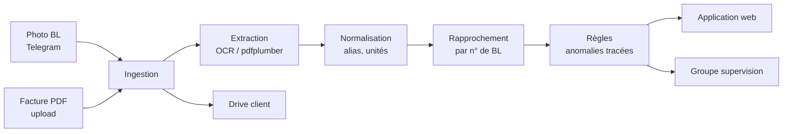
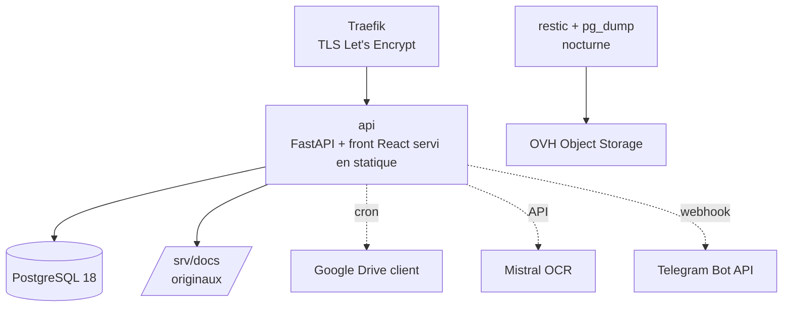

# Cahier des charges — Contrôle BL & factures fournisseurs (Habitat & Rénovation)

2026-09-16 · @u_wecs_ekc8KlthQHEnBdf4g

## 1. Contexte et objectifs

Habitat & Rénovation (Toulouse, Montauban, Albi, Carcassonne) reçoit chaque mois des dizaines de bons de livraison (BL) et bons d'enlèvement fournisseurs, puis des factures mensuelles qui les regroupent. Personne ne rapproche systématiquement ce qui a été reçu sur chantier de ce qui est facturé. La facture Unikalo d'août 2026 référence environ 25 BL pour 9 277 € TTC ; une partie porte la mention « retrait, pas de bon » et n'a jamais été remise au chantier.

**Objectif de la phase 1 :** un système qui collecte les BL à la réception, extrait leur contenu, les rapproche automatiquement des factures fournisseurs et signale, ligne par ligne et de façon explicable, ce qui doit être contesté ou vérifié.

**Résultats attendus pour le client :**

- Chaque facture fournisseur est contrôlée avant paiement, sans ressaisie.
- Toute quantité facturée non couverte par un BL reçu est signalée avec le document source.
- Les écarts de prix par rapport à l'historique du fournisseur sont signalés.
- Le responsable voit en temps réel qui a déposé quoi, sur quel chantier, et ce qui reste à traiter.
- Un bilan mensuel par chantier et par fournisseur est produit sans travail manuel.

**Principe non négociable :** l'IA extrait et normalise, elle ne décide pas. Tout contrôle financier est une règle déterministe, nommée, dont la justification est stockée et affichée.

## 2. Périmètre

La phase 1 couvre la chaîne complète pour **un fournisseur pilote (Nuances Unikalo)** et **un second fournisseur au format BL différent (Point.P)**, sur les quatre agences. Tout fournisseur supplémentaire au-delà de ces deux formats de facture est un lot séparé.

### Inclus en phase 1

| Brique | Contenu |
| --- | --- |
| Collecte | Dépôt des BL par photo via un groupe Telegram ; dépôt des factures PDF par upload dans l'application |
| Extraction | Factures PDF natives (texte) ; photos de BL via OCR |
| Normalisation | Fournisseurs, chantiers (alias), articles, unités et conditionnements |
| Rapprochement | Facture ↔ BL par numéro de BL ; lignes BL ↔ lignes facture |
| Contrôles | Catalogue de règles de la section 5 |
| Restitution | Application web (5 écrans), responsive, avec authentification et rôles |
| Notifications | Accusé de réception et alertes dans le groupe Telegram de supervision |
| Archivage | Copie automatique des documents dans le Google Drive du client (consultation) |
| Exploitation | Hébergement OVH, sauvegardes, supervision, mises à jour (prestation récurrente, section 9) |

### Hors périmètre phase 1 (avenant ou lot ultérieur)

- WhatsApp Business comme canal de dépôt.
- Tout fournisseur au-delà des deux formats pilotes (chaque nouveau format de facture = un parseur = un chiffrage).
- Assistant documentaire en langage naturel (RAG).
- Export vers un logiciel comptable.
- Authentification à deux facteurs, SSO.
- Gestion des devis, commandes ou stocks.
- Reconnaissance des mentions manuscrites (seul le texte imprimé est extrait).
- Toute fonctionnalité non listée dans ce document et dans le compte rendu du 14 septembre 2026.

## 3. Acteurs et rôles

Deux rôles applicatifs, pas plus. Un troisième sera ajouté quand un besoin réel l'exigera.

| Acteur | Rôle applicatif | Ce qu'il fait | Ce qu'il voit |
| --- | --- | --- | --- |
| Charly Bouchut et les personnes qu'il désigne | `admin` | Dépose les factures PDF, traite les anomalies, valide les alias chantier/article inconnus, gère les utilisateurs | Tout, toutes agences |
| Agents travaux, chefs de chantier | `agent` | Photographient les BL et les déposent dans le groupe Telegram, confirment la vérification physique des quantités | Les BL qu'ils ont déposés, les chantiers de leur agence, en lecture |
| Comptable (si distinct de l'admin) | `admin` | Dépose les factures, consulte le bilan mensuel | Tout |
| Prestataire (Ilane) | accès serveur | Déploiement, exploitation, support | Logs techniques ; pas de compte applicatif nominatif hors recette |

Chaque utilisateur applicatif est rattaché à une agence et, pour les agents, à un identifiant Telegram. Un dépôt Telegram provenant d'un identifiant non rattaché est ignoré et signalé dans le groupe de supervision.

## 4. Spécifications fonctionnelles



Chaque document traverse la chaîne dans cet ordre ; chaque étape écrit son résultat en base avec un statut, jamais en mémoire seulement.

### 4.1 Collecte des BL (Telegram)

- Un groupe Telegram « BL chantiers » réunit les agents et le bot. Le bot lit toutes les photos et fichiers image/PDF du groupe ; il ignore le texte et n'y répond jamais.
- À la réception d'une photo, le bot répond **en réponse au message** : numéro interne du document, et deux boutons « Quantités vérifiées » / « Écart constaté ». Le clic est horodaté et rattaché à l'utilisateur.
- Une photo envoyée en « fichier » (non compressée) est acceptée et préférée ; une photo compressée par Telegram est acceptée mais marquée comme telle.
- Plusieurs photos envoyées en rafale sont traitées comme autant de documents. L'admin peut fusionner deux documents (BL sur deux pages) depuis l'application.
- Un envoi par un identifiant Telegram non rattaché à un compte est ignoré et signalé dans le groupe de supervision.
- Chaque dépôt déclenche une ligne dans le groupe de supervision : numéro, fournisseur, chantier détectés, déposant, heure, statut.

### 4.2 Collecte des factures (application)

- L'admin dépose un PDF de facture ou d'avoir depuis l'écran Factures. Le fournisseur est détecté depuis le document ; en cas de doute, il est demandé.
- Un PDF déjà déposé (même fournisseur, même numéro de facture) est rejeté avec le lien vers l'original.
- Un PDF scanné (sans couche texte) est accepté mais passe par l'OCR et est marqué « confiance réduite ».

### 4.3 Extraction

- **Factures PDF natives :** extraction par lecture de la couche texte. Champs : numéro de facture, date, fournisseur, client, échéance ; par bloc : numéro de BL, date du BL, numéro de commande, chantier brut, commentaires ; par ligne : code article, désignation, quantité livrée, quantité totale, prix unitaire, prix conditionné, remise, montant HT, taux TVA. Les lignes d'éco-participation et les lignes négatives (avoirs) sont conservées et typées.
- **Photos de BL :** OCR par API. Champs : fournisseur, agence fournisseur, numéro de BL, date, chantier brut, référence commande, personne ayant enlevé, lignes (code, désignation, quantité, unité, prix unitaire, montant), totaux HT/TVA/TTC. Chaque champ porte un score de confiance.
- **Contrôle de cohérence interne :** somme des lignes = total HT du document, à 0,05 € près. Un échec place le document en « à vérifier » avec le champ suspect surligné.
- Un champ obligatoire absent ou sous le seuil de confiance place le document en « à vérifier ». L'admin corrige dans l'application ; la valeur corrigée est tracée avec l'auteur et l'heure, la valeur OCR d'origine est conservée.
- Aucune extraction n'est considérée fiable sur la base d'exemples propres : le taux d'erreur est mesuré à la recette sur au moins 30 BL réels (section 10).

### 4.4 Normalisation

- **Fournisseur :** identifié par SIRET ou numéro de TVA lu sur le document, sinon par correspondance sur le nom. Une agence fournisseur (Unikalo Toulouse Nord, Unikalo St Orens) est rattachée au même fournisseur.
- **Chantier :** le libellé brut du fournisseur (« ormeaux », « ORMEAUX (9944126862) », « PINS ») est résolu vers un chantier canonique via une table d'alias. Un alias inconnu crée une demande de validation ; l'admin le rattache à un chantier existant ou en crée un. Les codes chantier fournisseur ne sont jamais utilisés comme clé : ils changent d'une commande à l'autre.
- **Article :** clé (fournisseur, code article). Pour chaque article, l'unité de conditionnement (seau, sac, rouleau) et l'unité de facturation (kg, m, unité) avec le ratio. Exemple constaté : enduit vendu par seau de 25 kg, facturé au kg. Un article inconnu est créé automatiquement avec les unités lues ; le ratio est proposé à partir des quantités (4 seaux ↔ 100 kg) et validé par l'admin.
- Toute résolution est tracée : valeur brute, valeur canonique, méthode (exacte, alias, validation humaine), auteur.

### 4.5 Rapprochement

- **Facture ↔ BL :** chaque bloc « Concerne le B.L. n°… » d'une facture est rapproché du BL déposé portant le même numéro. Résultat par bloc : BL reçu / BL non reçu / BL reçu mais non déposé (mention « pas de bon »).
- **Lignes :** pour un bloc rapproché, chaque ligne facture est rapprochée d'une ligne BL par code article, puis par désignation normalisée si le code manque. Comparaison en unité de facturation après conversion.
- **Avoirs :** une ligne négative annule une ligne positive antérieure de même article et même chantier ; le rapprochement montre le solde net.
- **Bons d'enlèvement (Point.P) :** traités comme des BL.
- Un BL déposé mais absent de toute facture après 45 jours est signalé.

### 4.6 Restitution — application web

Cinq écrans. Aucun graphique en phase 1 ; des tableaux, des cartes, des filtres, des couleurs de statut.

| Écran | Contenu | Usage principal |
| --- | --- | --- |
| À traiter | BL en attente de validation, extractions à faible confiance, alias inconnus, anomalies ouvertes de gravité haute | Mobile |
| Factures | Liste des factures ; détail = blocs BL avec statut de rapprochement, lignes en écart, lien PDF et photo | Ordinateur |
| Anomalies | Liste filtrable (type, gravité, chantier, fournisseur, période) ; chaque ligne cite la règle, la justification chiffrée, le document source ; actions « traitée » / « ignorée » avec commentaire obligatoire | Mobile et ordinateur |
| Chantiers & fournisseurs | Référentiels, alias, dépôts par agent sur 30 jours, chantiers sans dépôt depuis plus de 7 jours | Ordinateur |
| Bilan | Navigation en trois niveaux reliés par le BL : chantier → fournisseurs de ce chantier → BL de ce fournisseur sur ce chantier → document source (photo ou bloc facture). À chaque niveau : facturé HT, rapproché, en écart, non justifié, nombre d'anomalies ouvertes. Filtre par mois, par agence ; vue inverse fournisseur → chantiers ; export CSV | Mobile et ordinateur |

- Authentification par email et mot de passe, session côté serveur, déconnexion automatique après 12 h d'inactivité.
- Responsive : les écrans À traiter, Anomalies et Bilan sont conçus pour téléphone d'abord. Sur téléphone, le Bilan se parcourt par cartes empilées (un chantier par carte, puis un fournisseur par carte, puis un BL par carte) avec les quatre montants et le nombre d'anomalies visibles sans défilement horizontal ; le tableau complet et l'export sont réservés à l'ordinateur. Les écrans Factures et Chantiers & fournisseurs restent lisibles sur téléphone avec défilement horizontal des tableaux.
- Depuis n'importe quel BL du Bilan, un tap ouvre la photo d'origine ou le bloc de facture correspondant, et un second tap la ou les anomalies rattachées.
- Toute action d'un utilisateur (validation, correction, traitement d'anomalie, création d'alias) est journalisée avec auteur et horodatage.

### 4.7 Archivage Drive

- Chaque document (photo originale, PDF) est copié dans le Google Drive du client sous `Fournisseurs/<fournisseur>/<AAAA-MM>/` avec un nom normalisé `<type>_<numero>_<chantier>.<ext>`.
- Le Drive est un espace de consultation : la source de vérité reste la base applicative. Une modification dans le Drive n'est jamais relue.
- La copie est asynchrone ; un échec est réessayé toutes les heures et signalé après 24 h.

## 5. Catalogue des règles de contrôle

Chaque règle est une fonction pure, nommée, testée unitairement, qui produit zéro ou une anomalie avec une justification chiffrée. Les seuils sont des paramètres modifiables par l'admin, avec valeur par défaut ci-dessous. Aucune règle n'appelle un modèle d'IA.

| Code | Règle | Déclenchement | Gravité | Justification produite |
| --- | --- | --- | --- | --- |
| R01 | BL facturé non reçu | Un bloc BL de la facture n'a aucun BL déposé de même numéro | Haute | N° BL, chantier, date, montant HT du bloc |
| R02 | BL facturé « pas de bon » | Le bloc porte une mention de retrait sans bon et aucun BL n'est déposé | Haute | Idem R01 + mention lue |
| R03 | Quantité facturée > quantité BL | Par ligne, après conversion d'unité, écart > 0 | Haute | Article, qté BL, qté facture, unité, écart |
| R04 | Quantité facturée < quantité BL | Écart négatif (fournisseur sous-facture ou livraison partielle) | Moyenne | Idem R03 |
| R05 | Ligne facturée absente du BL | Article facturé dans un bloc sans ligne correspondante sur le BL | Haute | Article, qté, montant |
| R06 | Ligne BL non facturée | Article sur le BL sans ligne dans le bloc facture, après 45 jours | Basse | Article, qté, date BL |
| R07 | Prix hors historique | PU HT d'un article s'écarte de plus de 5 % de la médiane des 6 derniers mois pour ce fournisseur | Moyenne | Article, PU facturé, médiane, nb d'occurrences, écart % |
| R08 | Prix hors historique fort | Écart > 15 % sur R07 | Haute | Idem R07 |
| R09 | Remise absente | Un article habituellement remisé (≥ 3 occurrences) est facturé sans remise | Moyenne | Article, remise habituelle, remise appliquée |
| R10 | Incohérence arithmétique facture | Somme des lignes ≠ total HT à plus de 0,05 € | Haute | Somme calculée, total lu, écart |
| R11 | Incohérence arithmétique BL | Idem sur le BL extrait | Moyenne (document « à vérifier ») | Idem R10 |
| R12 | Doublon de facturation | Même n° BL dans deux factures distinctes du même fournisseur | Haute | Les deux factures, le BL |
| R13 | Avoir sans origine | Ligne négative sans ligne positive antérieure de même article et chantier | Moyenne | Article, montant, chantiers cherchés |
| R14 | Chantier non résolu | Alias fournisseur inconnu après 48 h sans validation | Moyenne | Libellé brut, fournisseur |
| R15 | BL sans confirmation | BL déposé sans clic « quantités vérifiées » après 24 h | Basse | Déposant, heure de dépôt |
| R16 | Chantier silencieux | Chantier actif sans dépôt de BL depuis 7 jours alors que des factures y référencent des BL | Basse | Chantier, dernier dépôt, BL facturés depuis |
| R17 | Conditionnement inhabituel | Quantité livrée non multiple du conditionnement connu (ex : 2,5 seaux) | Moyenne | Article, qté, conditionnement |

**Semi-remorque :** toute livraison par semi-remorque est une anomalie de gravité haute, à confirmer par un admin. Le déclencheur n'est pas défini à ce stade (pas assez d'informations sur la façon dont ces livraisons apparaissent sur les documents) ; il sera précisé avec le client à partir de cas réels avant le lot Rapprochement.

**Cycle de vie d'une anomalie :** `ouverte` → `traitée` (avec commentaire) ou `ignorée` (avec commentaire). Une anomalie ignorée sur un couple (article, fournisseur) n'est pas régénérée sur les factures suivantes pour la même cause pendant 90 jours. Toute transition est journalisée.

**Ordre d'exécution :** R10 et R11 d'abord (cohérence du document) ; si elles échouent, le document reste en « à vérifier » et les règles de rapprochement ne s'exécutent pas tant que l'admin n'a pas corrigé. Puis R01–R02 et R12 (niveau bloc), puis R03–R09, R13, R17 (niveau ligne), puis R14–R16 (niveau suivi).

## 6. Modèle de données

PostgreSQL 18, migrations Alembic. Toutes les tables portent `created_at` ; les tables modifiables portent `updated_at` et `updated_by`. Aucune suppression physique de document : un statut `archive` remplace la suppression.

| Table | Colonnes principales | Rôle |
| --- | --- | --- |
| `utilisateur` | id, email, nom, mdp\_hash, role (admin/agent), agence, telegram\_user\_id, actif | Comptes applicatifs |
| `fournisseur` | id, nom, siret, tva, aliases\[\] | Référentiel fournisseurs |
| `agence_fournisseur` | id, fournisseur\_id, nom, adresse | Point de vente (Unikalo Nord, St Orens…) |
| `chantier` | id, nom\_canonique, agence, actif, ouvert\_le, ferme\_le | Référentiel chantiers du client |
| `chantier_alias` | fournisseur\_id, libelle\_brut, code\_brut, chantier\_id, valide\_par, valide\_le | Résolution des libellés fournisseurs |
| `article` | id, fournisseur\_id, code, libelle, unite\_cdt, unite\_fact, ratio, valide | Catalogue par fournisseur avec conversion d'unité |
| `document` | id, type (bl/enlevement/facture/avoir), fournisseur\_id, agence\_fournisseur\_id, numero, date\_doc, fichier\_path, drive\_url, source (telegram/upload), deposant\_id, telegram\_message\_id, confirme\_le, confirme\_par, statut, confiance\_min, ocr\_brut (jsonb) | Un document par fichier reçu |
| `bloc_facture` | id, facture\_id, numero\_bl, date\_bl, numero\_commande, chantier\_brut, chantier\_id, commentaire, bl\_document\_id (nullable), statut\_rapprochement | Un bloc « Concerne le B.L. » |
| `ligne` | id, document\_id, bloc\_id (nullable), article\_brut, code\_brut, article\_id, qte\_livree, qte\_totale, unite\_brut, qte\_fact (convertie), pu\_ht, pu\_cdt, remise\_pct, montant\_ht, tva, type\_ligne (article/eco/commentaire), ordre | Lignes de tous les documents |
| `rapprochement_ligne` | ligne\_facture\_id, ligne\_bl\_id, methode (code/libelle/manuel), ecart\_qte | Correspondance ligne à ligne |
| `anomalie` | id, regle, gravite, document\_id, bloc\_id, ligne\_id, detail (jsonb), statut, traitee\_par, traitee\_le, commentaire | Sortie des règles |
| `parametre` | cle, valeur, modifie\_par, modifie\_le | Seuils des règles |
| `journal` | id, utilisateur\_id, action, cible\_table, cible\_id, avant (jsonb), apres (jsonb), horodatage | Traçabilité de toute modification |
| `telegram_update` | update\_id, recu\_le | Dédoublonnage des webhooks |

**Invariants garantis en base :** unicité (fournisseur\_id, numero) sur `document` ; unicité (fournisseur\_id, libelle\_brut, code\_brut) sur `chantier_alias` ; unicité (fournisseur\_id, code) sur `article` ; `anomalie.detail` contient toujours les valeurs chiffrées ayant déclenché la règle.

## 7. Architecture technique

Monolithe modulaire : une application, un dépôt Git, un conteneur applicatif, un `docker compose up`. Les modules métier sont des paquets Python purs, testables sans base ni réseau.



### Stack

| Couche | Choix | Justification |
| --- | --- | --- |
| Hébergement | VPS OVH VPS-4 (8 vCores, 24 Go RAM, 200 Go NVMe, 19,96 € HT/mois), datacenter France, compte OVH au nom du client | Données chez le client, marge confortable pour l'OCR et le front sans montée en gamme, réversibilité immédiate |
| OS / conteneurs | Debian 12, Docker + Compose | Standard, sans surprise |
| Reverse proxy | Traefik | TLS automatique, seule porte d'entrée 80/443 |
| Back | Python 3.11, FastAPI, Uvicorn, `uv` | Stack maîtrisée, OpenAPI généré |
| Base | PostgreSQL 18, SQLAlchemy 2 async, asyncpg, Alembic | Transactions, jsonb pour l'OCR brut, migrations versionnées |
| Auth | `fastapi-users` en transport cookie, argon2, `slowapi` sur `/login` | Session serveur révocable, aucun token côté navigateur |
| Front | React 18, TypeScript, Vite, React Router, TanStack Query, Tailwind, types générés depuis l'OpenAPI de FastAPI | Décision client ; servi en statique par l'API, même origine, pas de CORS |
| Extraction PDF | `pdfplumber` | Factures natives : texte fiable sans OCR |
| OCR | Mistral OCR (API, hébergement France) | Qualité sur tableaux, coût de quelques centimes par page, sous-traitant européen |
| Messagerie | Telegram Bot API en webhook ; interface `messaging/base.py` avec une implémentation | Seule abstraction autorisée, pour la bascule WhatsApp ultérieure |
| Archivage | Google Drive API, compte de service ou OAuth du client | Consultation par les équipes dans l'outil qu'elles ont déjà |
| Sauvegardes | `pg_dump` (image postgres:18) + `restic` chiffré vers OVH Object Storage | Restauration testée, coût de quelques euros par mois |
| Supervision | `/health`, UptimeRobot, alertes dans le groupe Telegram de supervision | Zéro infrastructure de monitoring à opérer |
| Qualité | ruff, mypy, pytest, `pip-audit` au déploiement | Discipline gratuite |

### Arborescence

```
app/
  core/          config (fail-fast au démarrage), db, auth, middleware
  modules/
    ingest/      router, service d'orchestration, models, tests
    extract/     pdf.py, ocr.py, tests        ← pur, sans HTTP ni base
    normalize/   fournisseur, chantier, article, unites, tests  ← pur
    rules/       engine.py, rules/R01..R18.py, tests           ← pur
    api/         routers JSON consommés par le front
    messaging/   base.py, telegram.py, tests
    jobs/        drive_sync, bilan_mensuel, rappels
  main.py
web/             front React (build copié dans l'image api)
migrations/      alembic
deploy/          docker-compose.yml, traefik, backup.sh, deploy.sh
```

**Règles de frontière :** `extract`, `normalize`, `rules` n'importent ni FastAPI, ni SQLAlchemy, ni le front ; entrées et sorties en dataclasses. Aucun module métier n'importe un autre module métier : `ingest/service.py` est le seul point d'orchestration. Aucune règle métier dans le front : il affiche ce que l'API renvoie.

**Déploiement :** `deploy.sh` = `git pull`, build multi-stage (Node pour `web/dist`, Python pour l'API), `docker compose up -d`, `alembic upgrade head`. Rollback = `git checkout <tag précédent>` et relance. Chaque livraison est un tag Git.

**Explicitement absent :** n8n, Redis, file de messages, worker séparé, S3/MinIO, Neo4j, Keycloak, CI, environnement de staging, RAG. Chacun peut être ajouté sur devis si un besoin réel apparaît.

## 8. Sécurité et RGPD

Habitat & Rénovation est responsable de traitement ; le prestataire est sous-traitant au sens de l'article 28 du RGPD et signe un accord de sous-traitance. Aucune conformité n'est affirmée tant que le registre ci-dessous n'est pas validé par le client.

### Traitements et données

| Traitement | Données personnelles | Personnes concernées | Base légale | Conservation |
| --- | --- | --- | --- | --- |
| Collecte et rapprochement des BL et factures | Noms des agents (« enlevé par », déposant), identifiants Telegram, noms des contacts fournisseurs, signatures manuscrites sur les photos | Salariés du client, salariés des fournisseurs | Intérêt légitime (contrôle des achats) et obligation comptable | Documents : 10 ans (obligation comptable) ; journal applicatif : 3 ans |
| Comptes utilisateurs | Email, nom, agence, hash du mot de passe, journal des actions | Salariés du client | Exécution du contrat de travail / intérêt légitime | Durée du compte + 1 an |
| Notifications Telegram | Nom d'utilisateur Telegram, contenu des accusés | Salariés du client | Intérêt légitime | Selon Telegram ; le bot ne conserve que l'`update_id` |

### Sous-traitants ultérieurs

| Sous-traitant | Usage | Localisation | Ce qui transite |
| --- | --- | --- | --- |
| OVH | Hébergement VPS et Object Storage | France | Tout |
| Mistral AI | OCR des photos de BL | France (UE) | Image du BL, donc noms et signatures ; pas de conservation côté Mistral au-delà du traitement selon leurs conditions API, à vérifier contractuellement |
| Telegram | Transport des photos et notifications | Hors UE (serveurs distribués) | Photos des BL, identifiants des agents. Point de vigilance à documenter ; la bascule WhatsApp Business ne l'améliore pas (Meta, États-Unis) |
| Google | Archivage Drive | UE selon paramétrage du Workspace client | Documents |

### Mesures

- Chiffrement en transit (TLS) partout ; chiffrement au repos des sauvegardes (restic) ; disque VPS chiffré si l'offre OVH le permet.
- Accès serveur par clé SSH uniquement, nominatif, révocable. Accès applicatif par rôle. Journal des actions conservé 3 ans.
- Minimisation : le bot ne lit que les images du groupe, jamais le texte. Les mentions manuscrites ne sont pas extraites.
- Droits des personnes : l'admin peut exporter ou anonymiser les données rattachées à un utilisateur (nom remplacé par un identifiant). Les documents comptables restent conservés, conformément à l'obligation légale.
- Suppression : à la fin de la relation, remise complète des données (dépôt Git, export de la base, documents originaux) puis effacement du VPS et des sauvegardes sous 30 jours, attesté par écrit.
- Aucune donnée du client n'est utilisée hors de sa mission ; les jeux de test sont effacés des environnements du prestataire à la livraison.

**À produire par le client avant la mise en production :** information des salariés (mention dans le règlement intérieur ou note interne) et inscription du traitement à son registre.

## 9. Exploitation

Le système tourne en continu ; son exploitation est une prestation récurrente distincte de la construction, chiffrée séparément.

| Domaine | Engagement phase 1 | Fréquence |
| --- | --- | --- |
| Sécurisation initiale | SSH par clé, root désactivé, ufw 22/80/443, fail2ban, unattended-upgrades, avant tout dépôt de donnée | Une fois, avant mise en production |
| Sauvegardes | `pg_dump` + `restic` chiffré vers OVH Object Storage ; rétention 30 quotidiennes, 12 mensuelles | Nocturne |
| Test de restauration | Restauration complète sur un VPS jetable, résultat consigné | Avant mise en production, puis trimestriel |
| Supervision | `/health` (API + base), UptimeRobot toutes les 5 min, alerte dans le groupe Telegram de supervision ; erreurs applicatives postées dans le même groupe | Continu |
| Mises à jour | OS automatiques ; images Docker et dépendances Python revues et déployées | Mensuel, ou sous 72 h pour une faille critique |
| Certificats | Renouvellement automatique Let's Encrypt via Traefik | Automatique, vérifié dans la supervision |
| Déploiement | `deploy.sh` depuis un tag Git ; rollback documenté | À chaque livraison |
| Journaux | Sortie JSON des conteneurs, rotation 14 jours | Continu |
| Support | Réponse sous 1 jour ouvré ; correction d'un blocage de production sous 2 jours ouvrés | Heures ouvrées |

**Indisponibilité acceptée :** le service n'est pas critique en temps réel. Une panne de quelques heures retarde un dépôt, elle ne le perd pas : Telegram conserve les messages et le bot les traite au redémarrage grâce au dédoublonnage. Aucune haute disponibilité n'est prévue en phase 1.

**Capacité :** dimensionné pour 500 documents et 20 factures par mois. Le VPS-4 absorbe dix fois ce volume sans changement.

## 10. Critères d'acceptation et recette

La recette se fait sur **deux mois de documents réels** (août et septembre 2026), pour les deux fournisseurs pilotes, avec Charly Bouchut ou une personne désignée. Les critères sont regroupés par lot fonctionnel ; un critère non atteint bloque la réception du lot concerné, pas le projet entier.

| Lot | Critère | Mesure |
| --- | --- | --- |
| Socle | Le VPS est sécurisé, une restauration complète a été exécutée et consignée, `/health` est supervisé | Rapport de restauration |
| Socle | Une facture Unikalo PDF déposée produit la liste exacte de ses blocs BL (numéro, date, chantier brut, montant) | 100 % des blocs sur les factures d'août et septembre |
| Collecte | Une photo déposée dans le groupe Telegram est stockée, accusée en réponse, visible dans l'application sous 60 s | 20 dépôts consécutifs sans perte |
| Collecte | Un dépôt par un identifiant non rattaché est ignoré et signalé | Test manuel |
| Extraction | Sur 30 photos de BL réelles minimum, dont au moins 10 dégradées (froissées, mal cadrées, annotées) : numéro de BL, fournisseur, date et chantier brut corrects | ≥ 95 % des documents pour ces 4 champs |
| Extraction | Lignes (code, quantité) correctes | ≥ 90 % des lignes ; toute ligne fausse dont la confiance était haute est analysée et documentée |
| Extraction | Aucune erreur silencieuse : tout document dont la somme des lignes ne correspond pas au total est en « à vérifier » | 100 % |
| Rapprochement | Chaque bloc BL des factures de recette est classé reçu / non reçu / pas de bon, sans faux positif | 100 % vérifié à la main |
| Rapprochement | Les conversions d'unité connues (seau ↔ kg, rouleau ↔ m) donnent une comparaison exacte | 0 anomalie R03/R04 due à une unité |
| Règles | Chaque anomalie affichée cite sa règle, sa justification chiffrée et son document source | Revue de 30 anomalies tirées au hasard |
| Règles | Chaque règle a au moins un test unitaire positif et un négatif | Rapport pytest |
| Règles | Toute livraison semi-remorque des factures de recette a produit une anomalie restée ouverte jusqu'à confirmation admin, selon le déclencheur défini avec le client | 100 % |
| Application | Les 5 écrans sont utilisables sur téléphone et ordinateur ; login, rôles et journal fonctionnent | Parcours de recette signé |
| Application | Sur téléphone, le Bilan permet d'aller d'un chantier à un BL puis à sa photo en trois taps | Parcours de recette signé |
| Application | Le bilan d'août correspond aux totaux des factures | Écart nul |
| Drive | Chaque document de la recette est présent dans le Drive au bon emplacement | 100 % |
| Livraison | Documentation d'exploitation, dépôt Git remis, formation de 2 h dispensée | Procès-verbal de réception |

**Ce qui ne constitue pas un motif de refus :** une erreur OCR sur un champ non obligatoire dont la confiance était basse et qui a été placé en « à vérifier » ; un alias chantier inconnu en attente de validation ; une anomalie légitime que le client juge non pertinente (elle se traite par « ignorée »).

## 11. Ordre de construction et livrables

Six lots, construits dans cet ordre, chacun réceptionné sur les critères de la section 10 avant de passer au suivant. Aucune date n'est fixée à ce stade : le rythme réel sera mesuré sur le premier lot, puis les dates seront posées par écrit avec le client. Chaque lot se termine par quelque chose que le client voit tourner.

| Ordre | Lot | Contenu | Ce que le client voit à la fin du lot |
| --- | --- | --- | --- |
| 1 | Socle | VPS-4 sécurisé, compose, Postgres, Alembic, sauvegardes testées, `pdfplumber` sur les factures Unikalo, bot Telegram en réception | Liste des BL facturés en août et septembre avec « photo reçue oui/non » |
| 2 | Collecte | Groupe Telegram, boutons de confirmation, notifications supervision, whitelist, API `/factures` et `/documents`, login, premier écran React (Factures) | Dépôt d'un BL depuis le terrain, visible dans l'application |
| 3 | Extraction | OCR des BL, contrôle de cohérence, écran À traiter avec correction, normalisation fournisseur/chantier/article avec validation des alias, parseur Point.P | Rapport du taux d'erreur OCR sur 30 BL réels |
| 4 | Rapprochement | Rapprochement bloc et ligne, avoirs, conversion d'unités, règles R01–R17, écran Anomalies | Anomalies réelles sur les factures d'août et septembre, chacune justifiée |
| 5 | Restitution | Écrans Chantiers & fournisseurs et Bilan (navigation chantier → fournisseur → BL → document, version mobile en cartes), export CSV, sync Drive, journal, paramétrage des seuils | Bilan d'août reconstitué, consultable sur téléphone |
| 6 | Livraison | Recette sur deux mois de documents, corrections, documentation, formation 2 h, remise du dépôt | Procès-verbal de réception |

### Livrables

- Code source complet dans un dépôt Git remis au client, taggé par jalon.
- `docker-compose.yml`, scripts de déploiement, de sauvegarde et de restauration.
- Documentation d'exploitation : installation depuis zéro, restauration, rotation des secrets, ajout d'utilisateur, ajout de fournisseur.
- Guide utilisateur d'une page pour les agents (déposer un BL) et de quatre pages pour l'admin.
- Rapport de recette OCR (échantillon, taux par champ, cas d'échec analysés).
- Catalogue des règles avec leurs paramètres et leurs tests.
- Registre des traitements pré-rempli (section 8) pour intégration au registre du client.

### Rythme

Un point de 30 minutes par semaine avec Charly Bouchut, sur ce qui tourne. Les demandes formulées en point hebdomadaire sont notées ; celles hors périmètre sont chiffrées séparément avant tout développement. Les dates de chaque lot sont fixées par écrit à la fin du lot précédent.

## 12. Ce que le client doit fournir

Chaque élément ci-dessous conditionne un lot. Sans lui, le lot ne démarre pas ; le retard n'est pas imputable au prestataire.

| Prérequis | Pour quel lot | Responsable |
| --- | --- | --- |
| Compte OVH au nom d'Habitat & Rénovation, VPS-4 (8 vCores, 24 Go, 200 Go NVMe) commandé, prestataire ajouté en contact technique | Socle | Charly Bouchut |
| Factures PDF Unikalo et Point.P d'août et septembre 2026 (originaux fournisseurs, pas des scans) | Socle | Comptabilité |
| Liste des utilisateurs (nom, email, agence, rôle, identifiant Telegram) | Collecte | Charly Bouchut |
| Au moins 30 photos de BL réels prises par les agents sur le terrain, dont des cas dégradés, avec pour chacune le chantier réel | Extraction | Agents travaux, coordonné par Charly Bouchut |
| Liste des chantiers actifs avec leur agence et, si possible, les libellés utilisés par chaque fournisseur | Extraction | Charly Bouchut |
| Seuils métier : tolérance de prix, délais de facturation habituels par fournisseur, et description de la façon dont une livraison semi-remorque apparaît sur les documents | Rapprochement | Charly Bouchut |
| Accès Google Drive : dossier cible et compte autorisé | Restitution | Charly Bouchut |
| Validation du registre des traitements et information des salariés | Livraison | Direction |
| Disponibilité pour la recette : une demi-journée par lot | Tous | Charly Bouchut ou personne désignée |

## 13. Risques, hypothèses, dette assumée

### Risques

| Risque | Probabilité | Impact | Parade |
| --- | --- | --- | --- |
| OCR insuffisant sur les BL annotés à la main (signature et « pas de bon » barrant le tableau) | Élevée | Lignes fusionnées ou perdues | Contrôle de cohérence somme/total, mise en « à vérifier », correction dans l'application ; taux mesuré à J3 avant tout engagement sur le rapprochement ligne à ligne |
| Agents qui n'envoient pas les BL | Élevée | Le rapprochement ne voit rien | R01/R02 rendent l'absence visible ; règle R16 ; rapport de dépôts par agent ; c'est un sujet de management, pas de logiciel |
| Format de facture différent chez Point.P ou changement de format Unikalo | Moyenne | Parseur à réécrire | Un parseur par fournisseur, testé sur ses fixtures ; un changement de format est une évolution facturée |
| Libellés chantier incohérents chez les fournisseurs | Certaine | Alias à valider en continu | Table d'alias avec validation humaine ; charge décroissante après le premier mois |
| Telegram hors UE | Certaine | Point de vigilance RGPD | Documenté au registre ; le bot ne conserve rien du canal au-delà de l'image |
| Disponibilité de Charly Bouchut pour la recette | Moyenne | Lots décalés | Demi-journée bloquée par lot, dès la signature |
| Demandes hors périmètre en cours de projet | Élevée | Dérive de charge | Toute demande hors sections 2 et 4 est chiffrée avant développement |

### Hypothèses

- Les factures fournisseurs sont disponibles en PDF natif, jamais uniquement en papier.
- Chaque BL porte un numéro imprimé unique par fournisseur, repris tel quel sur la facture.
- Le volume reste sous 500 documents par mois en phase 1.
- Les agents disposent d'un smartphone avec Telegram.

### Dette assumée

Listée pour ne pas être découverte plus tard. Aucune n'est traitée en phase 1 ; chacune est une évolution possible, sur devis.

- Pas d'environnement de staging ni d'intégration continue : les tests tournent en local avant chaque déploiement.
- Pas de haute disponibilité ; une panne se résout par restauration.
- Pas de rotation automatique des secrets.
- Pas de 2FA ; mot de passe seul, avec limitation de tentatives.
- Pas de fusion automatique des BL multi-pages ; fusion manuelle par l'admin.
- Pas d'extraction des mentions manuscrites.
- Interface en français uniquement.
- Un seul client par instance ; pas de multi-tenant.
