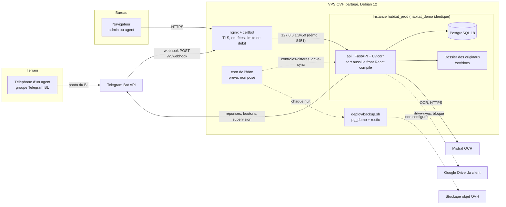

# Contrôle BL & factures : documentation technique d'ensemble

Document technique de référence du projet réalisé pour Habitat & Rénovation.
Il s'adresse à un lecteur technique qui découvre le projet (futur mainteneur,
prestataire du client) et à Ilane, le développeur.

- **État décrit** : 24/09/2026, commit `a085948` de `main`. Les deux instances
  en service ont été déployées le 23/09/2026.
- **Ce qui fait foi** : le cahier des charges, `docs/cahier-des-charges.md`
  (CDC). Ce document le résume, puis décrit ce qui a été construit, comment
  c'est hébergé et pourquoi.
- **Ce qui n'est pas ici** : les procédures pas à pas, qui restent dans
  `docs/` et `deploy/` (index au §11).
- **Données** : aucun secret, aucune donnée client réelle (montant, nom,
  numéro de document), aucune adresse IP. Les variables d'environnement sont
  citées par leur **nom** seulement.

## Sommaire

1. [Le projet en bref](#1-le-projet-en-bref)
2. [La demande de base du client](#2-la-demande-de-base-du-client)
3. [Vue d'ensemble technique](#3-vue-densemble-technique)
4. [Architecture applicative](#4-architecture-applicative)
5. [Infrastructure](#5-infrastructure)
6. [Services externes](#6-services-externes)
7. [Sécurité et données](#7-sécurité-et-données)
8. [Les choix d'infrastructure et pourquoi](#8-les-choix-dinfrastructure-et-pourquoi)
9. [Exploiter au quotidien](#9-exploiter-au-quotidien)
10. [Limites connues et prochaines étapes](#10-limites-connues-et-prochaines-étapes)
11. [Où trouver quoi](#11-où-trouver-quoi)

---

## 1. Le projet en bref

| | |
| --- | --- |
| **Client** | Habitat & Rénovation, quatre agences : Toulouse, Montauban, Albi, Carcassonne. |
| **Problème** | Chaque mois arrivent des dizaines de bons de livraison (BL) et de bons d'enlèvement, puis des factures fournisseurs mensuelles qui les regroupent. Personne ne compare systématiquement ce qui a été reçu sur le chantier avec ce qui est facturé. Une partie des BL facturés porte la mention « retrait, pas de bon » et n'a jamais été remise au chantier. |
| **Ce que fait l'outil** | Les agents photographient leurs BL dans un groupe Telegram et l'admin dépose les factures PDF dans l'application. L'outil lit les documents (OCR Mistral), les normalise et rapproche chaque BL facturé du BL reçu, par son numéro. Il applique ensuite des règles de contrôle déterministes et affiche ce qu'il faut contester ou vérifier, avec une justification chiffrée. |
| **Principe non négociable** | L'IA extrait et normalise, elle ne décide jamais. Chaque signalement vient d'une règle nommée (R01 à R17), testée, dont le détail est stocké et affiché. |
| **Utilisateurs** | *admin* (le responsable, les personnes qu'il désigne, le comptable) : voit tout, dépose les factures, traite les problèmes. *agent* (agents travaux, chefs de chantier) : dépose ses BL par Telegram et consulte ses propres dépôts. Le prestataire a un accès serveur, sans compte applicatif. |
| **Fournisseurs** | Nuances Unikalo (pilote) et Point.P. Seules les factures Unikalo sont lues aujourd'hui (§10). |
| **Forme technique** | Une application web FastAPI + React dans un seul conteneur, une base PostgreSQL et un dossier des originaux. Deux instances (production et démonstration) tournent sur un VPS OVH. |

### État au 24/09/2026

| Étape | État |
| --- | --- |
| Lot 1 Socle, lot 2 Collecte | Fusionnés dans `main` le 17/09/2026. |
| Lot 3 Extraction | Fusionné dans `main`. Bloqué côté données : 4 photos réelles de BL sur les 30 exigées, aucun document Point.P. |
| Lot 4 Rapprochement | Fusionné le 18/09/2026 : rapprochement, règles R01 à R17. |
| Lot 5 Restitution | Fusionné le 20/09/2026 : bilan, exports CSV, référentiels, journal, réglages, synchronisation Drive. |
| Refonte du front | 23/09/2026 : les 14 écrans techniques sont remplacés par 5 écrans lisibles par un dirigeant non technique. Fusionnée dans `main`. |
| Déploiement | 23/09/2026 : production (https://habitat.ellumena.fr, données réelles) et démonstration (https://demo.habitat.ellumena.fr, données fictives), schéma à la migration `0010`. |
| Qualité | Derniers contrôles consignés (sur `eeb93a4`, `docs/refonte-front-recette.md` §4) : 1 610 tests, ruff, mypy strict, typecheck et build du front, tous verts. |
| Lot 6 Livraison | Non commencé : recette sur deux mois, documentation d'exploitation, formation, remise du dépôt. |
| Validation client | Aucune. Les verdicts d'août, les montants du Bilan et les parcours n'ont pas été confirmés par un utilisateur réel. |

---

## 2. La demande de base du client

Synthèse du CDC du 16/09/2026. En cas d'écart entre ce résumé et le CDC,
le CDC fait foi.

### 2.1 Objectifs (CDC §1)

Objectif de la phase 1 : collecter les BL dès leur réception, en extraire le
contenu, les rapprocher automatiquement des factures fournisseurs et signaler,
ligne par ligne et de façon explicable, ce qui doit être contesté ou vérifié.

Résultats attendus :

- chaque facture fournisseur est contrôlée avant paiement, sans ressaisie ;
- toute quantité facturée non couverte par un BL reçu est signalée, avec le
  document source ;
- les écarts de prix par rapport à l'historique du fournisseur sont signalés ;
- le responsable voit en temps réel qui a déposé quoi, sur quel chantier, et ce
  qui reste à traiter ;
- un bilan mensuel par chantier et par fournisseur est produit sans travail
  manuel.

### 2.2 Périmètre (CDC §2)

| Inclus en phase 1 | Hors périmètre (avenant ou lot ultérieur) |
| --- | --- |
| Collecte des BL par photo dans un groupe Telegram, des factures PDF par upload | WhatsApp Business comme canal de dépôt |
| Extraction des factures PDF natives, OCR des photos de BL | Tout fournisseur au-delà des deux formats pilotes (un format de facture = un parseur = un chiffrage) |
| Normalisation : fournisseurs, chantiers (alias), articles, unités et conditionnements | Assistant documentaire en langage naturel (RAG) |
| Rapprochement facture ↔ BL par numéro de BL, puis ligne à ligne | Export vers un logiciel comptable |
| Catalogue de règles de contrôle (§2.5) | Double authentification, SSO |
| Application web de 5 écrans, responsive, avec rôles | Devis, commandes, stocks |
| Notifications dans le groupe Telegram de supervision | Mentions manuscrites |
| Copie des documents dans le Google Drive du client | Toute fonctionnalité absente du CDC et du compte rendu du 14/09/2026 |
| Exploitation : hébergement OVH, sauvegardes, supervision, mises à jour | |

### 2.3 Acteurs et rôles (CDC §3)

Deux rôles applicatifs seulement :

| Acteur | Rôle | Ce qu'il fait | Ce qu'il voit (CDC) |
| --- | --- | --- | --- |
| Responsable client et personnes désignées | `admin` | Dépose les factures, traite les anomalies, valide les alias, gère les utilisateurs | Tout, toutes agences |
| Comptable | `admin` | Dépose les factures, consulte le bilan | Tout |
| Agents travaux, chefs de chantier | `agent` | Photographient les BL dans le groupe Telegram, confirment les quantités | Leurs BL et les chantiers de leur agence, en lecture |
| Prestataire | accès serveur | Déploiement, exploitation, support | Journaux techniques ; aucun compte applicatif nominatif hors recette |

Chaque utilisateur est rattaché à une agence et, pour un agent, à un
identifiant Telegram. Un dépôt venant d'un identifiant non rattaché est ignoré
et signalé dans le groupe de supervision.

### 2.4 Fonctionnalités attendues (CDC §4) et réalisation

La chaîne demandée : photo Telegram ou PDF uploadé → ingestion → extraction
→ normalisation → rapprochement par numéro de BL → règles → application web
et groupe de supervision. Chaque document est aussi copié vers le Drive.
Chaque étape écrit son résultat en base avec un statut, jamais seulement en
mémoire.

| Brique | Ce que demande le CDC | Ce qui est construit |
| --- | --- | --- |
| Collecte Telegram | Le bot lit les photos et fichiers du groupe et ignore le texte. Il répond avec un numéro interne et deux boutons horodatés (« Quantités vérifiées », « Écart constaté »). Photo envoyée en fichier préférée, photo compressée acceptée mais marquée. Une ligne par dépôt dans le groupe de supervision. | Fait. Parcours validé de bout en bout le 23/09/2026. La fusion de deux documents par l'admin n'existe pas (§10). |
| Collecte des factures | Upload par l'admin, détection du fournisseur, doublon (même fournisseur, même numéro) rejeté avec un lien vers l'original, scan accepté via l'OCR et marqué « confiance réduite ». | Fait pour Unikalo : l'OCR est la voie normale, car la seule facture fournie est un scan. Point.P n'est pas lu. |
| Extraction | Champs de facture et de BL avec une confiance par champ. Somme des lignes = total HT à 0,05 € près, sinon « à vérifier ». Correction tracée, valeur OCR d'origine conservée. Taux d'erreur mesuré sur au moins 30 BL réels. | Fait, sauf la mesure : 4 photos réelles seulement. |
| Normalisation | Fournisseur par SIRET ou TVA, sinon par le nom. Chantier par table d'alias validée par l'admin (le code chantier du fournisseur n'est jamais une clé). Article par (fournisseur, code), avec unités et ratio validés par l'admin. | Fait. |
| Rapprochement | Chaque bloc de facture est comparé au BL de même numéro : reçu, non reçu ou « pas de bon ». Lignes appariées par code puis par désignation, comparées en unité de facturation. Avoirs en solde net. Bons d'enlèvement Point.P traités comme des BL. BL non facturé signalé après 45 jours. | Fait (pour le délai de 45 jours, voir R06 au §2.5). Le document d'avoir complet n'est pas géré, seules les lignes négatives le sont (R13). |
| Restitution | 5 écrans (À traiter, Factures, Anomalies, Chantiers & fournisseurs, Bilan), sans graphique. Connexion par e-mail et mot de passe, session serveur, déconnexion après 12 h d'inactivité. Téléphone d'abord pour À traiter, Anomalies et Bilan. Bilan chantier → fournisseur → BL → document, export CSV. Toute action journalisée avec son auteur. | Fait, puis refondu le 23/09/2026 en 5 autres écrans (§2.9). |
| Archivage Drive | Copie sous `Fournisseurs/<fournisseur>/<AAAA-MM>/`, nom `<type>_<numero>_<chantier>.<ext>`. Drive en consultation seule, la base reste la source de vérité. Copie asynchrone, réessayée toutes les heures, signalée après 24 h d'échec. | Code fait et testé avec un double local. Bloqué en réel (§6.3). |

### 2.5 Règles de contrôle (CDC §5) et état actuel

Chaque règle est une fonction pure, nommée, testée, sans IA. Ses seuils sont
modifiables par l'admin. Deux moments d'évaluation :

- **au rapprochement** d'une facture, à chaque dépôt ou rejeu ;
- **en contrôle différé**, par la commande `controles-differes`, prévue en
  tâche planifiée quotidienne mais **pas encore planifiée** (§5.8). Sans
  cette tâche, ces règles ne tournent que si quelqu'un lance la commande à la
  main.

| Règle | Ce qu'elle signale (CDC) | Gravité | Libellé à l'écran | Évaluée | État au 24/09/2026 |
| --- | --- | --- | --- | --- | --- |
| R01 | BL facturé non reçu | Haute | Bon de livraison jamais reçu | Rapprochement | Active |
| R02 | Bloc « pas de bon » | Haute | Livré sans bon | Rapprochement | Active, gardée par décision du 24/09/2026 |
| R03 | Quantité facturée supérieure au BL | Haute | Facturé plus que livré | Rapprochement | Active |
| R04 | Quantité facturée inférieure au BL | Moyenne | Facturé moins que livré | Rapprochement | Active |
| R05 | Ligne facturée absente du BL | Haute | Facturé mais absent du bon | Rapprochement | Active |
| R06 | Ligne de BL non facturée après 45 jours | Basse | Livré mais pas facturé | Contrôle différé | Désactivation décidée le 24/09/2026 (voir encadré). Tâche planifiée non posée. |
| R07 | Prix à plus de 5 % de la médiane sur 6 mois | Moyenne | Prix un peu plus cher | Rapprochement | Désactivation décidée le 24/09/2026 (voir encadré). Jamais exercée sur plus d'un mois de données. |
| R08 | Même écart, au-delà de 15 % | Haute | Prix plus cher que d'habitude | Rapprochement | Idem R07 |
| R09 | Remise habituelle absente | Moyenne | Remise habituelle oubliée | Rapprochement | Idem R07 |
| R10 | Incohérence arithmétique de la facture | Haute | Erreur de calcul sur la facture | Rapprochement | Active |
| R11 | Incohérence arithmétique du BL | Moyenne | Erreur de calcul sur le bon | Rapprochement | Active |
| R12 | Doublon de facturation | Haute | Bon facturé deux fois | Rapprochement | Active |
| R13 | Avoir sans origine | Moyenne | Avoir sans achat d'origine | Rapprochement | Active |
| R14 | Chantier non résolu après 48 h | Moyenne | Chantier à rattacher | Contrôle différé | Tâche planifiée non posée |
| R15 | BL sans confirmation après 24 h | Basse | Quantités non confirmées par l'équipe | Contrôle différé | Tâche planifiée non posée |
| R16 | Chantier silencieux depuis 7 jours | Basse | Chantier sans bon déposé récemment | Contrôle différé | Tâche planifiée non posée |
| R17 | Conditionnement inhabituel | Moyenne | Quantité inhabituelle pour le conditionnement | Rapprochement | Active |
| (R18) | Livraison par semi-remorque, à confirmer par un admin | Haute | — | — | **Non construite** : le client n'a défini aucun déclencheur. |

> **Décision d'Ilane du 24/09/2026, pas encore livrée.** Les contrôles de prix
> R07, R08 et R09 et la règle R06 sont désactivés côté serveur. On ne peut les
> réactiver que par une variable d'environnement, `CONTROLE_PRIX_ACTIF`, sans
> interrupteur à l'écran. R02 est gardée, sans fusion avec R01. Les autres
> règles restent actives.
> Motifs : il n'y a qu'un mois de factures, donc le « prix habituel » ne
> repose sur rien ; rien ne prouve que le cas R06 existe. Le but est de ne
> montrer en démonstration que ce qu'on peut prouver.
> **Au commit `a085948`, cette variable n'existe pas encore dans le code** et
> les deux instances déployées évaluent toujours R06 à R09. Mettre ce tableau
> à jour quand la décision sera livrée et déployée.

**Seuils modifiables** (écran Réglages, chaque modification est journalisée) :

| Clé | Défaut | Utilisée par |
| --- | --- | --- |
| `tolerance_total_ht` | 0,05 € | Cohérence somme des lignes / total (R10, R11, « à vérifier ») |
| `seuil_prix_pct` | 5 % | R07 |
| `seuil_prix_fort_pct` | 15 % | R08 |
| `occurrences_prix_min` | 3 | R07 à R09 : aucune anomalie de prix sous 3 occurrences |
| `delai_ligne_bl_non_facturee_j` | 45 j | R06 |
| `delai_alias_non_resolu_h` | 48 h | R14 |
| `delai_confirmation_bl_h` | 24 h | R15 |
| `delai_chantier_silencieux_j` | 7 j | R16 |
| `duree_ignorance_j` | 90 j | Une anomalie ignorée n'est pas régénérée pendant cette durée |

Le seuil de confiance OCR (`seuil_confiance_ocr`, 0,80 par défaut) est lu dans
la même table mais n'est **pas** modifiable depuis l'écran.

**Cycle de vie d'une anomalie** : ouverte → traitée ou ignorée, avec un
commentaire obligatoire. Une anomalie ouverte dont la cause disparaît est
supprimée au rejeu (entrée de journal `anomalie_levee`). Une anomalie traitée
ou ignorée n'est jamais modifiée par un rejeu.

### 2.6 Critères d'acceptation (CDC §10) et situation

La recette est prévue sur **deux mois réels** (août et septembre 2026), pour
les deux fournisseurs. Un critère non atteint bloque la réception du lot
concerné, pas le projet entier.

| Lot | Critère (résumé) | Situation au 24/09/2026 |
| --- | --- | --- |
| Socle | VPS sécurisé, restauration complète exécutée et consignée, `/health` supervisé | Pare-feu, fail2ban et mises à jour automatiques actifs sur le VPS partagé. Restauration prouvée seulement en local (17/09/2026). Pas de supervision externe. |
| Socle | Une facture Unikalo produit la liste exacte de ses blocs BL | Blocs extraits de la seule facture fournie (août). Pas de facture de septembre. |
| Collecte | 20 dépôts Telegram consécutifs sans perte, visibles sous 60 s | Parcours validé de bout en bout le 23/09/2026. Série de 20 dépôts non consignée. |
| Collecte | Dépôt d'un identifiant non rattaché ignoré et signalé | Implémenté et couvert par les tests automatisés ; test manuel de recette non consigné. |
| Extraction | 4 champs justes à au moins 95 % sur 30 photos réelles, dont 10 dégradées | **Non mesuré** : 4 photos disponibles (numéro 100 %, fournisseur 50 %, date 75 %, chantier 75 %), échantillon 6 à 7 fois trop petit. |
| Extraction | Au moins 90 % des lignes justes | **Non mesuré** : 66,7 % sur les 4 photos. |
| Extraction | Aucune erreur silencieuse | Zéro erreur silencieuse sur les 4 photos ; tout écart somme/total passe « à vérifier ». |
| Rapprochement | Chaque bloc classé reçu / non reçu / pas de bon, sans faux positif | Calculé sur août (28 blocs : 3 reçus, 4 « pas de bon », 21 non reçus). **Non vérifié par le client.** |
| Rapprochement | Conversions d'unité exactes | Implémentées. Si une seule des deux lignes a une unité connue, aucune comparaison n'est faite, pour éviter de faux R03/R04. |
| Règles | Chaque anomalie cite sa règle, sa justification chiffrée, son document | Garanti par construction : le détail n'est jamais vide, une contrainte en base le vérifie. Revue de 30 anomalies non faite. |
| Règles | Un test positif et un test négatif par règle | Fait : un fichier de test par règle. |
| Règles | Livraison semi-remorque signalée | Non construite (pas de déclencheur). |
| Application | 5 écrans, login, rôles, journal ; Bilan en trois taps sur téléphone ; bilan d'août égal aux factures | Construit puis refondu. Parcours de recette non signé, bilan d'août non confirmé. |
| Drive | Chaque document au bon emplacement | Bloqué (§6.3). |
| Livraison | Documentation d'exploitation, dépôt remis, formation de 2 h | Lot 6 non commencé. |

### 2.7 Lots (CDC §11)

| Ordre | Lot | Contenu prévu | État |
| --- | --- | --- | --- |
| 1 | Socle | VPS sécurisé, compose, Postgres, Alembic, sauvegardes testées, lecture des factures Unikalo, bot en réception | Fait (sur le VPS partagé, factures lues par OCR) |
| 2 | Collecte | Groupe Telegram, boutons, supervision, liste blanche, API, login, premier écran | Fait |
| 3 | Extraction | OCR des BL, cohérence, écran de correction, normalisation, parseur Point.P | Fait sauf le parseur Point.P et la mesure OCR |
| 4 | Rapprochement | Blocs et lignes, avoirs, unités, R01 à R17, écran Anomalies | Fait |
| 5 | Restitution | Référentiels, Bilan, CSV, Drive, journal, seuils | Fait (Drive bloqué en réel) |
| 6 | Livraison | Recette sur deux mois, documentation, formation, remise du dépôt taggé | Non commencé |

Livrables attendus (CDC §11) : dépôt Git remis au client et taggé par jalon,
compose et scripts, documentation d'exploitation, guides utilisateur, rapport
OCR, catalogue des règles, registre des traitements pré-rempli.

### 2.8 Ce que le client doit fournir (CDC §12)

| Élément | Pour | Situation connue |
| --- | --- | --- |
| Compte OVH au nom du client et VPS-4 dédié | Socle | Non : l'application tourne sur le VPS du prestataire (§5.1) |
| Factures PDF natives Unikalo et Point.P d'août et de septembre | Socle | Une seule facture Unikalo (août), scannée ; aucune facture Point.P |
| Liste des utilisateurs avec leurs identifiants Telegram | Collecte | Non consignée dans les documents du dépôt |
| Au moins 30 photos de BL réelles, dont des cas dégradés | Extraction | 4 photos, envoyées compressées (à renvoyer « en tant que fichier ») |
| Liste des chantiers avec leur agence | Extraction | Chantiers à renseigner ; alias d'août à valider |
| Seuils métier et description d'une livraison semi-remorque | Rapprochement | Seuils par défaut du CDC ; semi-remorque non décrite |
| Accès Google Drive | Restitution | Fourni, mais sur un Drive personnel, ce qui bloque l'écriture (§6.3) |
| Validation du registre des traitements, information des salariés | Livraison | Non faite |

### 2.9 Ce qui a évolué depuis le cahier des charges

**Ajouts hors cahier des charges**, décidés par Ilane :

| Date | Ajout | Où |
| --- | --- | --- |
| 23/09/2026 | Refonte complète du front pour un dirigeant non technique, sur ordinateur et téléphone, avant la démonstration du 26/09/2026. Cinq écrans : Vue d'ensemble, À régler, Chantiers, Fournisseurs, Documents, plus une page BL, Réglages et Journal. Aucun code de règle ni jargon technique à l'écran ; les anciennes URL redirigent. | `docs/refonte-front-recette.md`, `docs/superpowers/specs/2026-09-23-refonte-front-design.md` |
| 23/09/2026 | Quatre routes serveur pour la refonte : `/api/tableau-de-bord`, téléchargement nommé d'un document, `/api/documents/{id}/comparaison`, `/api/a-regler/compte`. Une table serveur unique, `CATEGORIES_REGLE`, classe les règles. | `docs/refonte-front-recette.md` §1.4 |
| 23/09/2026 | Client du chantier : colonne `chantier.client` en texte libre (migration `0010`), sans référentiel. | `docs/dette.md` |
| 23/09/2026 | Export CSV détaillé, ligne par ligne de facture, sur toute la période (`GET /api/bilan/detail.csv`), en plus de l'export du niveau affiché. | `docs/dette.md` |

**Décisions d'Ilane** (hors dépôt jusqu'ici, consignées ici) :

| Date | Décision |
| --- | --- |
| 23/09/2026 | Les quatre montants du Bilan (facturé HT, rapproché, en écart, non justifié) sont gardés tels que définis au lot 5 (L5-D3). Ils ne forment pas une partition. |
| 23/09/2026 | Le journal reste réservé aux admins. |
| 23/09/2026 | Le classement d'août sera revu avec le client pendant la démonstration. |
| 23/09/2026 | L'agence reste un texte libre sur le chantier ; les chantiers restent à renseigner. |
| 23/09/2026 | La démonstration se fait sur le VPS actuel, derrière nginx (écart au CDC §7 et §12, voir §5). |
| 23/09/2026 | Mistral passe en paiement à l'usage (§6.1). |
| 23/09/2026 | Fournisseur d'authentification : fastapi-users reste en place. Clerk et Better Auth ont été évoqués ; la décision est en attente (§7). |
| 24/09/2026 | R07, R08, R09 et R06 désactivées côté serveur, réactivables par `CONTROLE_PRIX_ACTIF` ; R02 gardée. Pas encore livré (§2.5). |

**Écarts de réalisation** par rapport au CDC :

| Écart | Raison |
| --- | --- |
| Factures lues par l'OCR Mistral puis par un parseur propre au fournisseur (`extract/unikalo.py`), et non par `pdfplumber` | La seule facture fournie est un scan de 9 pages sans couche texte. `pdfplumber` ne figure même pas dans les dépendances. |
| Parseur de facture Point.P absent | Aucun document Point.P disponible ; on ne construit pas sur une hypothèse de format. |
| R18 (semi-remorque) absente | Aucun déclencheur défini par le client. |
| Hébergement sur le VPS partagé du prestataire, derrière nginx, et non sur un VPS-4 dédié au nom du client derrière Traefik | Démonstration du 26/09/2026 décidée sur le VPS actuel ; nginx y occupe déjà les ports 80 et 443. |
| L'agent ne voit que ses propres dépôts (écran Documents), pas les chantiers de son agence | Refonte centrée sur le dirigeant ; les agents sont supposés passer par Telegram (hypothèse non confirmée). |
| Pas de `deploy/deploy.sh`, pas de tag Git, pas d'UptimeRobot, pas de `pip-audit` | Non réalisés à ce jour (§10). |
| Tâches `bilan_mensuel` et `rappels` du CDC absentes | Le bilan est calculé à la demande ; aucune tâche de rappel séparée n'existe, les retards sont signalés par les règles de suivi R14 à R16. |

**Proposition à présenter au client (hors CDC)** : importer les chantiers en
masse depuis un fichier Excel (nom, agence, client). Aujourd'hui, un chantier
se crée au fil de l'eau depuis « Chantier à rattacher » ou par un import
ponctuel.

---

## 3. Vue d'ensemble technique



Les traits pleins fonctionnent aujourd'hui ; les pointillés sont prévus mais
pas en service (§5.7, §5.8, §6.3).

**Parcours d'un BL (photo Telegram)**

1. L'agent poste une photo dans le groupe BL. Telegram appelle
   `POST /tg/webhook`, qui vérifie le secret, le groupe, le dédoublonnage et la
   liste blanche, puis répond 200 tout de suite.
2. En tâche de fond, dans le même processus : téléchargement du fichier,
   écriture atomique dans le dossier des originaux, insertion du document
   (statut `recu`), puis OCR Mistral avec annotation structurée.
3. Extraction et normalisation : fournisseur, numéro, date, chantier, lignes,
   articles. Toute incohérence passe le document « à vérifier » avec des
   motifs.
4. Une ligne part dans le canal de supervision et une réponse dans le groupe :
   « Reçu — document n° N » avec les deux boutons de confirmation.
5. Si un numéro de BL a été lu, les factures qui le citent sont rapprochées de
   nouveau.

**Parcours d'une facture (PDF)**

1. L'admin dépose le PDF (`POST /api/factures`, 20 Mo au plus). Le traitement
   est synchrone, OCR compris (jusqu'à 90 s).
2. OCR Mistral, puis le parseur Unikalo lit les blocs « Concerne le B.L. » et
   leurs lignes. Doublon (même fournisseur, même numéro) : réponse 409 avec
   l'identifiant de l'original.
3. Insertion de la facture, des blocs et des lignes en une transaction, puis
   rapprochement : chaque bloc est comparé au BL de même numéro, les lignes
   sont appariées et converties en unité de facturation, le moteur de règles
   produit les anomalies.

---

## 4. Architecture applicative

### 4.1 Monolithe modulaire

Une application, un dépôt, un conteneur applicatif. Les modules métier sont
des paquets Python.

```
app/
  main.py      point d'entrée FastAPI (config lue à l'import : fail-fast)
  cli.py       commandes d'exploitation (python -m app.cli …)
  core/        config, db, auth, contrôle d'origine, service du front, fuseau
  modules/
    ingest/    SEUL ORCHESTRATEUR : webhook, dépôts, extraction, rapprochement,
               anomalies, bilan, exports, référentiels, journal, modèles SQL
    extract/   PUR : lecture OCR, BL, parseur Unikalo, confiance, vérification
    normalize/ PUR : fournisseur, chantier, article, unités, appariement
    rules/     PUR : engine.py, rules/R01.py … R17.py
    api/       routeurs JSON consommés par le front
    messaging/ base.py (interface Messagerie), telegram.py
    jobs/      drive.py (client Drive), drive_sync.py
web/           front React + TypeScript (Vite)
migrations/    Alembic, 0001 à 0010
deploy/        compose, surcouches, vhost nginx, sauvegarde et restauration
docs/          CDC, plans, recettes, passations, dette, guides d'exploitation
infra/         ce document
```

| Module | Rôle | Dépend de |
| --- | --- | --- |
| `app/core` | Configuration (pydantic-settings, refus de démarrer si une variable manque), moteur SQLAlchemy async, authentification, contrôle d'origine, service des fichiers du front | `ingest.models` (`auth.py` : utilisateurs, sessions, journal ; décision L2-D4) |
| `ingest` | Orchestre tout : reçoit, stocke, appelle l'OCR, `extract`, `normalize` et `rules`, écrit en base, calcule le bilan et les exports | tous les modules, `core` |
| `extract` | Transforme une réponse OCR en dataclasses (BL, facture Unikalo), calcule les confiances, vérifie la cohérence | bibliothèque standard |
| `normalize` | Résout fournisseur, chantier, article et unités ; apparie les lignes | bibliothèque standard |
| `rules` | Évalue R01 à R17 sur des dataclasses gelées et renvoie des anomalies | bibliothèque standard |
| `api` | Valide, appelle `ingest`, sérialise. Aucune règle métier. | `ingest`, `core` |
| `jobs` | Synchronisation Drive (commande CLI) | `ingest`, `core` |
| `messaging` | Interface `Messagerie` et son implémentation Telegram | httpx ; aucun autre module |

### 4.2 Règles de frontière et leur test

- `extract`, `normalize` et `rules` n'importent ni FastAPI, ni Starlette, ni
  SQLAlchemy, ni httpx, ni asyncpg. Entrées et sorties en dataclasses ; leurs
  tests tournent sans base ni réseau.
- Aucun module métier n'importe un autre module métier, sauf `ingest`, le seul
  orchestrateur. `api` et `jobs` n'importent que `ingest` et `app.core`
  (décision L2-D3).
- Aucune règle métier dans les routeurs ni dans le front.

`tests/test_frontieres.py` vérifie ces règles par analyse statique des imports
(`ast`), avec des tests positifs sur le vrai code et négatifs sur des sources
synthétiques : une violation fait échouer la suite. Limite : seul
`app/modules` est contrôlé ; `app/cli.py`, `app/main.py` et `app/core`
échappent à la garde.

### 4.3 Modèle de données

PostgreSQL 18, SQLAlchemy 2 async et asyncpg. Les 14 tables du CDC, plus
`jeton_session` :

| Table | Contenu |
| --- | --- |
| `utilisateur` | Comptes : e-mail, nom, rôle (`admin` ou `agent`), agence, identifiant Telegram, mot de passe haché, actif |
| `fournisseur`, `agence_fournisseur` | Référentiel fournisseurs (nom, SIRET, TVA, alias) et leurs agences |
| `chantier`, `chantier_alias` | Chantiers (nom, agence et client en texte libre) et libellés fournisseurs en attente ou validés |
| `article` | Article par (fournisseur, code), unités de conditionnement et de facturation, ratio, validé ou non |
| `document` | BL, bon d'enlèvement, facture ou avoir : source, statut, numéro interne lisible, extraction OCR conservée, motifs « à vérifier », état de synchronisation Drive |
| `bloc_facture` | Blocs « Concerne le B.L. » d'une facture et leur statut de rapprochement |
| `ligne` | Lignes des documents (article, éco-participation ou commentaire) |
| `rapprochement_ligne` | Appariement ligne de BL ↔ ligne de facture (par code, libellé ou manuel) |
| `anomalie` | Règle, gravité, statut, détail chiffré, rattachements |
| `parametre` | Seuils modifiables |
| `journal` | Journal des actions, en ajout seul |
| `telegram_update` | Identifiants des updates Telegram déjà vus (dédoublonnage), en ajout seul |
| `jeton_session` | Sessions de connexion côté serveur |

Conventions : clés UUID générées par la base ; montants en `numeric` lus en
`Decimal`, sans précision imposée ; listes fermées en `text` avec un `CHECK`
nommé plutôt qu'en `ENUM` ; horodatages en UTC, affichés en heure de Paris ;
aucune suppression physique (un statut `archive` la remplace) ni suppression en
cascade. Contraintes clés : un document unique par (fournisseur, numéro), un
article unique par (fournisseur, code), un alias unique par (fournisseur,
libellé, code) en `NULLS NOT DISTINCT`, une anomalie unique par (règle,
document, bloc, ligne, chantier, alias) en `NULLS NOT DISTINCT`.

### 4.4 Migrations

Alembic en mode async, chaîne linéaire. L'URL vient de la configuration de
l'application (fichier d'environnement), jamais d'`alembic.ini`.

| Révision | Objet |
| --- | --- |
| 0001 | Schéma initial (14 tables) |
| 0002 | `jeton_session` |
| 0003 | Numéro interne, photo compressée, total HT du document |
| 0004 | Ordre des blocs de facture |
| 0005 | Colonnes d'extraction du document, confiance des lignes |
| 0006 | Anomalies : article et index unique d'identité |
| 0007 | Anomalies : chantier et alias dans l'identité |
| 0008 | Migration de données (rattachement des anciennes anomalies à leur bloc) |
| 0009 | État de synchronisation Drive |
| 0010 | `chantier.client` (ajout hors CDC du 23/09/2026) |

Aucune migration n'est lancée au démarrage du conteneur : on les applique à la
main, API arrêtée (§9). Les migrations ne sont pas conçues pour tourner
pendant que l'ancien code sert des requêtes, et une migration descendante peut
supprimer des données : pas de `alembic downgrade` automatique.

### 4.5 Moteur de règles

- **Contrat** : chaque règle `Rxx` est une fonction pure qui reçoit des
  dataclasses gelées et renvoie `Anomalie | None`. Le champ `detail` contient
  toutes les valeurs qui ont déclenché la règle ; il n'est jamais vide
  (contrainte `CHECK` en base).
- **Ordre de `evaluer_facture`** :
  1. R10 (arithmétique de la facture) ; si elle se déclenche, c'est la seule
     anomalie renvoyée.
  2. Pour chaque bloc : R11, puis R01, R02 et R12.
  3. R03 ou R04, puis R05 et R17, seulement si le BL est reçu et si R11 ne
     s'est pas déclenchée.
  4. R07 ou R08, et R09 (prix).
  5. R13, une fois par facture.
- **`evaluer_suivi`** (R06, R14, R15, R16) est un point d'entrée séparé, appelé
  par la commande `controles-differes`.
- **Synchronisation en base** : insertion ou mise à jour par clé d'identité. Une
  anomalie traitée ou ignorée n'est jamais touchée ; une anomalie ouverte qui
  n'est plus produite est supprimée ; une anomalie ignorée n'est pas recréée
  pendant `duree_ignorance_j`.
- **Rapprochement** : idempotent, il recalcule tout. Il est déclenché au dépôt
  d'une facture, après l'extraction ou la validation d'un BL, et par la
  commande `rapprocher`. Il ne fait jamais échouer l'action qui l'appelle.
- **Historique de prix** : médiane des 6 mois précédents, aucune anomalie sous
  3 occurrences.

### 4.6 API par domaine

46 opérations (schéma complet : `web/openapi.json`). Droits : `admin_requis`
sur presque tout ; un agent ne voit que les documents qu'il a déposés, en
lecture.

| Domaine | Routes | Droits |
| --- | --- | --- |
| Hors `/api` | `POST /tg/webhook` (secret Telegram), `GET /health` | public |
| Authentification | `POST /api/auth/login`, `POST /api/auth/logout`, `GET /api/moi` | tous |
| Documents | `GET /api/documents`, `GET /api/documents/{id}`, `GET /api/documents/{id}/fichier` | admin et agent (agent : ses dépôts) |
| Documents, correction | `GET …/comparaison`, `PATCH /api/documents/{id}`, `PUT …/lignes`, `POST …/validation`, `…/archivage`, `…/extraction` | admin |
| Factures | `GET` et `POST /api/factures`, `GET /api/factures/{id}`, `GET …/fichier` | admin |
| À régler | `GET /api/a-traiter`, `GET /api/a-regler/compte`, `GET /api/anomalies`, `POST /api/anomalies/{id}/traitement` | admin |
| Référentiels | `GET` et `POST /api/chantiers`, `PUT /api/chantiers/{id}`, `GET /api/fournisseurs`, validation d'un alias ou d'un article, `GET /api/referentiels/{depots-par-agent, chantiers-silencieux, agences}` | admin |
| Bilan | `GET /api/bilan/chantiers…` et `GET /api/bilan/fournisseurs…` (trois niveaux, chacun avec sa variante `.csv`), `GET /api/bilan/detail.csv` | admin |
| Vue d'ensemble | `GET /api/tableau-de-bord` | admin |
| Journal, réglages | `GET /api/journal`, `GET /api/parametres`, `PUT /api/parametres/{cle}` | admin |

Les agrégats du Bilan et du tableau de bord sont calculés dans `ingest`, à la
demande, sans cache ni table d'agrégat. Les exports CSV sont produits côté
serveur au format Excel français (BOM, séparateur `;`, virgule décimale).

### 4.7 Front

- **Stack** : React 18, TypeScript strict, Vite, React Router 7, TanStack
  Query 5, Tailwind 3 (`theme.extend`). Polices auto-hébergées avec
  `@fontsource`, parce que la CSP interdit Google Fonts.
- **Écrans** : Vue d'ensemble (`/`), À régler (`/a-regler`), Chantiers,
  Fournisseurs, Documents, page BL (`/bl/:id`), Journal, Réglages, Connexion.
  Barre de navigation basse sur téléphone. Un agent n'a que Documents. Les
  anciennes URL (`/a-traiter`, `/anomalies`, `/bilan…`, `/factures…`)
  redirigent.
- **Aucune logique métier** : le front affiche ce que l'API renvoie. Un seul
  module, `web/src/ui/libelles.ts`, traduit les codes de règle en libellés
  lisibles.
- **Types générés** : `npm run api:schema` exporte le schéma OpenAPI de FastAPI
  vers `web/openapi.json` (sans serveur, mais avec un `.env` complet), puis
  `npm run api:types` génère `web/src/api/schema.d.ts` avec
  openapi-typescript. Les deux fichiers sont commités. Les appels passent par
  un petit helper `fetch` typé.
- **Session** : cookie seulement, `credentials: same-origin`, ni
  `localStorage` ni `sessionStorage`. Un 401 renvoie vers `/connexion`.
- **Service** : le build est copié dans l'image et servi par FastAPI (`/assets`
  en statique, `index.html` pour les autres routes GET), sur la même origine
  que l'API.
- **Développement** : le proxy Vite envoie `/api` vers `127.0.0.1:8450` et
  réécrit l'en-tête `Origin` pour passer le contrôle d'origine. Attention : sur
  ce VPS, `8450` est le port de la **production** (§10).

### 4.8 Commandes CLI

Lancées dans le conteneur `api` : `python -m app.cli <commande>`.

| Commande | Rôle |
| --- | --- |
| `utilisateur-creer --email --nom --role {admin,agent} --agence [--telegram-id]` | Crée un compte ; mot de passe saisi deux fois, sans écho (12 caractères au moins). Seul moyen de créer un compte. |
| `utilisateur-desactiver --email` | Désactive un compte ; l'accès est coupé dès la requête suivante |
| `fournisseur-definir --nom [--siret] [--tva] [--alias …] [--agence …]` | Crée ou met à jour un fournisseur (jamais créé automatiquement depuis l'OCR) |
| `rapprocher --facture <uuid>` ou `--tout` | Rejoue le rapprochement |
| `controles-differes` | Évalue R06, R14, R15, R16 ; idempotente, prévue chaque jour |
| `drive-sync [--limite 1..1000]` | Copie vers le Drive les documents en attente (100 par défaut) ; sortie 0, 1 (au moins un échec) ou 2 (configuration Drive absente ou invalide) |
| `bl-non-recus <facture.pdf>` | Liste les BL d'une facture avec l'indicateur « photo reçue », en lecture seule |
| `rapport-ocr <dossier> --sortie <md> [--seuil] [--appeler-ocr]` | Mesure le taux d'erreur OCR sur des photos annotées (`docs/protocole-mesure-ocr.md`) |

### 4.9 Qualité et tests

| Outil | Réglage |
| --- | --- |
| Python | 3.11 épinglé, `uv` en mode non-paquet |
| ruff | Familles E, F, W, I, B, UP, SIM, RUF, ASYNC et S (sécurité) ; exceptions ciblées et commentées dans les tests |
| mypy | Strict sur `app/` et `tests/` |
| pytest | Tests à côté du code (`app/modules/<module>/tests/`) et transverses dans `tests/`. 1 610 tests, dont 701 marqués `db`. Un `ResourceWarning` fait échouer un test. |
| Base de test | `TEST_DATABASE_URL` (base vidée par `TRUNCATE` après chaque test) et une base `<nom>_migrations` dérivée automatiquement pour l'aller-retour des migrations ; les deux sont créées si besoin. Sans Postgres, le test **échoue**, il n'est jamais ignoré. |
| Fixtures réelles | Documents du client dans `tests/fixtures/`, exclus de git ; les tests qui en dépendent sont ignorés sur un clone neuf (8 appels `pytest.skip`) |
| Front | Pas de tests unitaires front : des tests de contrat pytest (`tests/test_web_*.py`) lisent les sources, plus `tsc --noEmit` et `vite build` |
| Hook pre-commit | ruff, format, mypy, **toute la suite pytest** (environ 7 min), refus des fixtures et de `.env` ; typecheck et build du front si `web/` change. Il tient lieu d'intégration continue (le CDC n'en prévoit pas). |

Méthode : une tâche = un commit, message en français préfixé du module ; tests
avant ou avec le code ; relecture indépendante de chaque tâche, puis revue
finale de la branche avant fusion. Pièges : un seul processus pytest à la fois
par base de test ; ne jamais lancer `pre-commit install` depuis un arbre de
travail secondaire (les hooks sont partagés).

---

## 5. Infrastructure

### 5.1 Serveur

| | Cible du CDC (§7, §12) | Réel au 24/09/2026 |
| --- | --- | --- |
| Machine | VPS OVH VPS-4 dédié : 8 vCores, 24 Go de RAM, 200 Go NVMe | VPS OVH **partagé** avec d'autres applications du prestataire : 4 vCPU, environ 8 Go de RAM, 74 Go de disque |
| Titulaire | Compte OVH au nom du client | Compte du prestataire |
| Système | Debian 12, Docker Compose | Debian 12, Docker 29, Docker Compose v5 |
| Frontal HTTPS | Traefik (Let's Encrypt) | nginx de l'hôte + certbot |
| Durcissement | SSH par clé, root désactivé, ufw 22/80/443, fail2ban, mises à jour automatiques | ufw (22, 80, 443, plus un port de supervision réservé à un réseau Docker interne), fail2ban et unattended-upgrades actifs ; configuration SSH non vérifiée pour ce document |

Au 24/09/2026, le disque était occupé à environ 71 % et la mémoire disponible
était faible (swap très sollicité). Les conteneurs n'ont pas de limite
mémoire. La base de développement et de tests (`habitat_reno-postgres-1`,
`127.0.0.1:5450`) tourne en permanence sur la même machine.

### 5.2 Instances

Une instance = un projet Docker Compose + un fichier d'environnement. Même
code, mêmes procédures ; chaque instance a sa base, son volume et son dossier
de documents.

| | Production | Démonstration |
| --- | --- | --- |
| Projet compose | `habitat_prod` | `habitat_demo` |
| Fichier d'environnement | `.env.prod` (non versionné, mode 600) | `.env.demo` (non versionné, mode 600) |
| Port local de l'API | `127.0.0.1:8450` | `127.0.0.1:8451` |
| Domaine | https://habitat.ellumena.fr | https://demo.habitat.ellumena.fr |
| Base | volume `habitat_prod_postgres-data` (PostgreSQL non publié) | volume `habitat_demo_postgres-data` (non publié) |
| Dossier des documents | `/home/debian/habitat-data/prod/docs` → `/srv/docs` | `/home/debian/habitat-data/demo/docs` → `/srv/docs` |
| Données | Réelles | Fictives, produites par un script hors dépôt (`/home/debian/habitat-data/demo/seed_demo.py`) qui passe par les vrais services et le vrai moteur de règles |
| Webhook Telegram | Fonctionnel (recette du 23/09/2026) | Fonctionnel (recette du 23/09/2026) |
| Drive | Variables vides | Variables renseignées, mais Drive bloqué (§6.3) |

Les deux instances ont été construites depuis l'arbre de travail
`/home/debian/habitat_reno`. Les dossiers de documents appartiennent à l'uid
10001, celui de l'image.

### 5.3 Docker Compose et surcouches

| Fichier | Rôle |
| --- | --- |
| `deploy/docker-compose.yml` | Stack de base prévue par le CDC : `traefik` (v3.6, Let's Encrypt, seul à publier 80 et 443), `api` (image construite depuis le dépôt, `restart: unless-stopped`, healthcheck sur `/health`), `postgres` (image `postgres:18`, healthcheck `pg_isready`, aucun port publié). Toute variable obligatoire manquante arrête la commande (`${VAR:?…}`). |
| `deploy/docker-compose.vps.yml` | Surcouche du VPS partagé : met `traefik` dans un profil jamais activé et publie l'API sur `127.0.0.1:${API_HOST_PORT}` seulement. |
| `deploy/docker-compose.dev.yml` | Surcouche de développement : PostgreSQL sur `127.0.0.1:5450` et API sur `127.0.0.1:8450`. |

Dans le conteneur, Compose reconstruit `DATABASE_URL` vers l'hôte `postgres`
du réseau Compose. `DOMAIN` et `ACME_EMAIL` restent exigés par l'interpolation
même quand Traefik ne démarre pas.

### 5.4 nginx et TLS

Le virtual host est versionné dans `deploy/nginx/habitat.conf` ; la copie
installée dans `/etc/nginx/sites-available/habitat` lui est identique.

- Une `map $host` envoie `habitat.ellumena.fr` vers `127.0.0.1:8450` et
  `demo.habitat.ellumena.fr` vers `127.0.0.1:8451`.
- `listen 443 ssl http2` ; le port 80 redirige en 301 vers HTTPS.
- Un seul certificat Let's Encrypt (`--cert-name habitat.ellumena.fr`) couvre
  les deux noms. Il est renouvelé par le timer certbot, avec rechargement de
  nginx par un hook de déploiement.
- En-têtes repris des labels Traefik : CSP, `nosniff`, `X-Frame-Options DENY`,
  `Referrer-Policy same-origin`, HSTS d'un an (§7).
- `client_max_body_size 25m` (l'application limite un document à 20 Mio),
  `limit_req zone=general burst=40 nodelay` (zone globale du VPS à 10 r/s),
  `proxy_read_timeout 120s`.
- nginx transmet `Host`, `X-Forwarded-Proto` et `X-Forwarded-For` fixé à
  `$remote_addr`. Uvicorn tourne avec `--proxy-headers
  --forwarded-allow-ips=*`, ce qui donne à slowapi l'adresse réelle du client.

### 5.5 Image Docker

Construction en deux étages (`Dockerfile`) :

1. `node:24-alpine` : `npm ci`, puis `npm run build` du front.
2. `python:3.11-slim` : `uv` 0.11.16, `uv sync --frozen --no-dev`, copie de
   `app/`, `alembic.ini`, `migrations/` et du front compilé dans `web/dist`.

L'image tourne sous l'utilisateur non root `appuser` (uid 10001, sans shell) et
lance `uvicorn app.main:app --host 0.0.0.0 --port 8000 --proxy-headers
--forwarded-allow-ips=*` en un seul processus. Ni Node ni npm ne restent dans
l'image servie. Le `Dockerfile` ne copie que des chemins explicites : aucun
fichier `.env` ni `tests/` n'y entre.

### 5.6 Variables d'environnement (noms seulement)

Modèle commenté : `.env.example`. Aucune valeur ne doit apparaître dans un
commit, un journal ou un ticket.

| Variable | Statut | Lue par | Rôle |
| --- | --- | --- | --- |
| `DOMAIN` | Obligatoire | Compose | Domaine servi (routage Traefik) ; exigée même avec la surcouche VPS |
| `ACME_EMAIL` | Obligatoire | Compose | Adresse Let's Encrypt de Traefik ; même remarque |
| `API_HOST_PORT` | Obligatoire avec la surcouche VPS | Compose | Port local de l'API (8450 ou 8451). Absente de `.env.example`. |
| `POSTGRES_USER`, `POSTGRES_PASSWORD`, `POSTGRES_DB` | Obligatoires | Compose, scripts de sauvegarde | Base de l'instance ; `DATABASE_URL` du conteneur en est reconstruite |
| `DOCS_HOST_DIR` | Obligatoire | Compose, scripts de sauvegarde | Dossier des originaux côté hôte, monté sur `/srv/docs` |
| `DATABASE_URL` | Obligatoire pour l'application | Application | Hors conteneur (développement) ; remplacée par Compose dans le conteneur |
| `DOCS_DIR` | Obligatoire pour l'application | Application | Fixée à `/srv/docs` par Compose |
| `TELEGRAM_BOT_TOKEN` | Obligatoire | Application | Jeton du bot |
| `TELEGRAM_WEBHOOK_SECRET` | Obligatoire | Application | Secret vérifié dans l'en-tête `X-Telegram-Bot-Api-Secret-Token` |
| `TELEGRAM_CHAT_BL_ID` | Obligatoire | Application | Seul groupe dont les dépôts sont traités |
| `TELEGRAM_CHAT_SUPERVISION_ID` | Obligatoire | Application | Canal des notifications de supervision |
| `MISTRAL_API_KEY` | Obligatoire | Application | Clé de l'API Mistral OCR |
| `COOKIE_SECURE` | Obligatoire | Application | Attribut `Secure` du cookie de session (`true` sur les deux instances) |
| `GOOGLE_DRIVE_SERVICE_ACCOUNT_JSON`, `GOOGLE_DRIVE_FOLDER_ID` | Optionnelles | Commande `drive-sync` | Compte de service et dossier racine du Drive ; l'API démarre sans |
| `RESTIC_REPOSITORY`, `RESTIC_PASSWORD` | Obligatoires pour les scripts de sauvegarde | `deploy/backup.sh`, `deploy/restore.sh` | Dépôt restic et son mot de passe. **Absentes de `.env.prod` et `.env.demo`.** |
| `AWS_ACCESS_KEY_ID`, `AWS_SECRET_ACCESS_KEY` | Seulement pour un dépôt restic distant | Scripts de sauvegarde | Accès au stockage objet |
| `TEST_DATABASE_URL` | Tests seulement | `tests/conftest.py` | Base de test |
| `CONTROLE_PRIX_ACTIF` | Prévue (décision du 24/09/2026) | — | Réactivation de R06 à R09 ; **absente du code au commit `a085948`** |

Les paramètres des scripts de `deploy/` se passent à l'appel, pas dans le
fichier : `HABITAT_RENO_ENV_FILE` (fichier d'environnement, `.env` par défaut),
`COMPOSE_PROJECT_NAME` (projet, `habitat_reno` par défaut) et
`COMPOSE_OVERRIDE_FILE` (surcouche, pour `restore.sh`).

Les secrets de l'application sont typés `SecretStr` : ils n'apparaissent ni
dans une représentation d'objet ni dans un message d'erreur.

### 5.7 Sauvegardes et restauration

**Conception** (lot 1, `deploy/RESTAURATION.md`) :

- `deploy/backup.sh` lance un `pg_dump -Fc` dans un conteneur `postgres:18`
  jetable, puis `restic backup` (image `restic/restic:0.19.1`) du dump et du
  dossier des originaux, avec le tag `nocturne`. Il applique enfin la
  rétention : 30 sauvegardes quotidiennes, 12 mensuelles.
- Rien n'est installé sur l'hôte ; les secrets passent aux conteneurs sans
  apparaître sur la ligne de commande. Cible prévue : stockage objet OVH (S3),
  chiffré par restic.
- `deploy/restore.sh <snapshot> --confirmer` exige un snapshot précis
  (`latest` est refusé). Il vérifie tout avant d'agir, arrête l'API, recrée la
  base avec `pg_restore`, bascule les documents par renommage (l'ancien
  contenu est gardé dans `.avant-restauration-<horodatage>`), redémarre l'API
  et attend `/health`.
- `deploy/test-restauration.sh` fait un aller-retour complet sur un projet
  isolé avec un dépôt restic jetable. Dernière réussite consignée : 17/09/2026.

**Réalité au 24/09/2026** :

| Point | État |
| --- | --- |
| Dépôt restic pour la production ou la démonstration | **Aucun** : pas initialisé, variables `RESTIC_*` et `AWS_*` absentes des fichiers d'instance |
| Sauvegarde nocturne | **Non planifiée** |
| Seules copies existantes | Deux `pg_dump -Fc` manuels du 23/09/2026 (avant la migration `0010`) dans `/home/debian/sauvegardes-habitat/`, sur le même disque, **sans les originaux** |
| Restauration vers ou depuis un stockage distant | Jamais exercée |
| Test trimestriel de restauration (CDC §9) | Non organisé |

Pièges :

- les scripts visent par défaut `.env` et le projet `habitat_reno`, c'est-à-dire
  l'environnement de développement. Pour une instance, il faut passer
  `HABITAT_RENO_ENV_FILE`, `COMPOSE_PROJECT_NAME` et, pour la restauration,
  `COMPOSE_OVERRIDE_FILE=deploy/docker-compose.vps.yml` (§9) ;
- `test-restauration.sh` utilise le port `127.0.0.1:8451`, pris par la
  démonstration : il ne peut pas tourner tant qu'elle est en service ;
- `backup.sh` n'enregistre pas le SHA Git dans le snapshot. L'association SHA,
  révision Alembic et snapshot se consigne à la main avant chaque déploiement.

### 5.8 Tâches planifiées

Il n'y a ni worker ni file d'attente : les tâches différées sont des
commandes CLI lancées par le cron de l'hôte avec `docker compose exec -T api
python -m app.cli …`. Elles sont idempotentes : un passage manqué est rattrapé
au suivant.

| Tâche | Horaire prévu | Ce qu'elle fait | État |
| --- | --- | --- | --- |
| Sauvegarde | `0 3 * * *` | `deploy/backup.sh` | **Non posée** (restic non configuré) |
| Contrôles différés | `15 6 * * *` | `controles-differes` : R06, R14, R15, R16 | **Non posée** : ces règles ne tournent pas automatiquement |
| Synchronisation Drive | `10 * * * *` | `drive-sync --limite 100`, sous `flock -n`, alerte syslog en cas d'échec | **Non posée**, et à ne pas poser avant d'avoir débloqué Drive |

Les lignes cron de `docs/deploiement-et-tests.md` §9 visent l'environnement
`habitat_reno` / `.env` : il faut les adapter à chaque instance (options du
§9 de ce document). Sont prévus aussi : un dossier
`/home/debian/habitat_reno/logs`, `/etc/logrotate.d/habitat-reno` (rotation
quotidienne, 14 jours) et une adresse `MAILTO`. Rien de cela n'existe encore.

### 5.9 Journaux et supervision

- **Journaux des conteneurs** : pilote `json-file`, 10 Mo × 3 fichiers par
  conteneur (réglage du démon Docker du VPS). Il n'y a pas de rétention de 14
  jours comme le prévoit le CDC. Les journaux nginx sont mêlés à ceux des
  autres applications du VPS dans `/var/log/nginx/`.
- **Santé** : `GET /health` répond `{"statut":"ok","base":"ok"}` (200) ou 503
  si la base est injoignable. Il ne vérifie ni la révision Alembic, ni le
  dossier des documents, ni Telegram, Mistral ou Drive. `HEAD /health` répond
  405 : une sonde doit utiliser `GET`.
- **Supervision externe** : UptimeRobot, prévu par le CDC, n'est pas
  configuré.
- **Haute disponibilité** : aucune, comme le prévoit le CDC. `restart:
  unless-stopped` et les healthchecks suffisent : Telegram conserve les
  messages pendant une panne et le dédoublonnage évite les doublons au retour.

---

## 6. Services externes

### 6.1 Mistral OCR

| | |
| --- | --- |
| Appel | `POST https://api.mistral.ai/v1/ocr`, modèle `mistral-ocr-latest`, clé en `Authorization: Bearer`. Un seul point d'appel dans le dépôt : `app/modules/ingest/mistral.py`. |
| Envoi | Fichier en base64 dans une data URI : `image_url` pour une image, `document_url` pour un PDF. `table_format: markdown` et `include_image_base64: false` sont imposés. |
| Photo de BL | Confiance par mot et annotation structurée (schéma JSON strict `bon_de_livraison`, commun aux deux fournisseurs), puis conversion déterministe. Chaque valeur annotée est confrontée au texte OCR et à sa confiance, pour détecter une valeur inventée ou reformulée par le modèle. |
| Facture | Confiance par page, puis parseur Unikalo sur le texte markdown. |
| Délais | 90 s pour une photo comme pour une facture. |
| Erreurs | `ErreurOCR` porte un message fixe, sans clé ni contenu. Aucune nouvelle tentative automatique : le document passe « à vérifier » (motif `ocr_echec`), et l'admin relance l'extraction depuis l'écran. |
| Pourquoi Mistral | Choix du CDC : qualité sur les tableaux, quelques centimes par page, sous-traitant européen. |

**Piège rencontré le 23/09/2026** : toutes les requêtes recevaient
`429 Rate limit exceeded`, avec une limite de 0 requête par minute pour
l'espace de travail. Un crédit prépayé ne change pas le palier : seul le
**paiement à l'usage** débloque les limites. Il a été activé le 23/09/2026 et
l'OCR fonctionne depuis sur les deux instances. Si ce mode de paiement est
coupé, l'OCR retombe à zéro requête.

### 6.2 Telegram Bot API

| | |
| --- | --- |
| Entrée | Webhook `https://<domaine>/tg/webhook`, enregistré à la main (`setWebhook` avec `secret_token` = `TELEGRAM_WEBHOOK_SECRET`) ; aucune commande du dépôt ne le fait. |
| Contrôles | Secret comparé en temps constant (403 sinon) ; seul `TELEGRAM_CHAT_BL_ID` est traité ; dédoublonnage atomique sur `update_id` ; liste blanche des utilisateurs actifs (un expéditeur inconnu est signalé en supervision, sans téléchargement). |
| Traitement | Réponse 200 immédiate, puis traitement en `BackgroundTasks` dans le même processus. |
| Types acceptés | JPEG, PNG, WebP, HEIC/HEIF, TIFF, PDF. Une photo compressée par Telegram est marquée comme telle. Le texte est ignoré, rien n'est écrit. |
| Boutons | `v:<n>` (« Quantités vérifiées ») et `e:<n>` (« Écart constaté », qui passe le document « à vérifier »). Le premier clic fait foi, un document archivé est refusé. |
| Sorties | Réponse dans le groupe, notifications dans le canal de supervision (`TELEGRAM_CHAT_SUPERVISION_ID`). |
| Abstraction | Protocole `Messagerie` (`messaging/base.py`), seule abstraction « pour plus tard » autorisée par le CDC, en vue d'un passage à WhatsApp. |

**Pièges rencontrés** :

- **Mode confidentialité du bot** : dans ce mode, Telegram ne transmet pas
  les photos d'un groupe à un bot qui n'y est pas administrateur. Le bot a
  donc été nommé administrateur du groupe BL, sans droit particulier, et le
  mode confidentialité est resté actif. Conséquence : Telegram lui transmet
  aussi les messages texte, que l'application ignore sans rien écrire.
- **Jeton dans les URL** : le jeton du bot figure dans les URL de l'API
  Telegram. `ErreurTelegram` porte donc un message fixe et aucune URL brute
  n'est journalisée (vérifié dans les journaux des deux instances).
- **Taille** : Telegram ne permet pas de télécharger un fichier de plus de
  20 Mo, et l'expéditeur n'en est pas averti.
- **Perte possible** : si le processus meurt entre la réponse 200 et la fin du
  traitement, le dépôt est perdu sans signalement (`docs/dette.md`, T6).

### 6.3 Google Drive

| | |
| --- | --- |
| Client | REST Drive v3 via httpx, sans SDK Google. Jeton OAuth de compte de service signé en RS256 avec `cryptography`. |
| Copie | `Fournisseurs/<fournisseur>/<AAAA-MM>/<type>_<numero>_<chantier>.<ext>`. Création idempotente grâce à une propriété d'application ; envoi simple jusqu'à 5 Mio, par session reprenable au-delà. |
| Déclenchement | Commande `drive-sync` (§4.8) ; verrou en base et `SKIP LOCKED`. Un document sans fournisseur résolu reste en attente. |
| Échecs | Seul le type d'exception est stocké. Après 24 h d'échec, une alerte Telegram part au plus une fois : elle peut donc se perdre. |
| Tests | Protocole `ClientDrive` doublé en mémoire : aucun test n'utilise le réseau. |

**Blocage constaté le 23/09/2026** : « Service Accounts do not have storage
quota ». Un compte de service ne peut pas écrire dans un Drive **personnel**,
quel que soit le rôle qu'on lui donne. Partager un dossier avec le rôle
Éditeur, comme le propose `docs/exploitation-lot-5.md`, ne suffit donc pas.
Deux issues :

1. un **Drive partagé** Google Workspace, où le compte de service est
   « Gestionnaire de contenu » ;
2. une authentification **OAuth utilisateur** dans `jobs/drive.py`.

Aucune n'est en place ; le choix revient à Ilane. En attendant, `drive-sync`
n'a jamais tourné en réel et son cron ne doit pas être posé. Lors de la
recette réelle, vérifier aussi la recherche dans un Drive partagé (le paramètre
`corpora=drive` n'est pas utilisé).

---

## 7. Sécurité et données

### 7.1 Authentification et sessions

| Point | Mise en œuvre |
| --- | --- |
| Bibliothèque | fastapi-users, stratégie `DatabaseStrategy` : sessions stockées en base (`jeton_session`) |
| Cookie | `bl_session`, `httpOnly`, `SameSite=Lax`, `Secure` selon `COOKIE_SECURE`, cookie de session du navigateur |
| Durée | 12 h, en expiration glissante (rafraîchie au plus toutes les 5 min) |
| Déconnexion | Supprime le jeton en base ; un compte désactivé est refusé dès la requête suivante |
| Mots de passe | argon2id, 12 caractères au moins ; hachage factice pour un e-mail inconnu (contre l'attaque temporelle) ; même erreur pour un identifiant faux ou un compte désactivé |
| Limitation | slowapi : 5 tentatives de connexion par minute et par adresse |
| Comptes | Créés et désactivés en CLI seulement ; aucune route d'inscription ni de réinitialisation |
| Rôles | `admin` et `agent` (contrainte en base) ; `admin_requis` renvoie 403 à un agent |

Le choix Clerk / Better Auth / authentification maison reste en attente.
La recommandation présentée à Ilane : garder fastapi-users, conforme à la
stack imposée, avec les données des salariés sur le VPS, une révocation
immédiate et aucun second serveur ; ajouter plus tard un TOTP pour les admins.

### 7.2 Protection du navigateur

- **Même origine** : le front est servi par l'API. Il n'y a ni CORS, ni JWT,
  ni jeton dans le navigateur.
- **Contrôle d'origine (anti-CSRF)** : `ControleOrigineMiddleware` renvoie 403
  à toute requête POST, PUT, PATCH ou DELETE sur `/api/*` dont l'en-tête
  `Origin` diffère de l'origine du service ou dont `Sec-Fetch-Site` vaut
  `cross-site`. Une requête sans ces deux en-têtes (curl, tests) passe.
  `/tg/webhook` n'est pas concerné. Avec `SameSite=Lax`, cela remplace un
  jeton CSRF.
- **En-têtes** (servis par nginx) :
  `Content-Security-Policy: default-src 'self'; img-src 'self' data:;
  style-src 'self' 'unsafe-inline'; frame-ancestors 'none'`, `nosniff`,
  `X-Frame-Options DENY`, `Referrer-Policy same-origin`,
  `Strict-Transport-Security max-age=31536000; includeSubDomains`.
  `'unsafe-inline'` sur les styles est gardé par prudence ; aucun style inline
  n'était utilisé lors de la vérification.
- **Polices** auto-hébergées : la CSP interdit Google Fonts.

### 7.3 Secrets

- Fichiers `.env`, `.env.prod` et `.env.demo` non versionnés, en mode 600 ;
  secrets typés `SecretStr` ; configuration vérifiée au démarrage.
- Jamais dans l'image : le `Dockerfile` copie des chemins explicites.
  Attention, `.dockerignore` exclut `.env` mais pas `.env.prod` ni `.env.demo` :
  un futur `COPY . .` les ferait entrer dans l'image.
- Hook pre-commit `interdit-env` : il ne bloque que les fichiers nommés
  exactement `.env`. `.env.prod` et `.env.demo` ne sont protégés que par
  `.gitignore`.
- **À faire après la démonstration** : faire tourner les secrets communiqués
  en clair pendant la mise en place du 23/09/2026, à savoir la clé Mistral,
  le jeton du bot Telegram (`/revoke`) et la clé du compte de service Google.
  La rotation de la clé Mistral est en attente depuis le lot 1.

### 7.4 Données du client hors de git

Les documents réels du client (factures, photos de BL) restent dans
`tests/fixtures/`, exclu de git (seul `README.md` y est suivi). Le hook
`interdit-fixtures` refuse tout fichier de ce dossier. Ces documents ne vont
jamais dans un commit, un journal, ni vers un service extérieur à la stack.
Les dossiers `.superpowers/` et `.claude/` sont aussi ignorés : le suivi
interne des tâches ne sera donc pas dans le dépôt remis.

### 7.5 RGPD (CDC §8)

| Point | Contenu |
| --- | --- |
| Rôles | Le client est responsable de traitement ; le prestataire est sous-traitant (article 28). Aucune conformité n'est affirmée avant validation du registre. |
| Sous-traitants ultérieurs | OVH (France), Mistral (UE ; non-conservation des données à vérifier contractuellement), Telegram (hors UE : point de vigilance), Google |
| Conservation | Documents 10 ans ; journal 3 ans ; comptes pendant leur durée plus 1 an |
| Minimisation | Le bot n'exploite que les images. Nuance : étant administrateur du groupe, il reçoit aussi le texte, qu'il ignore sans rien écrire. |
| Fin de relation | Remise des données, puis effacement sous 30 jours |
| À la charge du client | Information des salariés et inscription au registre : **non faites** |

### 7.6 Points de vigilance

- `/docs` et `/openapi.json` sont publics : le schéma de l'API est lisible, les
  routes restent protégées.
- Les jetons de session expirés ne sont jamais purgés et sont stockés tels
  quels : qui lirait la base pourrait réutiliser une session de moins de 12 h.
- Le compteur slowapi est en mémoire, propre au processus, remis à zéro à
  chaque redémarrage ; la zone nginx `login` n'est pas appliquée à cette route.
- L'unicité de l'e-mail est sensible à la casse en base.
- `--forwarded-allow-ips=*` : tout processus local qui joint `127.0.0.1:8450`
  ou `8451` peut forger `X-Forwarded-For` (risque limité à l'hôte).
- Les dossiers des originaux sont en 755, alors que le guide prévoit 750, sur
  une machine partagée.

---

## 8. Les choix d'infrastructure et pourquoi

| Choix | Raison | Alternative écartée | Conséquence |
| --- | --- | --- | --- |
| **Monolithe modulaire** : une application, un dépôt, un conteneur | Un client, une instance, moins de 500 documents par mois. Modules métier testables sans base ni réseau, exploitation par un seul `docker compose up`. | Microservices, worker séparé (exclus par le CDC) | Déploiement simple. Les frontières internes doivent être tenues par un test (`test_frontieres.py`). |
| **PostgreSQL seul, sans Redis ni file de messages** : tâches différées en commandes CLI lancées par cron | Le volume ne justifie pas Celery, RQ, n8n ni Redis, que le CDC interdit. Les commandes sont idempotentes. | Worker Celery/RQ, ordonnanceur n8n | Rien de plus à exploiter. En contrepartie : dépôt Telegram traité en tâche de fond dans le processus (perdu s'il meurt), facture traitée de façon synchrone (jusqu'à 90 s), et crons à poser, ce qui n'est pas fait. |
| **Docker Compose**, image multi-étage, utilisateur non root | Standard, sans surprise (CDC §7). Node reste hors de l'image servie. | Installation directe sur l'hôte | Une instance = un projet Compose + un fichier d'environnement. Migrations appliquées à la main, API arrêtée. |
| **Traefik prévu, nginx + certbot en service** : Traefik reste dans le compose de base mais une surcouche le désactive | nginx occupe déjà les ports 80 et 443 du VPS partagé. Le compose de base reste valable pour le VPS dédié du CDC. | Supprimer Traefik, ou maintenir un second compose complet | Les en-têtes de sécurité existent en double (labels Traefik et vhost nginx) et doivent rester alignés. L'API n'est publiée que sur `127.0.0.1`. |
| **Une instance par client, plus une instance de démonstration**, sur la même machine | Séparer les données réelles des données fictives, avec un code et des procédures identiques. Un seul client par instance, pas de multi-tenant (CDC §13). | Une instance unique mêlant démo et réel | Deux bases, deux dossiers, deux ports (8450, 8451), un seul vhost et un seul certificat. Chaque procédure doit viser la bonne instance. |
| **Mistral OCR pour les factures aussi**, puis un parseur par fournisseur | La seule facture fournie est un scan sans couche texte : `pdfplumber` n'en tire rien. | `pdfplumber` sur PDF natif (CDC) | Chaque facture coûte un appel OCR et dépend du paiement à l'usage. `pdfplumber` reste à ajouter si des PDF natifs arrivent. |
| **Telegram plutôt qu'une application mobile** pour le dépôt des BL | Choix du CDC : les agents ont déjà un smartphone avec Telegram ; il n'y a rien à installer ni à publier. Le groupe de supervision sert aussi de canal d'alerte. | Application mobile dédiée ; WhatsApp Business (hors périmètre) | Webhook public à protéger (secret, groupe, liste blanche). Telegram est hors UE (vigilance RGPD). Interface `Messagerie` gardée pour une bascule. |
| **Authentification maison avec fastapi-users** plutôt que Clerk ou Better Auth | Stack imposée ; session serveur révocable ; données des salariés sur le VPS ; aucun tiers à déclarer au registre ; aucun second serveur. | Clerk (SaaS américain, révocation à l'expiration d'un jeton), Better Auth (Node/TS, second serveur). Décision en attente. | Pas de 2FA, pas de « mot de passe oublié » : comptes gérés en CLI. |
| **Front servi par l'API**, même origine, sans CORS ni JWT | Un seul conteneur ; cookie `httpOnly` et contrôle d'origine suffisent contre le CSRF. | Serveur front séparé avec CORS, jetons dans le navigateur (interdits) | Déployer l'API, c'est déployer le front. Les types TypeScript sont générés depuis l'OpenAPI et commités. |
| **Polices auto-hébergées** (`@fontsource`) | La CSP `default-src 'self'` interdit Google Fonts. | Google Fonts par CDN | Seule dépendance d'interface ajoutée par la refonte ; un test de contrat le vérifie. |
| **restic vers un stockage objet**, via des images Docker épinglées | Chiffrement au repos pour quelques euros par mois ; les originaux font partie des données à restituer ; restauration testable ; rien à installer sur l'hôte. | Sauvegarde de la base seule, restic installé sur l'hôte | Scripts et procédure prêts et testés en local, **mais aucun dépôt configuré** pour les instances en service. |
| **Contrôles de prix désactivés par variable d'environnement** (`CONTROLE_PRIX_ACTIF`, décision du 24/09/2026) | Un seul mois de factures : le « prix habituel » ne repose sur rien. Ne montrer que ce qu'on peut prouver. | Interrupteur à l'écran ; garder les règles actives | Réactivation par l'administrateur du serveur seulement. **Pas encore livrée** au commit `a085948`. |

---

## 9. Exploiter au quotidien

Toutes les commandes se lancent depuis `/home/debian/habitat_reno`. Avant un
`build`, vérifier la branche et que l'arbre de travail est propre : l'image
est construite depuis cet arbre.

```bash
cd /home/debian/habitat_reno
# Production :
P="-p habitat_prod --env-file .env.prod -f deploy/docker-compose.yml -f deploy/docker-compose.vps.yml"
# Démonstration :
# P="-p habitat_demo --env-file .env.demo -f deploy/docker-compose.yml -f deploy/docker-compose.vps.yml"
```

| Besoin | Commande |
| --- | --- |
| État des conteneurs | `docker compose $P ps` |
| Journaux | `docker compose $P logs --tail=100 -f api` |
| Santé | `curl -s http://127.0.0.1:8450/health` (démo : `8451`) ; `curl -s https://habitat.ellumena.fr/health` |
| Révision du schéma | `docker compose $P exec -T api alembic current` |
| Créer un utilisateur | `docker compose $P exec api python -m app.cli utilisateur-creer --email … --nom "…" --role agent --agence "…" --telegram-id …` (sans `-T` : le mot de passe est demandé de façon interactive) |
| Désactiver un utilisateur | `docker compose $P exec -T api python -m app.cli utilisateur-desactiver --email …` |
| Définir un fournisseur | `docker compose $P exec -T api python -m app.cli fournisseur-definir --nom "…" --siret … --tva …` |
| Rejouer le rapprochement | `docker compose $P exec -T api python -m app.cli rapprocher --tout` (ou `--facture <uuid>`) |
| Contrôles différés | `docker compose $P exec -T api python -m app.cli controles-differes` |
| Synchronisation Drive | `docker compose $P exec -T api python -m app.cli drive-sync --limite 100` (bloquée, §6.3) |

**Déployer une nouvelle version** (procédure du 23/09/2026,
`docs/deploiement-et-tests.md` §1.1 et §10) :

```bash
# 1. Sauvegarder d'abord. Tant que restic n'est pas configuré : dump manuel
#    (préfixe « demo- » pour la démonstration). Ne contient pas les originaux.
(umask 077; docker compose $P exec -T postgres sh -c 'pg_dump -Fc -U "$POSTGRES_USER" "$POSTGRES_DB"' \
  > /home/debian/sauvegardes-habitat/prod-$(date +%Y%m%d-%H%M).dump)
# 2. Construire, arrêter, migrer, redémarrer.
docker compose $P build api
docker compose $P stop api
docker compose $P run --rm -T api alembic upgrade head
docker compose $P up -d --wait api
# 3. Vérifier : santé, alembic current, journaux, un parcours dans l'application.
```

Consigner avant chaque déploiement le SHA déployé et la révision Alembic.

**Sauvegarder et restaurer une instance** (une fois restic configuré ; ces
appels sont déduits des scripts et n'ont pas encore été exercés sur les
instances) :

```bash
HABITAT_RENO_ENV_FILE=/home/debian/habitat_reno/.env.prod \
COMPOSE_PROJECT_NAME=habitat_prod \
  ./deploy/backup.sh

HABITAT_RENO_ENV_FILE=/home/debian/habitat_reno/.env.prod \
COMPOSE_PROJECT_NAME=habitat_prod \
COMPOSE_OVERRIDE_FILE=deploy/docker-compose.vps.yml \
  ./deploy/restore.sh <identifiant-snapshot> --confirmer
```

Lire **entièrement** `deploy/RESTAURATION.md` avant toute restauration : elle
remplace la base. Pour un retour arrière du code seul, voir
`docs/deploiement-et-tests.md` §11.2 ; pour un retour complet, §11.3.

Autres procédures, à ne pas recopier ici :

| Sujet | Où |
| --- | --- |
| Installation depuis zéro sur un VPS dédié (Traefik) | `docs/deploiement-et-tests.md` §3 à §7 |
| Contrôles qualité avant déploiement | `docs/deploiement-et-tests.md` §5 |
| Lignes cron (à adapter à l'instance) | `docs/deploiement-et-tests.md` §9, `docs/exploitation-lot-4.md`, `docs/exploitation-lot-5.md` |
| Initialisation restic, rotation de son mot de passe, reprise après sinistre | `deploy/RESTAURATION.md` |
| Enregistrement du webhook Telegram | `docs/deploiement-et-tests.md` §6.6 |
| Mesure du taux d'erreur OCR | `docs/protocole-mesure-ocr.md` |
| Arrêt et diagnostic (ne jamais `down -v` en production) | `docs/deploiement-et-tests.md` §12 |

---

## 10. Limites connues et prochaines étapes

### 10.1 Ce qui n'est pas fait

**Exploitation**

- Sauvegardes : aucun dépôt restic pour la production ni la démonstration.
  Seuls existent deux dumps manuels, sur le même disque, sans les originaux.
- Tâches planifiées : ni sauvegarde, ni `controles-differes`, ni `drive-sync`.
  R06, R14, R15 et R16 ne sont jamais évaluées automatiquement.
- Pas de supervision externe, pas de `deploy/deploy.sh`, pas de tag Git, pas
  de remote Git configuré, pas de `pip-audit`.
- Restauration jamais exercée vers ou depuis un stockage distant.

**Services externes**

- Google Drive bloqué : il faut un Drive partagé Workspace ou l'OAuth
  utilisateur (§6.3).

**Fonctionnel**

- Point.P : le parseur de facture n'existe pas, donc aucun rapprochement n'est
  possible avec ce fournisseur. Le comportement au dépôt d'une facture Point.P
  n'est pas vérifié.
- Photos réelles : 4 sur 30. Les critères OCR du CDC ne sont pas mesurés et le
  seuil de confiance (0,80) n'est pas recalé. Les 4 photos sont à renvoyer
  « en tant que fichier ».
- Règles : R18 (semi-remorque) absente ; historique de prix d'un seul mois ;
  document d'avoir complet non géré ; fusion des BL multi-pages absente.
- Une facture « à vérifier » ne se corrige pas depuis l'application : il faut
  corriger en base puis relancer `rapprocher`.
- Écart d'accès : le CDC donne à l'agent les chantiers de son agence en
  lecture ; depuis la refonte, il ne voit que ses propres dépôts.
- Données de référence : SIRET et TVA d'Unikalo et de Point.P non enregistrés
  en production ; alias de chantier d'août à valider ; filtre par agence
  souvent vide (texte libre rarement renseigné).
- Exports CSV : le client du chantier n'apparaît dans aucun export, les
  en-têtes gardent des termes techniques et les quantités sont arrondies à 2
  décimales dans l'export détaillé.
- Ergonomie : des cibles tactiles sous 44 px, pas de bandeau d'erreur global,
  quelques liens vers d'anciennes routes redirigées.

**Validation et sécurité**

- Aucune validation par un utilisateur réel. Verdicts d'août, quatre montants
  du Bilan et classement d'août à confirmer avec le client.
- Secrets communiqués en clair le 23/09/2026 à faire tourner (§7.3).
- Registre RGPD et information des salariés non faits.

**Hébergement**

- La production tourne sur le VPS partagé du prestataire, pas sur un VPS-4
  dédié au nom du client (écart au CDC §7 et §12). Machine chargée : peu de
  mémoire libre, disque occupé à environ 71 %.
- Ports locaux : `deploy/docker-compose.dev.yml` et le proxy Vite visent
  `127.0.0.1:8450`, qui est le port de la **production** sur ce VPS ;
  `test-restauration.sh` utilise `8451`, celui de la démonstration.

**Dépôt**

- Documentation interne partiellement périmée. `CLAUDE.md` dit « aucun push
  ni déploiement » et cite `deploy.sh`. `docs/deploiement-et-tests.md` §5.3
  donne encore 1 362 tests.
- La branche `lot-5-referentiels` porte 3 commits sans équivalent dans
  `main`.

### 10.2 Prochaines étapes suggérées

| Priorité | Action |
| --- | --- |
| Avant toute donnée réelle supplémentaire | Configurer restic (dépôt distant, variables `RESTIC_*` / `AWS_*` dans chaque fichier d'instance), exécuter une sauvegarde et une restauration de test, poser le cron nocturne |
| Juste après la démonstration | Faire tourner la clé Mistral, le jeton du bot et la clé du compte de service |
| Dès que possible | Poser le cron `controles-differes` par instance ; configurer une sonde externe `GET /health` |
| Décision d'Ilane | Mode Drive (Drive partagé ou OAuth) ; fournisseur d'authentification ; livraison de `CONTROLE_PRIX_ACTIF` |
| Avec le client | Revue du classement d'août et des quatre montants ; 30 photos de BL réelles envoyées en fichier ; factures Point.P et de septembre ; liste des chantiers ; déclencheur semi-remorque ; registre RGPD |
| Évolutions à proposer (hors CDC) | Import des chantiers en masse depuis Excel (nom, agence, client). Réactivation des contrôles de prix quand plusieurs mois de factures donneront un historique réel. |
| Lot 6 | Recette sur deux mois, corrections, documentation d'exploitation, guides, formation de 2 h, remise du dépôt taggé, idéalement sur un VPS au nom du client |

---

## 11. Où trouver quoi

| Document | Contenu |
| --- | --- |
| `docs/cahier-des-charges.md` | Le cahier des charges : **fait foi** |
| `CLAUDE.md` | Consignes de travail, stack imposée, règles de frontière, commandes usuelles |
| `docs/plan-lot-1.md` à `docs/plan-lot-5.md` | Plans de lot : décisions numérotées (Dx, L2-Dx…), questions, tâches |
| `docs/lot-1-recette.md` à `docs/lot-5-recette.md` | Recettes de lot : ce qui a été livré et vérifié |
| `docs/passation-lots-1-2.md`, `docs/passation-lot-3.md`, `docs/passation-lot-4.md`, `docs/passation-lot-5.md` | Passations : état, décisions, questions ouvertes, méthode |
| `docs/refonte-front-recette.md` | Recette de la refonte du front et du déploiement du 23/09/2026 |
| `docs/superpowers/specs/2026-09-23-refonte-front-design.md`, `docs/superpowers/plans/2026-09-23-refonte-front.md` | Conception et plan de la refonte du front |
| `docs/dette.md` | Dette technique, tâche par tâche : ce qui est volontairement laissé de côté |
| `docs/deploiement-et-tests.md` | Guide opérationnel : tests, déploiement, mise à jour, cron, retour arrière |
| `docs/exploitation-lot-4.md` | Contrôles différés et rejeu du rapprochement |
| `docs/exploitation-lot-5.md` | Synchronisation Google Drive (compléter avec le §6.3 de ce document) |
| `docs/protocole-mesure-ocr.md` | Protocole de mesure OCR à suivre dès réception des photos |
| `deploy/docker-compose.yml`, `deploy/docker-compose.vps.yml`, `deploy/docker-compose.dev.yml` | Stack de base, surcouche du VPS partagé, surcouche de développement |
| `deploy/nginx/habitat.conf` | Virtual host nginx des deux instances |
| `deploy/backup.sh`, `deploy/restore.sh`, `deploy/test-restauration.sh`, `deploy/RESTAURATION.md` | Sauvegarde, restauration, test isolé, procédure complète |
| `Dockerfile`, `.dockerignore` | Image de l'API et du front |
| `.env.example` | Modèle commenté des variables d'environnement |
| `.pre-commit-config.yaml`, `pyproject.toml` | Hooks et configuration de ruff, mypy, pytest |
| `web/openapi.json`, `web/src/api/schema.d.ts` | Schéma OpenAPI et types TypeScript générés |
| `tests/test_frontieres.py` | Vérification automatique des règles de frontière |
